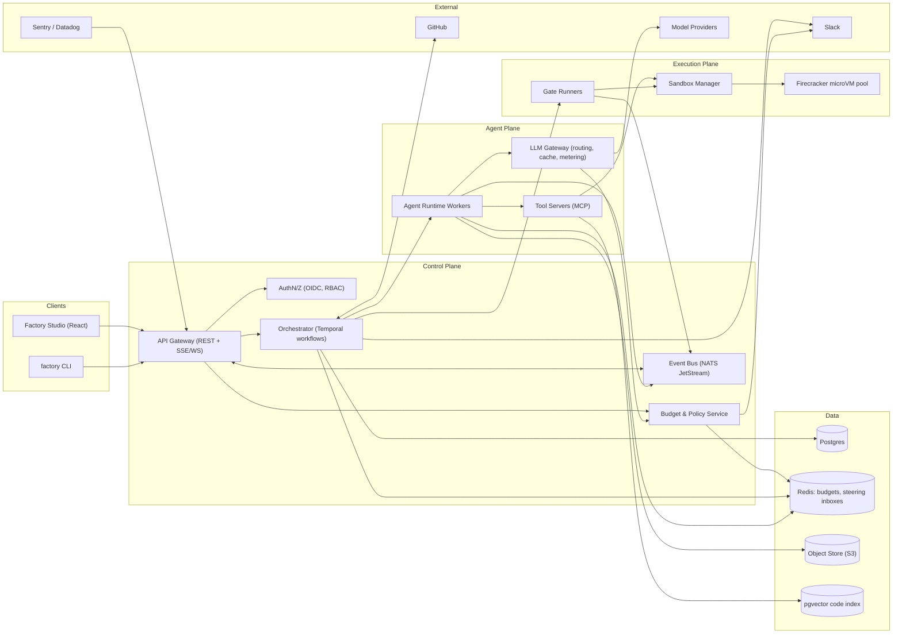
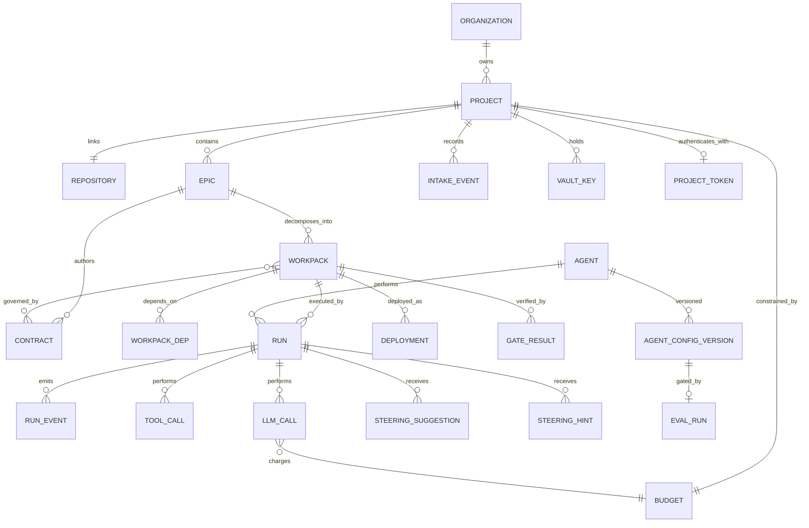
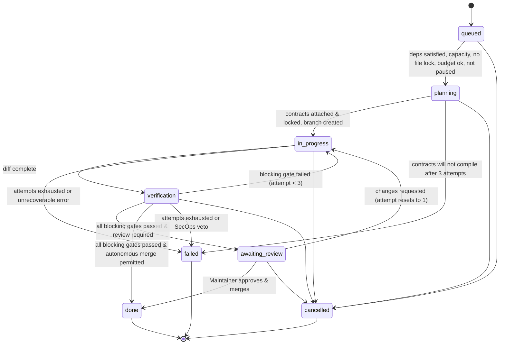
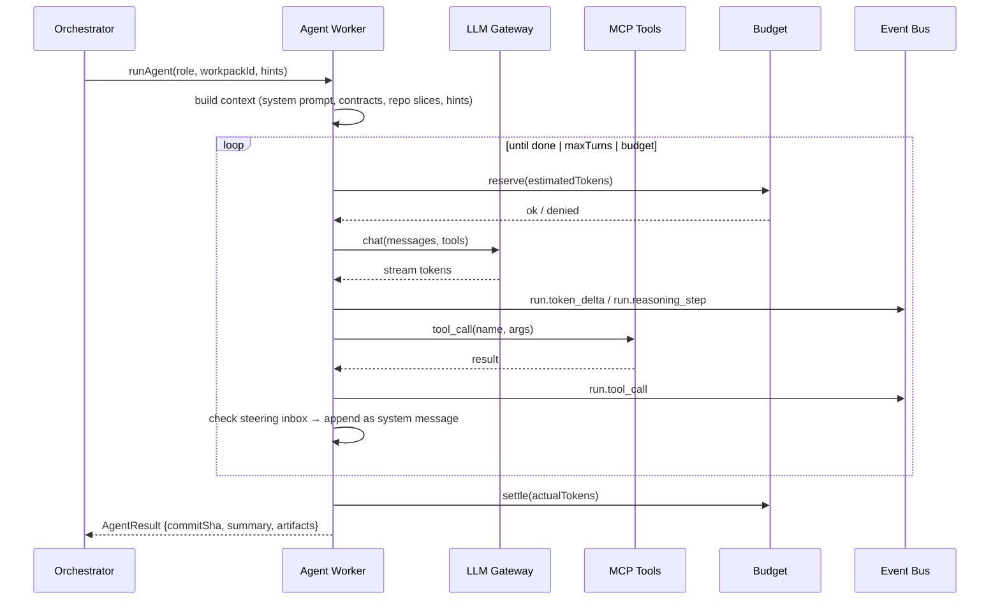

# Technical Specification — Synthetix Factory OS

> **Status:** Draft v0.3 · **Owner:** Platform Engineering · **Last updated:** 2026-11-01
> **Source docs:** [PRD](../designs/synthetix_factory_os_product_requirements_document_prd.md) · Frontend feature modules in [`src/pages/`](../src/pages) · [v0.2 Build Plan](./SPEC_V0.2_PLAN.md) · [v0.3 changelog](#appendix-i--changelog-v02--v03)
> **Scope lock:** v1 = GitHub-wins intake (Spec Studio files a GitHub issue), TS/JS synthesize only, project-cap budget, Slack-only notify, single org with one repo per project, provider-only LLMs, screenshots-only QA, merge-then-staging. See §1.2 for deferred list.
> **v0.3 focus:** every Studio feature is specified to build level in §16 (roles, states, interactions, acceptance criteria). Contradictions found in v0.2 are resolved and logged in Appendix I. The Studio runs today against a spec-faithful simulated backend (Appendix H).

---

## 1. Purpose & Scope

This document turns the Synthetix Factory OS PRD into a buildable design. The **Factory Studio frontend** (React + Vite, feature-sliced under `src/pages/*`) talks to the backend only through the REST, SSE, and WebSocket contract in §10. In mock mode (the default until the backend exists) that contract is served by an in-browser simulator built on MSW (Appendix H), so every behavior in §16 can be demonstrated without real services. This spec defines everything behind the contract: the **control plane, orchestration engine, agent runtime, sandbox fleet, verification gates, budget enforcement, and integrations**. These turn the UI into a working autonomous software factory.

### 1.1 Goals

| # | Goal | Measurable target (from PRD) |
|---|------|------------------------------|
| G1 | Autonomous delivery | ≥ 80% of standard workpacks go from intake to a mergeable PR without a human writing code |
| G2 | Zero architectural drift | 100% of merged PRs pass blocking gates (contract + type + test + security + migration). Warn-only gates (perf/a11y/i18n) tracked but non-blocking |
| G3 | Cost predictability | No budget overrun beyond the hard cap. Spend is visible in Studio within ≤ 5 s of settlement |
| G4 | Human steerability | An approved steering hint is committed to the run's steering inbox in ≤ 2 s (p95) from approval. The agent consumes it at its next turn boundary; that wait is measured and shown in Studio but carries no SLO (§7.4) |
| G5 | Full auditability | Every agent action, tool call, and token spend is attributable and replayable. Hash-chain verifiable via Audit Log view |

GA exit: G1–G5 held for 30 days on the dogfood staging project after P0–P5 completion.

### 1.2 Non-Goals (v1)

- Training or fine-tuning foundation models. The factory only **consumes provider-hosted inference** (no self-hosted vLLM in v1).
- Replacing CI/CD. The factory **produces PRs** and calls existing CI. It does not take over deploy pipelines past staging.
- Multi-repo atomic changes (single-repo workpacks only in v1; monorepo treated as one repo). **One repository per project**: connecting a second repo creates a second project.
- Non-TypeScript/JavaScript synthesis. Indexing covers TS/Python/Go/Java + docs, but sandbox execution and gates support TS/JS only in v1.
- Jira/Linear intake (deferred post-v1). GitHub Issues is the sole Epic source of truth.
- Deployed preview environments. Quality ships screenshots-only QA (Playwright captures to object store). **No visual-regression baselines or pixel-diff gate**: captures are evidence, not comparisons.
- Self-hosted model inference, BYO sandbox runners, uploaded custom skill bundles, non-Slack notifications (including an in-app notification center), per-epic/agent enforceable caps, scoped/expiring API tokens, multi-org SaaS billing, custom KPI builder.
- **GitHub App / OAuth connection.** The wizard is PAT-only in v1. The App path is designed in §13.1 but disabled.
- A general-purpose chat assistant.

---

## 2. Glossary

| Term | Definition |
|------|------------|
| **Epic** | A top-level request. In v1 every Epic is a GitHub issue: Spec Studio files one, SentryWatch files one for production alerts, and humans can file one by hand. It must carry the frontmatter DSL (Appx C). GitHub Issues is the sole source of truth |
| **Workpack** | An atomic unit of work produced by decomposing an Epic. It maps 1:1 to a branch and PR |
| **Workpack DAG** | The dependency graph between workpacks in one Epic |
| **Contract** | A machine-checkable spec written *before* code: TypeScript types, OpenAPI fragments, and acceptance tests. Authored per Epic (Stage 1) and attached to the workpacks it governs |
| **Stage** | One step in the pipeline (Spec → Decompose → Synthesize → Verify). Stages 1–2 run once per Epic; stages 3–4 run per workpack |
| **Gate** | A deterministic check. **Blocking** gates must pass; **warn-only** gates (perf/a11y/i18n) surface without blocking; **quarantine** (flaky) files a tracking issue |
| **Specialist** | An agent role bound to a stage (Architect-Prime, CodeCraft, GateKeeper, SecOps-Vanguard, DocuForge, SentryWatch) |
| **Run** | One execution attempt of a stage for a workpack. A workpack can have many runs (retries, fixed `max_attempts=3`) |
| **Steering hint** | Approved human text delivered to a live run at its next turn boundary through the run's steering inbox. Viewers file *suggestions*; Engineer+ approves or posts directly |
| **Steering suggestion** | A pending viewer proposal awaiting Engineer approval. Expires when its run ends |
| **Steering inbox** | A per-run queue (Redis stream) that the agent loop polls at every turn boundary. The only path from a human to a live agent |
| **Sandbox** | An ephemeral, isolated microVM where code is built and tested (Node-only images in v1) |
| **Recently ended / Archive** | Terminal `failed`/`cancelled` workpacks stay in the Task Matrix **Recently ended** tray for 5 min, then are archived and listed only in the Archive view |
| **Paused reason** | Why a workpack is paused: `manual-global`, `manual-workpack`, `budget-hard-cap`, `integration-disabled`. Pause is a flag, not a status |
| **Queued reason** | Why a `queued` workpack is not running: `deps`, `file-lock`, `capacity`, `budget`, `paused`, `integration-off` |
| **Escalation** | The SLA-breach marker (`escalated_at`). It moves the workpack into the P0 queue band and badges it. `priority` itself never changes |
| **Intake event** | The outcome of evaluating a GitHub issue for intake: `accepted`, `duplicate` (linked to the canonical Epic), or `rejected` (with field errors) |
| **Config version / Eval run** | An immutable snapshot of an agent's configuration, and the 200-ticket evaluation that gates its promotion |
| **Revert workpack** | A new workpack (`revert_of` set) that reverts a merged one. The original stays `done` |
| **Capability** | A named UI/API action (for example `workpack.promote`) mapped to a minimum role (Appx G) |
| **Mock mode** | Studio running against the MSW simulator (`VITE_USE_MOCKS` not `false`), Appx H |

---

## 3. System Architecture

### 3.1 High-Level Topology



### 3.2 Technology Choices

| Concern | Choice | Rationale | Alternatives considered |
|---------|--------|-----------|-------------------------|
| Backend language | **TypeScript (Node 22)** | Shares types with the frontend (`src/contracts`) | Go (faster, but splits the type system) |
| Durable workflows | **Temporal** | Long-running, retryable, pausable workflows with signals (needed for pause/steer/fork) | Inngest, custom queue + state machine |
| Primary DB | **Postgres 16** + `pgvector` | Relational core plus embeddings for code search | — |
| Hot state / rate limits | **Redis 7** | Token-bucket budgets, live counters, per-run steering inboxes | — |
| Event streaming | **NATS JetStream** | Low-latency fan-out to the UI with replay | Redis Streams, Kafka (heavier) |
| Sandboxes | **Firecracker microVMs** (factory-hosted pool only, KVM bare-metal) | Strong isolation, single-language pool keeps images warm | gVisor, Kata, hosted E2B, BYO runners (all deferred) |
| Agent ↔ tools | **Model Context Protocol (MCP)** | A standard tool interface, reusable across agents | Bespoke function-calling |
| LLM gateway | Custom service (or LiteLLM fork) | Central routing, fallback, prompt cache, and metering. **Provider-only in v1** (no vLLM) | Direct provider SDKs |
| Telemetry | **OpenTelemetry** → Datadog/Grafana | Vendor-neutral traces, metrics, and logs | — |
| Frontend data layer | **TanStack Query** + SSE | Matches the HarperFast `queries/` / `mutations/` convention already in `src/pages` | SWR, Redux |
| Frontend routing | **TanStack Router** | Deep links `/p/:project/<tab>/<workpackId>/<runId>` for every tab, workpack, and run | `currentTab` state only |
| Validation | **zod** schemas in `src/contracts` | One definition validates API responses, events, the mock backend, and forms | Hand-written types |
| Mock backend | **MSW** (REST + SSE + WebSocket) over an in-memory simulator | The UI is written against the real transports, so a real backend only changes the base URL | In-process fetch shim, JSON fixtures |
| Tests | **vitest** | Pure-logic seams in `src/domain`; REST contract via `msw/node` | Jest |

### 3.3 Repository Layout (target)

```
software-factory/
├── apps/
│   ├── studio/                 # current Vite app (this repo's src/)
│   ├── api/                    # REST + SSE gateway
│   ├── orchestrator/           # Temporal workers (workflows + activities)
│   ├── agent-runtime/          # specialist agent workers
│   ├── llm-gateway/            # model routing, metering, cache
│   ├── sandbox-manager/        # Firecracker pool + exec API
│   └── cli/                    # `factory` CLI
├── packages/
│   ├── contracts/              # shared zod schemas + TS types (source of truth)
│   ├── agent-sdk/              # base agent loop, tool binding, steering hooks
│   ├── gates/                  # gate runner implementations
│   ├── mcp-tools/              # repo, fs, search, test, git MCP servers
│   └── telemetry/              # OTel helpers, event envelope
├── infra/                      # Terraform, Helm charts, Firecracker images
└── docs/
```

The Studio's own layout (today the repo root):

```
src/
├── contracts/   # zod schemas + inferred types; moves to packages/contracts later
├── domain/      # pure, tested logic: workpack state machine, queue + SLA, budget ledger, spec DSL,
│                #   audit chain, RBAC, terminal policy, KPIs, eval gate, offline queue, stream reducer
├── api/         # typed client, endpoint functions, query options, SSE + WebSocket wrappers
├── mocks/       # MSW handlers, in-memory db, simulator, seeds, scenarios (mock mode only)
├── app/         # router, providers, session/role, offline queue
├── components/  # shell, overlays, ui primitives
└── pages/       # feature modules: components/ hooks/ queries/ mutations/ lib/
```

> [!NOTE]
> `src/contracts` holds the zod schemas the API, workers, and UI all validate against. When `packages/contracts` exists it moves there unchanged.

---

## 4. Domain Model

### 4.1 Entity Relationship



One repository per project in v1 (`PROJECT ||--|| REPOSITORY`). The `/p/:project` route segment is therefore also the repository switcher.

### 4.2 Core Tables (abridged DDL)

```sql
CREATE TYPE workpack_status AS ENUM (
  'queued','planning','in-progress','verification','awaiting-review','done','failed','cancelled'
);
CREATE TYPE priority AS ENUM ('P0 Blocker','P1 High','P2 Normal');
CREATE TYPE autonomy_policy AS ENUM ('fully-autonomous','draft-and-queue','propose-only');
CREATE TYPE gate_severity AS ENUM ('block','warn','quarantine');
CREATE TYPE queued_reason AS ENUM ('deps','file-lock','capacity','budget','paused','integration-off');
CREATE TYPE paused_reason AS ENUM ('manual-global','manual-workpack','budget-hard-cap','integration-disabled');

CREATE TABLE epic (
  id            TEXT PRIMARY KEY,             -- e.g. EPIC-1042
  project_id    UUID NOT NULL REFERENCES project(id),
  source        TEXT NOT NULL,                -- 'github' | 'sentry-via-github'. GitHub is the only source (v0.3)
  origin        TEXT NOT NULL,                -- 'spec-studio' | 'github-ui' | 'sentry' (how the issue was created; informational)
  source_ref    TEXT NOT NULL,                -- GitHub issue URL (canonical dedupe key); Sentry fingerprint lives in source_meta
  source_meta   JSONB NOT NULL DEFAULT '{}',  -- e.g. {sentryFingerprint, issueNumber, dslVersion}
  title         TEXT NOT NULL,
  spec_markdown TEXT NOT NULL,                -- frontmatter-Markdown DSL, see Appx C
  mode          TEXT NOT NULL,                -- 'feature' | 'refactor' | 'bug' | 'security'
  priority      priority NOT NULL,
  areas         TEXT[] NOT NULL,
  acceptance    TEXT[] NOT NULL,
  status        TEXT NOT NULL DEFAULT 'intake', -- intake | stage-1 | stage-2 | executing | completed | failed | cancelled
  paused        BOOLEAN NOT NULL DEFAULT false, -- per-epic pause (manual-workpack reason on every non-terminal workpack)
  created_by    UUID REFERENCES app_user(id),
  created_at    TIMESTAMPTZ DEFAULT now(),
  completed_at  TIMESTAMPTZ,
  UNIQUE (project_id, source_ref)             -- GitHub-wins dedupe: duplicates link to the canonical Epic
);

CREATE TABLE workpack (
  id                TEXT PRIMARY KEY,         -- e.g. WP-2841
  epic_id           TEXT NOT NULL REFERENCES epic(id),
  title             TEXT NOT NULL,
  description       TEXT NOT NULL,
  status            workpack_status NOT NULL DEFAULT 'queued',
  priority          priority NOT NULL DEFAULT 'P2 Normal', -- never mutated by SLA escalation
  category          TEXT NOT NULL,
  language          TEXT NOT NULL DEFAULT 'typescript', -- v1 synthesizes TS/JS only; other values rejected at intake
  assigned_agent_id TEXT REFERENCES agent(id),-- current stage owner. Derived from stage, never user-chosen
  branch            TEXT,                     -- always factory/<wp-id>-<slug>; not user-editable
  pr_number         INT,
  commit_sha        TEXT,
  target_files      TEXT[] NOT NULL DEFAULT '{}',
  lines_added       INT NOT NULL DEFAULT 0,
  lines_removed     INT NOT NULL DEFAULT 0,
  files_count       INT NOT NULL DEFAULT 0,
  completeness      SMALLINT NOT NULL DEFAULT 0 CHECK (completeness BETWEEN 0 AND 100),
  tokens_consumed   BIGINT NOT NULL DEFAULT 0,
  cost_usd_micros   BIGINT NOT NULL DEFAULT 0,
  attempt           SMALLINT NOT NULL DEFAULT 1,  -- 1..max_attempts; resets on human "request changes"
  max_attempts      SMALLINT NOT NULL DEFAULT 3,
  temporal_wf_id    TEXT UNIQUE,
  version           INT NOT NULL DEFAULT 0,   -- optimistic concurrency (If-Match)
  queued_reason     queued_reason,            -- set only while status='queued'
  blocked_by        TEXT REFERENCES workpack(id), -- file-lock queue pointer
  paused            BOOLEAN NOT NULL DEFAULT false, -- orthogonal to status; true while paused_reasons is non-empty (§5.1 rule 14)
  paused_reasons    paused_reason[] NOT NULL DEFAULT '{}', -- several reasons may hold at once
  paused_by         TEXT,                     -- actor of the most recent pause
  paused_at         TIMESTAMPTZ,
  sla_due_at        TIMESTAMPTZ,              -- P0: created+4h, P1: created+24h, P2: NULL
  sla_breached      BOOLEAN NOT NULL DEFAULT false,
  escalated_at      TIMESTAMPTZ,              -- set once on SLA breach; moves the workpack into queue band 0
  fork_of           TEXT REFERENCES workpack(id),  -- set on -fork-N clones (retry)
  revert_of         TEXT REFERENCES workpack(id),  -- set on revert workpacks (rollback)
  invariants        TEXT[] NOT NULL DEFAULT '{}',  -- from 'constraint' hints; inherited by retries and forks
  human_locked_files TEXT[] NOT NULL DEFAULT '{}', -- per-run editor locks, released on run end
  human_intervened  BOOLEAN NOT NULL DEFAULT false, -- any human commit on the branch; excluded from zero-intervention
  autonomy_override TEXT,                     -- NULL | 'require-review' (can only make the merge path stricter)
  proposal          BOOLEAN NOT NULL DEFAULT false, -- propose-only agent: patch stored, no branch/PR
  failure_reason    TEXT,
  created_at        TIMESTAMPTZ DEFAULT now(),
  ended_at          TIMESTAMPTZ,              -- set when status becomes failed/cancelled (starts the 5-min archive timer)
  archived          BOOLEAN NOT NULL DEFAULT false, -- true 5 min after ended_at
  archived_at       TIMESTAMPTZ,
  merged_at         TIMESTAMPTZ,
  completed_at      TIMESTAMPTZ
);

CREATE TABLE workpack_dep (
  workpack_id   TEXT REFERENCES workpack(id),
  depends_on_id TEXT REFERENCES workpack(id),
  PRIMARY KEY (workpack_id, depends_on_id)
);

-- Contracts are authored per Epic in Stage 1 and attached to the workpacks they govern.
CREATE TABLE contract (
  id           UUID PRIMARY KEY,
  epic_id      TEXT NOT NULL REFERENCES epic(id),
  kind         TEXT NOT NULL,                 -- 'ts-types' | 'openapi' | 'playwright' | 'invariant'
  path         TEXT NOT NULL,
  content      TEXT NOT NULL,
  hash         TEXT NOT NULL,
  locked       BOOLEAN NOT NULL DEFAULT false, -- locked contracts cannot be edited by CodeCraft
  unlocked_by  UUID REFERENCES app_user(id),  -- Maintainer one-click unlock
  unlocked_at  TIMESTAMPTZ,
  unlock_reason TEXT
);
CREATE TABLE workpack_contract (
  workpack_id TEXT REFERENCES workpack(id),
  contract_id UUID REFERENCES contract(id),
  PRIMARY KEY (workpack_id, contract_id)
);

CREATE TABLE run (
  id           UUID PRIMARY KEY,
  workpack_id  TEXT REFERENCES workpack(id),
  stage        SMALLINT NOT NULL,             -- 1..4
  agent_id     TEXT REFERENCES agent(id),
  agent_config_version INT NOT NULL,
  attempt      SMALLINT NOT NULL DEFAULT 1,
  turn         INT NOT NULL DEFAULT 0,        -- last completed turn (turn boundary = steering delivery point)
  status       TEXT NOT NULL,                 -- running | paused | succeeded | failed | cancelled
  started_at   TIMESTAMPTZ DEFAULT now(),
  ended_at     TIMESTAMPTZ,
  transcript_uri TEXT                         -- s3://… full message log
);

CREATE TABLE llm_call (
  id             UUID PRIMARY KEY,
  run_id         UUID REFERENCES run(id),     -- NULL for non-run spend (benchmark, preview)
  source         TEXT NOT NULL DEFAULT 'workpack', -- workpack | eval | benchmark | preview | intake (attribution; all count toward the cap)
  provider       TEXT NOT NULL,
  model          TEXT NOT NULL,
  input_tokens   INT NOT NULL,
  cached_tokens  INT NOT NULL DEFAULT 0,
  output_tokens  INT NOT NULL,
  reasoning_tokens INT NOT NULL DEFAULT 0,
  cost_usd_micros BIGINT NOT NULL,
  latency_ms     INT NOT NULL,
  fallback_from  TEXT,
  created_at     TIMESTAMPTZ DEFAULT now()
);

CREATE TABLE gate_result (
  id          UUID PRIMARY KEY,
  workpack_id TEXT REFERENCES workpack(id),
  run_id      UUID REFERENCES run(id),
  gate        TEXT NOT NULL,                  -- see §8
  severity    gate_severity NOT NULL DEFAULT 'block',
  status      TEXT NOT NULL,                  -- queued | running | passed | failed | skipped | quarantined
  metrics     JSONB NOT NULL DEFAULT '[]',    -- [{label,value}]
  failures    JSONB NOT NULL DEFAULT '[]',    -- [{file,line,message,excerpt}] excerpt ≤ 8 KB
  details_uri TEXT,
  screenshot_uris TEXT[] NOT NULL DEFAULT '{}', -- Playwright captures, 30d TTL
  created_at  TIMESTAMPTZ DEFAULT now()
);

CREATE TABLE steering_suggestion (
  id          UUID PRIMARY KEY,
  run_id      UUID REFERENCES run(id),
  workpack_id TEXT REFERENCES workpack(id),
  author_id   UUID REFERENCES app_user(id),
  text        TEXT NOT NULL,
  kind        TEXT NOT NULL DEFAULT 'hint',   -- chosen by the approver on approval; hint | constraint | veto
  status      TEXT NOT NULL DEFAULT 'pending',-- pending | approved | rejected | expired
  approver_id UUID REFERENCES app_user(id),
  reject_reason TEXT,
  created_at  TIMESTAMPTZ DEFAULT now(),
  decided_at  TIMESTAMPTZ
);

CREATE TABLE steering_hint (
  id          UUID PRIMARY KEY,
  run_id      UUID REFERENCES run(id),
  author_id   UUID REFERENCES app_user(id),
  text        TEXT NOT NULL,
  kind        TEXT NOT NULL DEFAULT 'hint',   -- hint | constraint | veto
  suggestion_id UUID REFERENCES steering_suggestion(id), -- set when promoted from the queue; NULL for direct hints
  approved_at TIMESTAMPTZ NOT NULL,           -- G4 clock starts here
  queued_at   TIMESTAMPTZ,                    -- committed to the steering inbox (G4 clock stops, ≤ 2 s p95)
  delivered_at TIMESTAMPTZ,                   -- consumed at a turn boundary (turn wait = delivered_at − queued_at)
  acknowledged_at TIMESTAMPTZ                 -- agent echoed it in its next message
);

CREATE TABLE agent_config_version (
  id          UUID PRIMARY KEY,
  agent_id    TEXT NOT NULL REFERENCES agent(id),
  version     INT NOT NULL,
  config      JSONB NOT NULL,                 -- AgentConfig (§7.2), immutable
  status      TEXT NOT NULL,                  -- evaluating | passed | failed | active | superseded
  eval_run_id UUID,
  note        TEXT,
  created_by  UUID REFERENCES app_user(id),
  created_at  TIMESTAMPTZ DEFAULT now(),
  activated_by UUID REFERENCES app_user(id),
  activated_at TIMESTAMPTZ,
  UNIQUE (agent_id, version)
);

CREATE TABLE eval_run (
  id          UUID PRIMARY KEY,
  agent_id    TEXT NOT NULL REFERENCES agent(id),
  version     INT NOT NULL,
  trigger     TEXT NOT NULL,                  -- on-change | nightly | manual
  status      TEXT NOT NULL,                  -- running | passed | failed
  tickets_total INT NOT NULL DEFAULT 200,
  tickets_done  INT NOT NULL DEFAULT 0,
  first_pass_rate NUMERIC,                    -- 0..1 on this version
  baseline_first_pass_rate NUMERIC,           -- the active version's rate on the same tickets
  cost_per_pr_usd_micros BIGINT,
  baseline_cost_per_pr_usd_micros BIGINT,
  started_at  TIMESTAMPTZ DEFAULT now(),
  finished_at TIMESTAMPTZ
);

CREATE TABLE intake_event (
  id          UUID PRIMARY KEY,
  project_id  UUID NOT NULL REFERENCES project(id),
  issue_ref   TEXT NOT NULL,                  -- GitHub issue URL
  issue_number INT NOT NULL,
  issue_title TEXT NOT NULL,
  origin      TEXT NOT NULL,                  -- spec-studio | github-ui | sentry
  outcome     TEXT NOT NULL,                  -- accepted | duplicate | rejected
  code        TEXT,                           -- validation_failed | unsupported_language | missing_label | …
  errors      JSONB NOT NULL DEFAULT '[]',    -- [{path,message}] field errors echoed in the issue comment
  epic_id     TEXT REFERENCES epic(id),       -- set when accepted
  canonical_epic_id TEXT REFERENCES epic(id), -- set when duplicate
  created_at  TIMESTAMPTZ DEFAULT now()
);

CREATE TABLE vault_key (                      -- values live only in the KMS-backed secret store
  project_id  UUID NOT NULL REFERENCES project(id),
  name        TEXT NOT NULL,
  allowed_gates TEXT[] NOT NULL DEFAULT '{}', -- Maintainer allow-list: gates whose sandboxes receive it as a per-run env var
  created_by  UUID REFERENCES app_user(id),
  created_at  TIMESTAMPTZ DEFAULT now(),
  rotated_at  TIMESTAMPTZ,
  last_used_at TIMESTAMPTZ,
  PRIMARY KEY (project_id, name)
);

CREATE TABLE project_token (                  -- single full-power token per project
  project_id  UUID PRIMARY KEY REFERENCES project(id),
  last4       TEXT NOT NULL,                  -- display only; the token itself is hashed
  hash        TEXT NOT NULL,
  created_at  TIMESTAMPTZ DEFAULT now(),
  created_by  UUID REFERENCES app_user(id),
  last_used_at TIMESTAMPTZ,
  last_used_by TEXT,
  last_used_client TEXT,                      -- cli | studio | ci
  revoked_at  TIMESTAMPTZ
);

CREATE TABLE deployment (                     -- mirrored from GitHub deployment_status events
  id          UUID PRIMARY KEY,
  workpack_id TEXT REFERENCES workpack(id),
  environment TEXT NOT NULL DEFAULT 'staging',
  status      TEXT NOT NULL,                  -- queued | in-progress | succeeded | failed
  sha         TEXT NOT NULL,
  url         TEXT,
  updated_at  TIMESTAMPTZ DEFAULT now()
);

CREATE TABLE audit_log (
  id          UUID PRIMARY KEY,
  project_id  UUID NOT NULL,
  actor       TEXT NOT NULL,                  -- user id, agent id, or 'system'
  action      TEXT NOT NULL,
  target      JSONB NOT NULL DEFAULT '{}',
  prev_hash   TEXT NOT NULL,
  hash        TEXT NOT NULL,                  -- sha256(prev_hash || canonical(row))
  created_at  TIMESTAMPTZ DEFAULT now()
);
```

Append-only tables (`run_event`, `llm_call`, `tool_call`, `audit_log`) are **partitioned monthly** and never updated. The chain in `audit_log` is per project. Retention drops whole partitions, so the first surviving entry of each retained range stores a **checkpoint** (the dropped range's last hash) and `GET /audit/verify` starts from it.

---

## 5. Workpack Lifecycle

### 5.1 State Machine



**Manual transitions** are the only status changes a human can request from Studio (everything else is Orchestrator-only):

| Studio action | From → To | Min role | Notes |
|---------------|-----------|----------|-------|
| Cancel | `queued`, `planning`, `in-progress`, `verification`, `awaiting-review` → `cancelled` | Engineer | Kills the run. Branch and PR stay open for pickup |
| Request changes | `awaiting-review` → `in-progress` | Engineer | The reviewer's text becomes a `constraint` hint. `attempt` resets to 1 |
| Approve & merge (Promote) | `awaiting-review` → `done` | Maintainer | Requires all blocking gates passed and the sign-off rules of §11.3 |

An illegal request returns `409 illegal_transition` whose body lists the `allowed` targets for the workpack's current state.

**Rules**

1. Only the **Orchestrator** writes `workpack.status`. The API sends *intents* (Temporal signals). It never writes status directly.
2. Every transition emits a `workpack.status_changed` event (§10.3) and an audit entry.
3. A manual move from the Task Matrix (`PATCH /workpacks/:id/status`) becomes a signal. The workflow validates it against the state machine and rejects illegal moves with `409 illegal_transition`. Writes carry `If-Match: <version>`. A stale version is `409 stale_version`.
4. `max_attempts` is fixed at **3** per workpack for all priorities. Only gate failures consume attempts. After the third failed attempt the workpack goes to `failed` and a Slack failure notice fires. A human *request changes* starts a fresh cycle.
5. **The hard cap never fails work.** Budget exhaustion pauses runs (`budget-hard-cap`, rule 14). The v0.2 edge `in_progress → failed: budget hard cap` is removed.
6. **Recently ended → Archive.** `failed` and `cancelled` set `ended_at`. For 5 minutes they stay `archived=false` and show in the Task Matrix **Recently ended** tray with a countdown. Then `archived=true`, the card leaves the board query, and it lists in the Archive view. Engineer+ can archive early. Archived workpacks are read-only. Recovery is **Fork** (rule 12), seeded from the repro bundle.
7. **SLAs.** P0 is due at `created_at + 4h`, P1 at `+ 24h`, P2 has no due date. The clock is wall time and keeps running while paused. On breach, once, the workflow sets `sla_breached` and `escalated_at`, emits `workpack.sla_breached` (carrying the pause reasons in force at breach, for triage), and pages the configured on-call handle in Slack. `priority` is **never mutated**. Escalation only changes queue order (rule 9) and shows an ESCALATED badge. Disabling the SLA-escalation policy (§11.3) suppresses the page and the queue-band move but not the badge.
8. **File locks.** If a workpack's `target_files` (glob-aware) overlap a workpack that is `planning`, `in-progress`, or `verification`, the newcomer stays `queued` with `queued_reason=file-lock` and `blocked_by` set, and emits `workpack.blocked`. It starts when the lock releases, then rebases before gates. Paused workpacks keep their locks.
9. **Queue order.** Candidates are ordered by band. Band 0: P0 and escalated workpacks, FIFO by `escalated_at ?? created_at`. Band 1: P1. Band 2: P2. Within bands 1–2, FIFO by `created_at`. A free slot goes to the first candidate that is not blocked. No capacity is reserved for any band.
10. **Capacity.** A project runs at most **8** workpacks concurrently, counting those in `planning`, `in-progress`, or `verification` (paused ones included). `awaiting-review` does not count. Column WIP limits are not enforced; the board only shows counts.
11. **Abort/cancel** kills the run but keeps the branch and PR open for pickup. Workpack → `cancelled` → Recently ended → Archive.
12. **Fork = retry.** Clones the workpack (`fork_of` set) to a `-fork-N` branch from the same commit SHA and starts a fresh `WorkpackWorkflow` in the same Epic. Maintainer+. Constraints in `invariants` carry over.
13. **Rollback = new workpack.** `done` is terminal. Rollback opens a **revert workpack** (`revert_of` set, branch `factory/<new-wp-id>-revert-<slug>`) whose PR reverts the merge and runs the normal gates. There is no "reopen".
14. **Pause is a flag, not a status.** `paused` is true while `paused_reasons` is non-empty. A workpack can carry several reasons and runs only when none remain. Paused workpacks keep their slot and file locks. Global resume clears only `manual-global`.

   | Reason | Set by | Cleared by |
   |--------|--------|------------|
   | `manual-global` | `pipeline.pause` (Maintainer+) | `pipeline.resume` |
   | `manual-workpack` | `workpack.pause` or `epic.pause` (Engineer+) | `workpack.resume` / `epic.resume` |
   | `budget-hard-cap` | Budget service on reservation denial | Cap raise or period rollover (`budget.resumed`) |
   | `integration-disabled` | Disabling the GitHub integration | Re-enabling it |

15. **Queued reasons**, highest precedence first: `integration-off`, `budget`, `paused`, `deps`, `file-lock`, `capacity`. The card shows the highest-precedence reason. The drawer lists all of them.
16. **`planning` means** "contracts attached and locked, branch created, file lock held, awaiting the first synthesis run". Contract authoring itself (stages 1–2) is Epic-level and has no workpack status.
17. **Epic status.** `intake` → `stage-1` (contracts) → `stage-2` (decomposition) → `executing` (workpacks in flight) → `completed` | `failed` | `cancelled`. An Epic completes when every workpack is `done` or superseded by a revert. It fails when a workpack ends `failed` and none remain in flight. Per-epic pause sets `manual-workpack` on every non-terminal workpack of the Epic.
18. **Autonomy and merge decision.** `finalize` auto-merges only when all of these hold: the project `autoMergeVerifiedPRs` toggle is on; the assigned synthesizing agent's `autonomyPolicy` is `fully-autonomous`; no sign-off is required; `autonomy_override` is NULL. Sign-off is required when the `humanSignoffP0P1Schema` policy is on and the workpack is P0/P1 or its diff touches `migrations/` or `*.prisma`. `autonomy_override = 'require-review'` (Maintainer, at creation or later) can only make the path stricter. A `propose-only` agent never creates a branch or PR: the patch is stored, the workpack stops at `awaiting-review` with `proposal=true`, and a Maintainer can "Open as PR" to continue as `draft-and-queue`.

### 5.2 Pipeline Stages ↔ Specialists

| Stage | Name (UI) | Primary agent | Scope | Inputs | Outputs | Exit gate |
|-------|-----------|---------------|-------|--------|---------|-----------|
| 1 | Product Spec & Contracts | Architect-Prime | Epic | Epic spec, repo index | Contracts (types, OpenAPI, acceptance tests) | `contract.schema_valid`, `contract.compiles` |
| 2 | Architecture Decomposition | Architect-Prime | Epic | Contracts, dependency graph | Workpack DAG, target files, assignment | `dag.acyclic`, `dag.coverage` |
| 3 | Code Synthesis | CodeCraft | Workpack | Workpack + locked contracts | Branch + commits + streaming diff | `build.passes`, `types.pass` |
| 4 | Verification & Security | GateKeeper + SecOps-Vanguard | Workpack | Branch | Gate results, screenshot set | All §8 blocking gates |
| post | Docs & Merge | DocuForge | Workpack | Merged diff | PR summary + changelog + OpenAPI sync (public interfaces); ADRs/guides on demand | `docs.openapi_in_sync` |
| loop | Observability | SentryWatch | Project | Prod telemetry | GitHub issue (auto-filed on fingerprint miss) → new Epic | — |

**Stepper scope.** Stages 1–2 run once per Epic and stages 3–4 once per workpack, so the Mission Control stepper is **Epic-scoped** (`GET /pipeline/stages?epic=`). Stage 3 is *active* while any of the Epic's workpacks is `in-progress` and *completed* when none is `queued`, `planning`, or `in-progress`. Stage 4 is *active* while any workpack is in `verification`. A workpack's `assigned_agent_id` follows its stage: Architect-Prime in `planning`, CodeCraft in `in-progress`, GateKeeper or SecOps-Vanguard in `verification`, DocuForge after merge.

**Global merge rule:** the project `autoMergeVerifiedPRs` governance toggle overrides per-agent autonomy policy. The workpack auto-merges only under the full condition in rule 18; otherwise it stops at `awaiting-review`.

---

## 6. Orchestration (Temporal)

### 6.1 Workflows

```ts
// apps/orchestrator/src/workflows/epic.ts
export async function EpicWorkflow(input: { epicId: string }): Promise<void> {
  const contracts = await stage1_Spec(input.epicId);         // Architect-Prime
  const dag = await stage2_Decompose(input.epicId, contracts); // Architect-Prime

  // Fan out: start child workflows in topological order, honoring deps
  await runDag(dag, (wp) =>
    executeChild(WorkpackWorkflow, { workflowId: `wp-${wp.id}`, args: [{ workpackId: wp.id }] })
  );
}

// apps/orchestrator/src/workflows/workpack.ts
export async function WorkpackWorkflow({ workpackId }: { workpackId: string }) {
  const MAX_ATTEMPTS = 3; // fixed for all priorities in v1
  const pauseReasons = new Set<PausedReason>();
  let attempt = 1;
  setHandler(pauseSignal, (reason: PausedReason) => pauseReasons.add(reason));       // broadcast: manual-global | budget-hard-cap | integration-disabled
  setHandler(resumeSignal, (reason: PausedReason) => pauseReasons.delete(reason));
  setHandler(workpackPauseSignal, () => pauseReasons.add('manual-workpack'));
  setHandler(workpackResumeSignal, () => pauseReasons.delete('manual-workpack'));
  setHandler(approveSteerSignal, (hint) => activities.enqueueSteeringHint(hint));    // writes the per-run steering inbox; the agent loop polls it every turn (§7.4)
  setHandler(cancelSignal, () => cancelScope.cancel());                              // keeps branch + PR open
  setHandler(requestChangesSignal, (text) => { invariants.push(text); attempt = 1; }); // awaiting-review → in-progress
  setHandler(statusQuery, () => currentState);

  await activities.acquireFileLock(workpackId);            // queue while target_files overlap; held across attempts
  for (; attempt <= MAX_ATTEMPTS; attempt++) {
    await condition(() => pauseReasons.size === 0);
    await activities.assertBudget(workpackId);             // hard-cap check → pause, never fail
    const synth = await activities.runAgent('codecraft', workpackId, { attempt });
    const gates = await activities.runGates(workpackId, synth.commitSha);
    if (gates.blockingPassed) return finalize(workpackId, gates); // §5.1 rule 18
    feedback = gates.failures;                             // fed into next attempt
  }
  await activities.markFailed(workpackId); // → Recently ended → auto-archive after 5 min
}
```

The workflow records steering intents but never carries hint text to the agent. v0.2 drained hints only at attempt start, so a hint approved mid-run could not reach the live loop. In v0.3 the signal handler writes to the run's steering inbox and the agent loop reads it every turn (§7.4).

### 6.2 Signals & Queries (map to UI controls)

| UI control | Feature module | Temporal primitive |
|------------|----------------|--------------------|
| Pause Swarm / Resume (global) | shell, `mission-control`, `live-workspace` | `pauseSignal('manual-global')` / `resumeSignal`, broadcast to every active workflow in the project (Maintainer+) |
| Pause / Resume workpack or Epic | `task-matrix`, `mission-control`, `live-workspace` | `workpackPauseSignal` / `workpackResumeSignal` for one workflow (an Epic fans out to each non-terminal workflow). Engineer+ |
| Suggest steering (Viewer) | `mission-control/SteeringConsole`, `live-workspace/WorkspaceToolbar` | Creates a `steering_suggestion` row (pending). No signal yet |
| Inject hint / approve suggestion (Engineer+) | same | `approveSteerSignal(hint)` → steering inbox. G4 measures approval → inbox commit |
| Fork (Maintainer) | `task-matrix`, `mission-control` | Clone workpack (`fork_of` set), new `WorkpackWorkflow` from the same commit with a `-fork-N` branch |
| Cancel (Engineer) | `task-matrix`, `mission-control` | `cancelSignal` |
| Request changes (Engineer) | `task-matrix`, `quality-sandboxes` | `requestChangesSignal(text)`: `awaiting-review → in-progress`, `attempt` resets |
| Move card (Kanban) | `task-matrix` | `transitionSignal(target)` with `If-Match: version`. Only the manual transitions of §5.1 are accepted. Stale replays get `409` |
| Archive now | `task-matrix` | `archiveSignal`: sets `archived=true` before the 5-minute timer |
| Promote / Rollback (Maintainer) | `quality-sandboxes` | `approveSignal` (merge to main, then staging deploy) / `revertActivity` (opens a revert workpack) |
| Unlock contract (Maintainer) | `live-workspace`, `quality-sandboxes` | `unlockContractActivity` (audited, reason required) |
| Run intake cycle (Maintainer) | `fleet-tuning` | Start `IntakeWorkflow(agentId)`: Architect-Prime syncs GitHub issues now, SentryWatch polls telemetry now. No other agent has an intake cycle |

### 6.3 Concurrency & Fairness

- Task queues are split **per specialist** (`q.architect`, `q.codecraft`, …), so each role scales on its own.
- A per-project concurrency limit (8 concurrent workpacks, §5.1 rule 10) runs as a Temporal-side semaphore.
- Queue order is the banded FIFO of §5.1 rule 9. P0 and escalated workpacks jump the queue; no capacity is reserved.
- Offline replay: queued steering and Kanban moves carry the `If-Match` version captured when the user acted. Stale replays are rejected with `409` plus a toast. The UI refetches and the user retries.

---

## 7. Agent Runtime

### 7.1 Agent Loop

Every specialist runs the same loop from `packages/agent-sdk`:



### 7.2 Agent Definition (versioned config)

```ts
// packages/contracts/src/agent.ts
export const AgentConfig = z.object({
  id: z.string(),                         // 'architect-prime'
  role: z.string(),
  stage: z.number().int().min(1).max(4).nullable(),
  model: z.object({
    primary: z.string(),                  // 'anthropic/claude-sonnet'
    fallbacks: z.array(z.string()).default([]),
    reasoningEffort: z.enum(['Low', 'Medium', 'High', 'Max']),
    temperature: z.number().min(0).max(1),
    maxOutputTokens: z.number().int(),
  }),
  systemPrompt: z.string(),
  tools: z.array(z.string()),             // MCP tool ids allow-list
  autonomyPolicy: z.enum(['fully-autonomous', 'draft-and-queue', 'propose-only']),
  limits: z.object({
    maxTurns: z.number().int().default(40),
    maxTokensPerRun: z.number().int(),
    maxWallClockSec: z.number().int().default(1800),
  }),
  skills: z.array(z.string()).default([]), // skill names; each skill = Markdown prompt + tools[] allow-list JSON (no JS bundles in v1)
});

export const SkillDefinition = z.object({
  name: z.string(),
  promptMarkdown: z.string(),               // injected into system context when enabled
  tools: z.array(z.string()).default([]),    // subset of the agent's tool allow-list
});
```

- **Versioning.** Every save from the **Agent Tuning Drawer** creates a new immutable `agent_config_version`. Running runs keep the version they started with. New runs pick up the active version.
- **Promotion is asynchronous and eval-gated.** "Deploy Parameters" is a three-step flow. `POST /agents/:id/versions` stores the version as `evaluating` and starts an `eval_run` (200 historical tickets, also run nightly). Versions move `evaluating → passed | failed`. A `passed` version is promoted with `PUT /agents/:id/active-version` and becomes `active`. The previous active version becomes `superseded`.
- **What is gated.** Behavioral fields: system prompt, model and fallbacks, tools, skills, reasoning effort, temperature, and limits. Changing `autonomyPolicy` is **not** eval-gated, because it changes who may merge rather than how the agent behaves. It is Maintainer-only and audited.
- **Pass criteria.** No regression against the active version's baseline on the same tickets: gate first-pass rate must not drop by more than 2 pts and cost per PR must not rise by more than 10%. A `failed` version can never be promoted. Save a new version instead.
- **Rollback** is `PUT /agents/:id/active-version` to any version that was previously `active` or `superseded`. It needs no new eval.
- **Cost.** Eval and nightly runs are metered as `llm_call.source = 'eval'` and count toward the project cap (§11.1).
- **Fixed v1 model map.** Admins pick from the model catalog below and cannot free-type model IDs. Each specialist ships with this default, and the same catalog bounds its fallbacks:

| Specialist | Primary | Fallbacks (ordered) |
|------------|---------|---------------------|
| Architect-Prime | Claude Opus | Claude Sonnet → GPT-4o |
| CodeCraft | Claude Sonnet | DeepSeek-V3 → GPT-4o |
| GateKeeper | Claude Sonnet | Claude Haiku → DeepSeek-V3 |
| SecOps-Vanguard | Claude Sonnet | GPT-4o → DeepSeek-V3 |
| DocuForge | Claude Haiku | Claude Sonnet → GPT-4o |
| SentryWatch | Claude Sonnet | Claude Haiku → GPT-4o |

- **Model catalog** (`GET /models`): `anthropic/claude-opus`, `anthropic/claude-sonnet`, `anthropic/claude-haiku`, `deepseek/deepseek-v3`, `openai/gpt-4o`. Each entry carries the pinned provider model ID, the context window, and the versioned prices of the `price_table`. Pinning a new provider release is a catalog change, never a free-text edit.

### 7.3 Specialist Contracts

| Agent | Allowed tools | May write to | Hard prohibitions |
|-------|---------------|--------------|-------------------|
| Architect-Prime | `repo.read`, `search.semantic`, `search.ast`, `contracts.write`, `dag.write` | `contracts/`, workpack DAG | Committing application code |
| CodeCraft | `repo.read`, `fs.write` (editor path), `git.commit`, `sandbox.exec`, `search.*` | Files in `target_files` except `human_locked_files`; branch only. Terminal is read-only in v1 (no `--write`) | Editing locked contracts; writing to human-locked files |
| GateKeeper | `sandbox.exec`, `tests.write`, `browser.playwright` | `tests/` (additive, edits allowed only via second-agent review) | Unreviewed weakening or deleting existing tests |
| SecOps-Vanguard | `sast.semgrep`, `sbom.scan`, `secrets.scan`, `repo.read` | Gate results only | Any repo write. Holds **veto** |
| DocuForge | `repo.read`, `fs.write` (docs paths), `openapi.diff` | `docs/`, `openapi/`, PR body | Code paths |
| SentryWatch | `telemetry.query`, `github.issue.create` | GitHub issues only (Epics form from GitHub) | Any repo write; direct Epic creation |

Enforcement happens in the **MCP tool layer**, not in prompts. Path allow-lists and diff validators reject violating calls and log a `policy.violation` event.

**Human file locks:** `human_locked_files` is per-run and releases on run end. While set, any agent `fs.write` to a locked path is denied at the MCP layer. Terminal safe-command allow-list in v1: `vitest`, `git diff/status/log`, `tsc --noEmit`, `ls`, `cat`, log tail. Everything else is denied.

**GateKeeper test-review guardrail (reconciles R1):** any GateKeeper test add/edit/delete produces a diff that requires a second-agent review activity (Architect-Prime or a fresh GateKeeper run) before `finalize`. Unreviewed test weakening fails `contract.conformance`.

**Terminal command grammar** (enforced server-side and mirrored in Studio for fast feedback). One command per submission, at most 256 characters, with no shell operators or substitutions. Any of `|`, `;`, `&`, `>`, `<`, `` ` ``, `$`, `(`, `)`, `{`, `}`, `\`, or a newline rejects the whole line with `command_not_allowed`. Allowed forms:

| Command | Accepted arguments |
|---------|--------------------|
| `vitest` | optional `run`, file or test-name filters, `--coverage`, `--reporter=<name>` |
| `git diff` / `git status` / `git log` | `--stat`, `--name-only`, `--oneline`, `-n <1..200>`, at most one path |
| `tsc` | exactly `--noEmit` |
| `ls` | optional path |
| `cat` | exactly one path |
| `logs` | optional `--tail <1..500>` |

Paths must be relative and stay inside the workspace: no `..`, no absolute paths, no `.git/` internals, no vault-injected env files. Every accepted or rejected command is audited with `actor=human`. Viewers can watch the terminal output but cannot send input.

### 7.4 Steering Semantics

- **Who can steer.** Viewers file **suggestions** (`steering_suggestion`, `pending`) for a live run. Engineer+ either approves or rejects a suggestion, or posts a hint **directly** (`POST /runs/:id/steer`), which is approved at submission (`suggestion_id` NULL, approver = author). The approver or author chooses the hint **kind**: `hint` and `constraint` need Engineer+, `veto` needs Maintainer+ because it rolls work back.
- **Delivery path.** Approval writes the hint to the run's **steering inbox** (a Redis stream keyed by run id) and records `queued_at`. The `WorkpackWorkflow` only records the intent; it never carries hint text to the agent. The agent loop polls the inbox at every turn boundary (§7.1), appends each hint as `system: [HUMAN STEERING:<kind>] …`, and records `delivered_at`. Hints are never injected mid-stream.
- **G4.** ≤ 2 s (p95) from approval to `queued_at`. The wait from `queued_at` to `delivered_at` is bounded by turn length (a turn can take up to the 60 s first-token failover window plus generation time). Studio shows it ("next turn in ~Ns") and tracks it as a metric, not an SLO. A paused run keeps hints queued until it resumes.
- **Kinds.**
  - `hint` is appended for the next turn only.
  - `constraint` is also persisted to `workpack.invariants`, so retries, forks, and later runs inherit it.
  - `veto` rolls back the current turn's tool calls, and the agent is told why.
- **Acknowledgement.** The agent must acknowledge the hint in its next message. The runtime records `acknowledged_at`, and the UI advances the state pill **Queued → Delivered → Acknowledged**. A hint still unacknowledged after two further turns is flagged `ack missed` in the UI. No automatic action follows.
- **Suggestion lifecycle.** `pending → approved | rejected | expired`. The approver may change the kind (default `hint`). Rejection takes an optional reason shown to the author. When a run ends (`succeeded`, `failed`, or `cancelled`) or after 60 minutes, `pending` suggestions become `expired`, and hints that were queued but never delivered are shown as `undelivered`.
- **Request changes.** The reviewer's text becomes a `constraint` hint on the next run.
- **GitHub.** `@factory steer <text>` in a PR comment files a suggestion (Viewer) or a direct hint (Engineer+). The GitHub login is mapped to a Studio user, and an unmapped login is treated as Viewer.
- **Reasoning traces are summaries only** (step title + status). No raw chain-of-thought is stored or streamed.

---

## 8. Verification Gates

Gates are **deterministic programs**, not LLM opinions. LLM agents may *author* tests, but pass/fail comes only from executing them. Each gate carries a **severity**: `block` (must pass), `warn` (surfaced, non-blocking), or `quarantine` (flaky path).

| # | Gate id | Severity | Owner | Implementation | Pass criteria |
|---|---------|----------|-------|----------------|---------------|
| 1 | `static.types_lint` | block | GateKeeper | `tsc --noEmit`, oxlint/eslint, formatter check | 0 errors. No new warnings vs. base |
| 2 | `tests.unit_integration` | block | GateKeeper | vitest with coverage in sandbox (TS/JS only in v1) | 100% pass. Coverage on changed lines ≥ 80% |
| 3 | `tests.e2e_viewports` | block | GateKeeper | Playwright across the viewport matrix (desktop/tablet/mobile × browsers) | 100% pass. Captures stored as screenshots (no deployed preview) |
| 4 | `security.sast_sbom` | block | SecOps-Vanguard | Semgrep, gitleaks, SBOM (syft) + CVE (grype), license policy | 0 new high/critical findings. No disallowed licenses (GPL/AGPL in proprietary repos) |
| 5 | `contract.conformance` | block | Orchestrator | Compile against locked contracts. OpenAPI diff for breaking changes. Rejects unreviewed test weakening | No contract file modified. No breaking API diff unless the epic allows it |
| 6 | `diff.scope` | block | Orchestrator | Changed files ⊆ `target_files` ∪ allowed globs. Size limits. Respects `human_locked_files` | Within scope, or flagged for review |
| 7 | `perf.budgets` | warn | GateKeeper | Bundle delta, LCP/p95 check on sandbox captures | Surfaced in Quality + PR body; never blocks in v1 |
| 8 | `a11y.scan` | warn | GateKeeper | Automated a11y scan (new criticals flagged) | New criticals flagged; warns only in v1 |
| 9 | `i18n.check` | warn | GateKeeper | Missing-key / locale-format check | Warns only in v1 |
| 10 | `migration.safety` | block | GateKeeper | Migration dry-run + backward-compat check | Dry-run must pass; blocks on failure |

- Blocking gates 1–6 and 10 run **in parallel** in one sandbox snapshot. Gate 4 runs in a separate network-isolated sandbox. Warn gates 7–9 run alongside and cannot fail the workpack.
- Results stream as `gate.updated` events (with `severity`), which drive `quality-sandboxes/VerificationGateGrid`.
- The structured failure output (file, line, message, logs excerpt ≤ 8 KB) feeds back into the next CodeCraft attempt.
- **Screenshots-only QA:** Playwright captures are written to object store at `previews/<workpack>/<sha>/<viewport>.png` with 30d TTL and served via signed GET. There is no deployed preview environment in v1.
- **Flaky test handling:** a failing test is re-run up to 2× in isolation. If it passes on retry, it is marked `quarantined`, does not block merge, is listed in the PR body, and auto-files a GitHub `flaky-test` issue.

### 8.1 Gate Conventions

- **Check runs.** Each gate posts a GitHub check run named `factory/gates/<NN>-<slug>` on the workpack commit: `01-types-lint`, `02-unit-integration`, `03-e2e-viewports`, `04-security`, `05-contract`, `06-diff-scope`, `07-perf`, `08-a11y`, `09-i18n`, `10-migration`. Blocking failures conclude `failure`. Warn and quarantined results conclude `neutral`.
- **Failure payload.** `[{file, line, message, excerpt}]` with `excerpt` ≤ 8 KB. It feeds the next CodeCraft attempt and renders in Studio's gate cards.
- **Viewport matrix (gate 3).** Default: 3 viewports (desktop 1440×900, tablet 768×1024, mobile 390×844) × 3 browsers (chromium, firefox, webkit), for every route named in the workpack's Playwright contract. Each cell stores one screenshot. A project may override the matrix, and Studio renders whatever the objects contain. v1 keeps no baselines, so there is no pixel-diff metric.
- **Sign-off status** (shown on the Quality page): every blocking gate passed; no SecOps-Vanguard veto; P0/P1 and schema sign-off satisfied or not required (§11.3); contract conformance (no locked contract changed unless Maintainer-unlocked).
- **Quarantined tests** list the test name, the retry outcomes, and the auto-filed `flaky-test` issue.
- **PR body.** Generated by DocuForge and rendered read-only in Studio: Summary, Changes, New dependencies, Gate results (blocking and warn), Quarantined flaky tests, Screenshots, Cost, Transcript link, Repro bundle link.
- **Repro bundle** for failed workpacks: Appx E.

---

## 9. Execution Plane (Sandboxes)

### 9.1 Sandbox Manager API (internal)

```
POST   /sandboxes                 { image, repoUrl, ref, cpu, memMb, network: 'none'|'egress-allowlist' }
POST   /sandboxes/:id/exec        { cmd, cwd, timeoutSec, env }  → stream stdout/stderr (safe-command allow-list for humans)
POST   /sandboxes/:id/snapshot    → snapshotId
POST   /sandboxes/:id/screenshot  { viewport, fullPage } → object-store URI (Playwright captures)
DELETE /sandboxes/:id
```

> `POST /sandboxes/:id/expose` (preview URLs) is **removed in v1**. QA is screenshots-only; no deployed preview environment.

### 9.2 Requirements

| Requirement | Target |
|-------------|--------|
| Cold start (from warm pool) | ≤ 200 ms p95 |
| Isolation | One microVM per run. No shared filesystem. Seccomp + jailer. Factory-hosted KVM bare-metal pool only (no BYO runners) |
| Network | Default `none`. The package-install phase uses an egress allow-list (registry mirrors only) |
| Secrets | Never mounted by default. Tests use the shared project vault via Maintainer allow-list, injected as per-run scoped env vars, redacted in logs |
| Lifetime | Max 60 min. Reaped on run end or orphan detection (heartbeat timeout 120 s) |
| Base images | **Node-only in v1**, prebuilt with dependency caches. Rebuilt nightly. Signed (cosign) |

The **Live Workspace terminal** (`live-workspace/TerminalSession`) attaches to the run's sandbox through `POST /sandboxes/:id/exec` streamed over WebSocket. Human commands are tagged `actor=human` in the audit log and are **read-only**: only the safe-command allow-list (`vitest`, `git diff/status/log`, `tsc --noEmit`, `ls`, `cat`, log tail) is accepted. The file editor is the sole human write path, governed by per-run `human_locked_files`.

---

## 10. API Surface

### 10.1 Conventions

- Base path `/api/v1`. JSON. Auth uses OIDC bearer tokens (the CLI uses the project token). Errors follow `application/problem+json`: `type` (slug), `title`, `status`, `detail`, optional `errors[]` (`{path, message, code}`) and `requiredRole` on `403`.
- Every response echoes `X-Request-Id` and carries `X-Server-Time` (RFC 3339). Studio uses it to correct clock skew for SLA countdowns and archive timers.
- Mutations accept an `Idempotency-Key` header. A replay with the same key returns the original response. The same key with a different body is `422 idempotency_conflict`.
- Versioned resources (workpacks) use optimistic concurrency: `If-Match: <version>`. A stale version is `409 stale_version`. An illegal manual move is `409 illegal_transition` with the `allowed` targets in the body.
- Lists are cursor-paginated: `?limit=&cursor=` → `{ items, nextCursor }`.
- Roles are checked on every endpoint. Insufficient role is `403 forbidden` with `requiredRole`. The capability matrix is Appx G.
- **Project scope.** Every endpoint except `GET /me`, `GET /projects`, and `POST /projects/connect*` is project-scoped. Clients send `X-Project: <project id>`; the SSE streams take `?project=<id>`. A missing project is `400 project_required`, an unknown one `404 project_not_found`.

| Problem `type` | Status | Meaning |
|----------------|--------|---------|
| `project_required` / `project_not_found` | 400 / 404 | No `X-Project`, or the project does not exist |
| `precondition_required` | 428 | A versioned write came without `If-Match` |
| `idempotency_conflict` | 422 | Same `Idempotency-Key` reused with a different body |
| `validation_failed` | 422 | Body or DSL failed validation. `errors[]` has field paths |
| `unsupported_language` | 422 | Non-TS/JS language at intake or in the DSL |
| `illegal_transition` | 409 | Move not allowed from the current status |
| `stale_version` | 409 | `If-Match` does not match the current version |
| `budget_blocked` | 409 | Action would spend while the hard cap is hit |
| `locked_by_other` | 409 | File already locked by another human in this run |
| `command_not_allowed` | — | Terminal frame rejected by the command grammar (§7.3) |
| `github_unavailable` | 503 | GitHub integration disabled or unreachable |
| `rate_limited` | 429 | Per-user limit (for example 6 previews/min) |
| `forbidden` | 403 | Role too low (`requiredRole` set) |

### 10.2 REST Endpoints

Min role is the lowest role that may call the endpoint (viewer < engineer < maintainer < admin).

**Session & projects**

| Method & path | Min role | Purpose | Frontend consumer |
|---------------|----------|---------|-------------------|
| `GET /me` | viewer | Current user, role, accessible projects | `app/session` |
| `GET /projects` | viewer | Project list (one repository each) | project switcher |
| `POST /projects/connect/preflight` | admin | Wizard dry-run: token validity and scopes, repo access, branch, TS/JS detected, webhook, `factory` label | `settings/ConnectGitHubRepoModal` |
| `POST /projects/connect` | admin | Create a project from repo + PAT + branch + cap + toggles | same |

**Overview**

| Method & path | Min role | Purpose | Frontend consumer |
|---------------|----------|---------|-------------------|
| `GET /overview/metrics?window=24h\|7d` | viewer | Four KPIs, sparkline series, warn counts | `overview/queries/getOverviewMetrics` |
| `GET /overview/health` | viewer | Specialist, provider, and sandbox-pool health | `overview` → `SystemHealthGauge` |
| `POST /benchmarks` | maintainer | Start the factory regression benchmark (spends budget, `source=benchmark`). `202`, then `benchmark.completed`. `409 benchmark_running` while one runs, `409 budget_blocked` at the hard cap | `overview/mutations/triggerFactoryBenchmark` |
| `GET /benchmarks/latest` | viewer | The latest benchmark `{id, running, total, passed, completed, startedAt, finishedAt}`, or `null`. Lets the progress bar survive a reload | `overview` |

**Pipeline, epics, intake**

| Method & path | Min role | Purpose | Frontend consumer |
|---------------|----------|---------|-------------------|
| `GET /pipeline/status` | viewer | Global pause state and reasons, capacity (n/8), `running`, `queued`, `awaitingReview`, `active` (for the navigation badges), hard-cap flag | shell |
| `GET /pipeline/stages?epic=` | viewer | Epic-scoped 4-stage stepper | `mission-control` |
| `POST /pipeline/pause` · `/resume` | maintainer | Global pause (broadcast). Returns `{status, affected}`: the new `PipelineStatus` and how many workpacks changed | shell, `mission-control` |
| `GET /epics?status=&q=` · `GET /epics/:id` | viewer | Epic list and detail (DAG, contracts, stage states, spend) | `task-matrix`, `mission-control`, `spec-studio` |
| `POST /epics/:id/pause` · `/resume` | engineer | Per-epic pause | `mission-control` |
| `POST /epics/preview` | engineer | Dry-run decomposition: contracts, DAG, cost estimate. No execution (`source=preview`, rate-limited) | `spec-studio` |
| `POST /epics` | engineer | Validate the DSL and **file a GitHub issue** (`factory` label). `202 {issue, intakeId}`. The Epic forms when the webhook arrives | `spec-studio/mutations/useDispatchSpecWorkpack` |
| `GET /intake?limit=` | viewer | Intake events: accepted, duplicate, rejected | `spec-studio` intake feed |

**Workpacks**

| Method & path | Min role | Purpose | Frontend consumer |
|---------------|----------|---------|-------------------|
| `GET /workpacks?status=&priority=&agent=&epic=&q=&archived=&doneSince=` | viewer | Task Matrix listing. Default `archived=false`; the Done column asks `doneSince=24h` | `task-matrix/queries` |
| `POST /workpacks` | engineer | Create one workpack inside an Epic | `NewWorkpackModal` |
| `GET /workpacks/:id` | viewer | Detail: attempts, queued/paused reasons, SLA, deployment, contract ids | `TaskDrawer` |
| `PATCH /workpacks/:id` | maintainer | Set `autonomy_override` (hold for review) | `TaskDrawer` |
| `PATCH /workpacks/:id/status` | engineer | Manual transition intent. `cancelled` cancels. `in-progress` (needs `text`) is *request changes*. `done` is *promote* (Maintainer). Anything else is `409 illegal_transition` listing the allowed targets. `If-Match: version` | `task-matrix/mutations/useUpdateTaskStatusMutation` |
| `POST /workpacks/:id/request-changes` | engineer | `awaiting-review → in-progress` with reviewer text | `quality-sandboxes`, `TaskDrawer` |
| `POST /workpacks/:id/pause` · `/resume` | engineer | Per-workpack pause | `task-matrix`, `live-workspace` |
| `POST /workpacks/:id/archive` | engineer | Archive a terminal workpack before the 5-minute timer | `task-matrix` |
| `POST /workpacks/:id/fork` | maintainer | Retry: clone to `-fork-N`, fresh workflow | `mission-control`, `task-matrix` |
| `POST /workpacks/:id/promote` · `/rollback` | maintainer | Approve & merge, then staging deploy / open a revert workpack | `quality-sandboxes/mutations/usePromoteReleaseMutation` |
| `GET /workpacks/:id/runs` · `GET /runs/:id` | viewer | Attempts and run detail | `TaskDrawer`, `live-workspace` |
| `GET /workpacks/:id/diff?file=` | viewer | Changed-file list with +/- and one file's diff | `live-workspace/queries/getWorkspaceCode` |
| `GET /workpacks/:id/gates` | viewer | Gate results with severity, metrics, failures | `quality-sandboxes` |
| `GET /workpacks/:id/screenshots` | viewer | Screenshot matrix with signed GET URLs (Appx F) | `quality-sandboxes` |
| `GET /workpacks/:id/release` | viewer | PR body preview, check runs, sign-off status, deployment | `quality-sandboxes` |
| `GET /workpacks/:id/repro` | viewer | Reproducibility bundle (Appx E) | `quality-sandboxes` |
| `GET /workpacks/:id/contracts` | viewer | Attached contracts with lock state | `live-workspace`, `quality-sandboxes` |
| `POST /contracts/:id/unlock` | maintainer | One-click unlock, reason required, audited | same |

**Runs, steering, editor, terminal**

| Method & path | Min role | Purpose | Frontend consumer |
|---------------|----------|---------|-------------------|
| `GET /runs/:id/logs?level=&cursor=` | viewer | Paged historical logs | `LiveExecutionLogViewer` |
| `GET /runs/:id/reasoning` | viewer | Summarized reasoning steps (no raw CoT) | `ReasoningTraceViewer` |
| `GET /runs/:id/steering` | viewer | Suggestions and hints with delivery state | `SteeringConsole` |
| `POST /steering/suggest` | viewer | File a viewer suggestion | `SteeringConsole`, `WorkspaceToolbar` |
| `POST /runs/:id/steer` | engineer (`veto`: maintainer) | Direct hint | `mission-control/mutations/useSteerAgentMutation` |
| `POST /steering/:id/approve` · `/reject` | engineer (`veto`: maintainer) | Approve (optionally changing kind) or reject a suggestion | `SteeringConsole` |
| `GET /workpacks/:id/files?path=` | viewer | Current content of one file | `live-workspace` editor |
| `PUT /workpacks/:id/files` | engineer | Human save. Marks `human_intervened` | same |
| `POST /runs/:id/locks` · `DELETE /runs/:id/locks?path=` | engineer | Acquire or release a human file lock | same |
| `GET /runs/:id/terminal` (WebSocket) | viewer read · engineer write | Sandbox terminal attach | `TerminalSession` |
| `GET /runs/:id/stream` (SSE) | viewer | High-volume run events: tokens, logs, reasoning steps, tool calls | `useRunStream` |

**Fleet**

| Method & path | Min role | Purpose | Frontend consumer |
|---------------|----------|---------|-------------------|
| `GET /agents` · `GET /agents/:id` | viewer | Fleet listing and agent detail | `fleet-tuning` |
| `GET /agents/:id/versions` · `GET /agents/:id/versions/:v` | viewer | Version history; one version with its eval run | `AgentTuningDrawer` |
| `POST /agents/:id/versions` | maintainer | Save a new version and start its eval | same |
| `PUT /agents/:id/active-version` | maintainer | Promote a `passed` version, or roll back | same |
| `POST /agents/:id/run` | maintainer | Manual intake cycle (Architect-Prime and SentryWatch only) | `fleet-tuning` |
| `GET /fleet/stats` | viewer | Providers, latency, cache hit, burn, failover (no VRAM in v1) | `fleet-tuning/queries/getFleetStatus` |
| `GET /models` | viewer | Model catalog and the default map | `AgentTuningDrawer` |

**Budget**

| Method & path | Min role | Purpose | Frontend consumer |
|---------------|----------|---------|-------------------|
| `GET /budget` | viewer | Caps, spend, runway, projection, flags | `BudgetModal`, shell |
| `PUT /budget` | admin | Monthly cap and soft-limit %. Raising the cap during a hard cap resumes paused runs | `BudgetModal` |
| `GET /budget/attribution?by=epic\|agent\|source` | viewer | Spend attribution (non-enforcing) | `overview`, `BudgetModal` |

**Settings & security**

| Method & path | Min role | Purpose | Frontend consumer |
|---------------|----------|---------|-------------------|
| `GET /integrations` | viewer | Connector state (GitHub, Slack, providers, Semgrep, alert sources) | `settings` |
| `GET /repository` | viewer | The connected repository: language and whether it is supported, default branch, webhook state, token permissions, intake label, last sync. `null` when none | `settings` |
| `PATCH /integrations/:id` | admin | Enable/disable. Turning GitHub off pauses all workpacks | `settings/mutations/useToggleIntegrationMutation` |
| `POST /integrations/:id/test` · `PUT /integrations/:id/key` | admin | Connectivity test · write-only provider key | `settings` |
| `GET /policies` · `PATCH /policies` | viewer · admin | Governance policies (§11.3) | `settings/GovernancePoliciesCard` |
| `GET /notifications/slack` · `PUT /notifications/slack` · `POST /notifications/slack/test` | viewer · admin · admin | Channel, on-call handle, event routing, test message | `settings` |
| `GET /tokens` | viewer | Masked project token, last used | `settings/TelemetryAndSecurityCard` |
| `POST /tokens/rotate` · `POST /tokens/revoke` | admin | Regenerate (value shown once) · revoke. Emits `token.rotated` | same |
| `GET /vault/keys` | maintainer | Key names, allow-lists, last used. Values are never returned | `settings` |
| `PUT /vault/keys/:name` · `DELETE /vault/keys/:name` | maintainer | Write-only value and gate allow-list · delete | `settings` |

**Audit & search**

| Method & path | Min role | Purpose | Frontend consumer |
|---------------|----------|---------|-------------------|
| `GET /audit?workpack=&actor=&action=&since=&until=&cursor=` | viewer | Hash-chained entries | Audit Log view |
| `GET /audit/verify?since=&until=` | viewer | Verify the hash chain over a range | Audit Log view |
| `GET /audit/export?format=ndjson\|csv&since=&until=` | maintainer | SIEM export | Audit Log view |
| `GET /search?q=&scope=epics,workpacks,files,logs` | viewer | Global search | command palette |

All mutations accept `Idempotency-Key` and enforce `If-Match: version` on versioned resources. Stale offline replays get `409`.

**v1 CLI (`factory`):** `up` (connect/status), `run` (trigger intake), `steer` (suggest/approve), `pause` (global or workpack), `logs` (tail), `budget` (show/set caps). Authenticates with the single project token.

### 10.3 Real-Time Event Streams

Two SSE streams. The **project stream** `GET /api/v1/stream?project=<id>&topics=…` carries low-volume lifecycle events (topics: `epic`, `intake`, `workpack`, `run`, `steering`, `gate`, `agent`, `budget`, `platform`). The **run stream** `GET /api/v1/runs/:id/stream` carries the high-volume events of one run (tokens, logs, reasoning steps, tool calls) and is opened only by views that focus a run. The terminal uses WebSocket because it is bidirectional.

```ts
// packages/contracts/src/events.ts
type FactoryEvent =
  // epics & intake
  | { type: 'intake.processed';        intakeId: string; outcome: 'accepted'|'duplicate'|'rejected'; issueRef: string; epicId?: string; canonicalEpicId?: string }
  | { type: 'epic.updated';            epicId: string; status: EpicStatus; stage: 1|2|3|4|null; paused: boolean }
  // workpack lifecycle
  | { type: 'workpack.created';        workpackId: string; epicId: string }
  | { type: 'workpack.status_changed'; workpackId: string; from: Status; to: Status; version: number }
  | { type: 'workpack.progress';       workpackId: string; completeness: number; linesAdded: number; linesRemoved: number; attempt: number }
  | { type: 'workpack.blocked';        workpackId: string; queuedReason: QueuedReason; blockedBy?: string }
  | { type: 'workpack.paused' | 'workpack.resumed'; workpackId: string; reasons: PausedReason[]; actor: string; version: number }
  | { type: 'workpack.archived';       workpackId: string; from: Status }
  | { type: 'workpack.sla_breached';   workpackId: string; priority: string; slaDueAt: string; pausedAtBreach: PausedReason[] }
  | { type: 'workpack.locks_changed';  workpackId: string; humanLockedFiles: string[] }
  // runs (run.started / run.ended on the project stream; the rest on the run stream)
  | { type: 'run.started' | 'run.ended'; runId: string; workpackId: string; status?: RunStatus }
  | { type: 'run.token_delta';         runId: string; tokens: number; text?: string }
  | { type: 'run.reasoning_step';      runId: string; step: number; title: string; status: 'active'|'done' }
  | { type: 'run.tool_call';           runId: string; tool: string; ok: boolean; durationMs: number }
  | { type: 'run.log';                 runId: string; level: 'info'|'warn'|'success'|'agent'|'error'; tag: string; message: string }
  // steering
  | { type: 'steering.suggested';      runId: string; suggestionId: string; author: string }
  | { type: 'steering.approved' | 'steering.rejected' | 'steering.expired'; runId: string; suggestionId: string; approver?: string }
  | { type: 'steering.queued';         runId: string; hintId: string; kind: HintKind; queuedAt: string }
  | { type: 'steering.delivered';      runId: string; hintId: string; deliveredAt: string }
  | { type: 'steering.acknowledged';   runId: string; hintId: string }
  // gates, release, contracts, policy
  | { type: 'gate.updated';            workpackId: string; gate: string; severity: 'block'|'warn'|'quarantine'; status: GateStatus; metrics: Metric[] }
  | { type: 'deploy.status';           workpackId: string; environment: 'staging'; status: DeployStatus; url?: string }
  | { type: 'contract.unlocked';       workpackId: string; contractId: string; by: string; reason: string }
  | { type: 'policy.violation';        runId: string; tool: string; path: string; reason: string }
  // agents
  | { type: 'agent.status';            agentId: string; status: AgentStatus }
  | { type: 'agent.eval.progress';     agentId: string; version: number; ticketsDone: number; ticketsTotal: number }
  | { type: 'agent.eval.completed';    agentId: string; version: number; status: 'passed'|'failed'; deltaFirstPassPts: number; deltaCostPct: number }
  | { type: 'agent.version.activated'; agentId: string; version: number; actor: string }
  // money & platform
  | { type: 'budget.updated';          spendUsdMicros: number; softLimitHit: boolean; hardCapHit: boolean; runwayHours: number | null }
  | { type: 'budget.resumed';          actor: string; resumedRuns: number; reason: 'cap-raised' | 'period-rollover' }
  | { type: 'integration.updated';     integrationId: string; enabled: boolean; status: string }
  | { type: 'token.rotated';           actor: string }
  | { type: 'pipeline.paused' | 'pipeline.resumed'; actor: string; scope: 'project' | 'workpack' | 'epic'; reason: PausedReason }
  | { type: 'benchmark.completed';     benchmarkId: string; passed: number; total: number }
  | { type: 'audit.appended';          entryId: string }
  | { type: 'stream.resync' };         // the server could not replay from Last-Event-ID: refetch everything

interface Envelope<E extends FactoryEvent = FactoryEvent> {
  id: string;           // monotonic per stream, used for Last-Event-ID resume
  ts: string;           // server time
  projectId: string;
  event: E;
}
```

**Delivery.** The server sends a heartbeat every 15 s, either an SSE comment or a named `heartbeat` event (the mock backend sends the named event because MSW cannot emit comments). It replays from `Last-Event-ID` when it still holds the range (5 minutes or 10,000 events). Otherwise it sends `stream.resync` and the client invalidates every query. Studio treats the stream as disconnected after two missed heartbeats (35 s).

**Frontend integration pattern.** A single `useFactoryStream()` hook in `src/api/` subscribes once per project. It applies each envelope through the pure reducer `applyFactoryEvent`, which patches the TanStack Query cache (`queryClient.setQueryData`) where the payload is complete and invalidates the affected queries where it is not. There is no parallel store. A `useRunStream(runId)` hook does the same for the run stream. This replaces the `setInterval` simulation that used to live in `AppContext`.

---

## 11. Budget, Cost & Guardrails

### 11.1 Model

- Spend is tracked in **USD micros**. The LLM gateway prices each call from a versioned `price_table` (input, cached input, output, and reasoning token rates per model).
- **All LLM spend counts toward the cap**, whatever its source: `workpack` runs, `eval` runs, `benchmark`, epic `preview`, and `intake`. Each `llm_call` carries `source`, so spend can be attributed without being capped separately.
- **Reservation protocol:** before each LLM call the agent reserves `estimate = prompt_tokens + maxOutputTokens` at the model's rate. After the call it settles to the actual amount. Reservations live in Redis (`INCRBY` against a Lua-guarded ceiling), so concurrent calls cannot overshoot the hard cap.
- Enforceable caps exist at **project/monthly level only**. Org/epic/agent/workpack spend is tracked as attribution (`GET /budget/attribution?by=epic|agent|source`), never enforced.
- **Period.** The budget period is the **calendar month in UTC**. Spend resets at rollover, and runs paused for `budget-hard-cap` resume automatically (`budget.resumed` with `reason: 'period-rollover'`).
- **Visibility (G3).** The Budget service coalesces settlements and emits `budget.updated` at most every 2 s, so Studio shows spend within 5 s.

### 11.2 Thresholds (from `BudgetModal`)

| Threshold | Default | Action |
|-----------|---------|--------|
| Soft limit | 80% of the monthly cap (configurable 50–95%) | Toast in Studio + Slack alert to the configured channel + `budget.updated{softLimitHit}`. Alert-only; runs continue |
| Hard cap | **100% of the monthly cap** (not separately configurable) | Reservation denied → active runs finish their current turn and then **pause** (`budget-hard-cap`, not fail). New runs are blocked (`queued_reason=budget`). Epics still form but stay queued. Spend-causing actions (benchmark, preview) return `409 budget_blocked`. Only an Admin can raise the cap |
| Cap raise | — | Emits `budget.resumed{reason:'cap-raised'}`. The orchestrator auto-resumes all budget-paused runs in priority order (P0 → P1 → P2, then FIFO) |
| Auto-throttle | OFF (deprecated in v1) | The field is kept for forward-compat but never enforced and **not shown in Studio**. No model downgrade, no concurrency cut |

**Runway** = `(cap − spend) / trailing_6h_burn_rate`, shown in days and hours. With zero burn the runway is unbounded and shown as "—". **Projected end-of-month spend** = `spend + trailing_6h_burn_rate × hours_left_in_period`.

### 11.3 Governance Policies (Settings)

| Policy | Control in Studio | Enforcement point |
|--------|-------------------|-------------------|
| Autonomous mainline auto-merge (global override) | Toggle, default **off** | `WorkpackWorkflow.finalize` (§5.1 rule 18). Auto-merge only when the toggle AND the agent's `autonomyPolicy` both allow it; otherwise it stops at `awaiting-review` |
| Human sign-off on P0/P1 + schema changes | Toggle, default **on** | `finalize` checks priority and whether the diff touches `migrations/` or `*.prisma` |
| SAST & license strictness | Select: **Strict** (block on any new high/critical finding; GPL/AGPL denied) or **Standard** (block on new critical findings; GPL/AGPL warn) | Gate 4 threshold and license deny-list. The gate is blocking in both modes (G2); only its threshold changes |
| SLA escalation (P0 4h / P1 24h) | Toggle, default **on** | `WorkpackWorkflow` timer → `workpack.sla_breached`, queue band 0, and the Slack page. Off suppresses the page and the band move, not the badge |
| Hard budget tripwire | **Always on**, shown read-only | Budget service (§11.1). Not optional, because G3 requires it |

---

## 12. LLM Gateway

- **Routing:** fixed per-specialist primary → ordered fallbacks (§7.2 table). Failover triggers on 5xx, timeout (> 60 s to first token), or a provider rate limit. **Provider-only in v1** — no self-hosted vLLM/H100. Fleet stats show provider latency, cache-hit, token burn, and failover rate (no VRAM/GPU cards).
- **Prompt caching:** stable prefixes (system prompt, contracts, repo summary) come first and are marked cacheable. The target is a cache hit ratio of ≥ 85%, surfaced in Fleet barometers.
- **Metering:** every call writes an `llm_call` row and emits OTel spans (`gen_ai.*` semantic conventions).
- **Safety:** outbound prompts are scanned for secrets (gitleaks patterns) and redacted. Responses are size-capped. Shared-vault values are redacted from transcripts.
- **Provider keys** live in a KMS-backed secret store. The Settings UI only shows masked tokens. Rotation does not need a redeploy.
- **Code index pipeline (pgvector):** on-push indexing of TS, Python, Go, Java + Markdown docs + OpenAPI specs. Ignores `node_modules/`, `dist/`, `build/`, lockfiles, binaries, generated dirs. TS/JS execution only in v1; other indexed languages return `unsupported_language` at intake.

---

## 13. Integrations

| Integration | Direction | Mechanism | Notes |
|-------------|-----------|-----------|-------|
| GitHub | ↔ | Fine-grained Personal Access Token (GitHub App deferred), webhooks | Sole Epic source of truth. Branch `factory/<wp-id>-<slug>`. PRs carry gate summaries as check runs. Deployment events feed the staging tile |
| Jira / Linear | — | Deferred post-v1 | No intake, no mirror in v1 |
| Sentry / Datadog | → intake via GitHub | Alert webhooks → SentryWatch → GitHub issue | SentryWatch dedupes by fingerprint and files a GitHub issue only when no open issue/Epic matches, then the Epic forms from GitHub (§13.2) |
| Slack | ← notify | Incoming webhook / app | v1 notify surface: budget alerts, review requests, failures, SLA breaches (§13.4). No in-app center, email, Teams, or webhooks in v1 |
| Model providers | ← | LLM gateway (provider-only) | Anthropic, OpenAI, DeepSeek. No self-hosted vLLM in v1 |
| Semgrep / Syft / Grype / gitleaks | internal | CLI in gate sandbox | Rule packs pinned and versioned |

### 13.1 GitHub Integration & Individual Repository Connection

Any individual developer can connect a personal GitHub repository (or organization repository) directly to the software factory without requiring enterprise infrastructure or organization admin privileges. One repository is one project.

1. **Onboarding wizard** (`POST /projects/connect`, Admin). Steps:
    1. **Repository.** `<owner>/<repo>` (for example `octocat/hello-world` or `BboyAkers/Software-Factory-Studio`) or a repository URL, normalized to `<owner>/<repo>`.
    2. **Authentication.** A fine-grained **Personal Access Token** scoped exclusively to the target repository. *GitHub App / OAuth is disabled in v1* (§1.2). Required permissions:
        - `Contents: Read and write` (branch creation and commit pushes)
        - `Pull requests: Read and write` (automated PR lifecycle management)
        - `Checks: Read and write` (deterministic gate check runs)
        - `Issues: Read and write` (intake from issues, Spec Studio dispatch, SentryWatch and flaky-test filing, intake reply comments)
        - `Deployments: Read` (staging deployment status)
        - `Metadata: Read` (implicit)
        - `Webhooks: Read and write` (optional: automatic webhook setup; otherwise the wizard shows manual setup instructions)
    3. **Branch and budget.** Default branch (`main`, or the user's trunk such as `master` or `develop`), monthly project cap (required), soft-limit percent (default 80).
    4. **Governance toggles.** `autoMergeVerifiedPRs` (default **off**), P0/P1 + schema sign-off (default **on**).
    5. **Preflight** (`POST /projects/connect/preflight`, on demand and before Connect). Checks: token valid; every required permission granted; repository reachable; default branch exists; **TS/JS detected** (a repo whose primary language is not TS/JS is blocked with `unsupported_language`); webhook creatable or instructions shown; the `factory` label exists or is created; initial code index queued. A failing required check disables **Connect**, and each failure shows its fix.

   There is no source-of-truth step: GitHub always wins.
2. **Autonomous Swarm Operations on Connected Repositories:**
    - **Branch Isolation:** Factory agents never commit directly to the default branch. All code changes are pushed to isolated workpack branches: `factory/<wp-id>-<slug>`.
    - **Check Runs & Gate Summaries:** When GateKeeper executes the deterministic gates, it posts GitHub check runs (`factory/gates/01-types-lint`, `factory/gates/02-unit-integration`, … §8.1) directly on the target commit.
    - **Interactive Steering via PR Comments:** Individual developers can review the opened PR on GitHub and comment `@factory steer <instructions>` to file a steering suggestion (viewer) or a direct hint (Engineer+) from GitHub's native review interface (§7.4).
    - **Mainline Auto-Merge:** Controlled by the `autoMergeVerifiedPRs` toggle AND the agent's `autonomyPolicy`, subject to sign-off (§5.1 rule 18). Both must allow autonomous merge; otherwise the workpack stops at `awaiting-review`. After a merge the repository's own CI deploys to staging (§13.3); the factory does not manage anything past staging.
    - **Dedupe:** intake checks `(project_id, source_ref)` uniqueness. Duplicates link to the canonical Epic and no second Epic is created.

Integration toggles in Settings map to `PATCH /integrations/:id { enabled }`. Turning off GitHub **pauses** all workpacks targeting that repo (`integration-disabled`). Turning it back on resumes them.

### 13.2 Intake Pipeline

Every Epic enters through a GitHub issue. Webhooks (`issues`, `issue_comment`) drive intake:

1. **Eligibility.** The issue is open, is not a pull request, and carries the `factory` label (configurable per project). Unlabeled issues are ignored and recorded nowhere.
2. **Parse and validate.** The body must contain the frontmatter DSL (Appx C). Validation yields field errors, the language guard (`unsupported_language`), and a check against the project's primary language.
3. **Dedupe.** Key `(project_id, source_ref)`, where `source_ref` is the issue URL. A Sentry-filed issue also dedupes on its fingerprint against open Epics. A duplicate links to the canonical Epic and creates nothing.
4. **Outcome and reply.** Every evaluated issue gets exactly one `intake_event` and one reply comment:

   | Outcome | Epic | Issue comment | Label |
   |---------|------|---------------|-------|
   | `accepted` | `EPIC-…` is created and auto-starts. Spending begins immediately; under a hard cap it stays queued | "Accepted as EPIC-… · open in Studio" | `factory:accepted` |
   | `duplicate` | None | Links the canonical Epic | `factory:duplicate` |
   | `rejected` | None | Lists the field errors or `unsupported_language`, plus a link to open the issue in Spec Studio | `factory:rejected` |

5. **Edits.** Editing an issue before its Epic leaves `intake` updates the Epic. After that, edits are ignored with a comment ("this Epic already started; open a new issue").
6. **Rate limit.** At most 30 accepted Epics per hour per project, to bound runaway spend from a webhook loop.
7. **Spec Studio dispatch** (`POST /epics`) runs steps 2–3 locally for instant field errors, then files the issue with the DSL as its body and the `factory` label. Steps 1–6 then run exactly as for any issue, so audit and dedupe behave uniformly. Dispatch needs GitHub reachable (`503 github_unavailable` otherwise) and cannot be queued offline.
8. **SentryWatch** authors its issues with generated frontmatter: `mode: bug`, priority from severity, `areas` from stack-trace paths, and an acceptance line that the fingerprint stops recurring.

### 13.3 Merge and Staging Deploy

"Promote" merges the PR to the default branch. The factory does not run deployments. The repository's existing CI deploys to staging, and the factory mirrors the result from GitHub `deployment_status` events into `deployment`. Studio shows a staging tile on the Quality page (queued → in progress → succeeded | failed). On `failed` it offers **Roll back**, which opens a revert workpack (§5.1 rule 13). If no deployment event arrives within 30 minutes of the merge, the tile reads "no deployment reported" (neutral, not a failure).

### 13.4 Slack Notifications

Slack is the only notification surface. Studio shows toasts for the user's own actions and the soft-limit alert, but has no notification center. Settings → Notifications holds the webhook URL (write-only, shown masked), the channel, the on-call handle (a user or user-group mention used for SLA pages), and four routing toggles: budget alerts, review requests, failures, SLA breaches. `POST /notifications/slack/test` sends a test message. Messages are threaded per workpack, carry the workpack id, priority, and a Studio deep link, and the same event is not sent twice within 10 minutes.

---

## 14. Security & Compliance

- **AuthN:** OIDC (Okta/Entra/Google). SCIM user provisioning. CLI authenticates with the single project token (no OIDC device flow in v1). In mock mode the session is a fixed mock user whose role the dev panel can switch.
- **AuthZ (RBAC):** four roles, **Viewer < Engineer < Maintainer < Admin**, mapped to named capabilities in **Appx G**. The API enforces every capability. Studio mirrors them by disabling controls with a tooltip that names the required role. Roles arrive from IdP groups via SCIM, so Studio has no role-editing UI in v1.

  | Role | Summary |
  |------|---------|
  | Viewer | Read everything except secrets. File steering *suggestions* (require Engineer approval) |
  | Engineer | Create epics and workpacks, approve steering suggestions or inject hints, cancel or request changes, pause one workpack or Epic, edit files and use the terminal |
  | Maintainer | Approve/promote and roll back, fork, unlock contracts (audited), tune agents, run intake cycles, global pause/resume, manage vault keys, `veto` hints |
  | Admin | Budgets, integrations, policies, project token, Slack, project connection |

- **Tenant isolation:** single org per deployment in v1. Row-level security on `project_id`.
- **Supply chain:** agents cannot add dependencies without blocking Gate 4 passing. New deps are listed explicitly in the PR body.
- **Audit log:** append-only and hash-chained (`prev_hash` → `hash`). Viewable in the Audit Log view with one-click chain verify (`GET /audit/verify`). Exportable to SIEM (`GET /audit/export`, Maintainer). Every write action and every human terminal command is audited.
- **API tokens:** a single full-power project token per project. Studio shows it masked (prefix and last 4) with its created time and **last use (time, actor, client)**. **Regenerate** shows the new value exactly once and **Revoke** invalidates it immediately. Both are Admin-only, audited, and emit `token.rotated`. Scoped/expiring tokens are a P1 follow-up. v1 accepts this residual risk.
- **Test secrets:** shared project vault. Maintainers manage key names and a per-key allow-list of gates whose sandboxes may receive the key as a per-run scoped env var. Values are write-only (never returned by the API) and are redacted in logs and transcripts.
- **Data retention:** transcripts 90 days, audit 1 year (fixed in v1). Customer code is never used for training (contractual flag sent to providers).
- **Prompt-injection defense:** repo content and issue text are wrapped as untrusted data. Tool allow-lists and path guards (§7.3) are the real boundary. Prompts are not trusted to enforce policy.

---

## 15. Observability

| Signal | Source | Destination | Used by |
|--------|--------|-------------|---------|
| Traces | OTel in API, orchestrator, agents, gateway | Datadog/Tempo | Debugging. Spec-to-merge cycle-time breakdown |
| Metrics | Prometheus exporters | Grafana / Datadog | Overview KPIs, Fleet barometers (latency, cache-hit, burn, no VRAM in v1) |
| Logs | Structured JSON (pino) | Loki/Datadog | Mission Control log stream (filtered subset) |
| Business events | Event bus → `factory_metrics` rollups | Postgres materialized views | Overview cards (velocity, zero-intervention rate) |

**Overview KPIs v1** (fixed, windows 24h and 7d):

| KPI | Definition |
|-----|------------|
| Output velocity | Workpacks merged in the window, shown as a count and an equivalent per-week rate, with the % change against the previous window of equal length |
| Zero-intervention rate | Merged workpacks with `human_intervened = false` ÷ merged workpacks. A human commit is any commit on the workpack branch by a non-factory actor (editor saves, direct pushes). Steering hints do not count |
| Cost per merged PR | **All** LLM spend in the window (every `source`) ÷ merged PRs in the window, so failed and cancelled work raises it |
| Spec-to-merge cycle | `merged_at − epic.created_at` per merged workpack; p50 and p90 |

Spend attribution by epic, agent, and source is shown alongside. Caps are enforced at project level only. A quality tile shows warn-gate counts (perf, a11y, i18n) with their trend (R7).

**Key SLIs**

- Spec-to-merge cycle time (p50/p90)
- Zero-intervention rate = merged without human commits ÷ total merged
- Gate first-pass rate
- Cost per merged PR
- Steering approval → inbox commit latency (p95, **G4**)
- Steering turn-boundary wait (`queued_at` → `delivered_at`, p95, tracked only)
- Steering suggestion approval latency (p95)
- Sandbox cold-start latency (p95)
- LLM failover rate
- SLA breach rate (P0/P1)
- Offline-replay conflict rate (`409` on stale version)
- Intake rejection rate (rejected ÷ evaluated)
- Eval pass rate (versions passed ÷ versions evaluated)

---

## 16. Frontend Specification

The Studio feature modules follow the HarperFast layout (`components/ hooks/ queries/ mutations/ lib/ routes.ts index.tsx`). This section is the build-level specification of what each module does. §16.1–16.2 cover architecture and behavior shared by every module. §16.3–16.14 specify each feature with its roles, layout, states, interactions, and acceptance criteria. §16.15 is the build order.

### 16.1 Architecture

| Layer | Responsibility |
|-------|----------------|
| `src/contracts` | zod schemas and inferred types for every API body, event, and DSL. The only place shapes are defined |
| `src/domain` | Pure, tested logic with no React and no I/O: workpack state machine, queue + SLA, budget ledger, spec DSL, audit chain, RBAC, terminal policy, KPIs, eval gate, offline queue, stream reducer. The simulator and the UI both use it |
| `src/api/client.ts` | `fetch` wrapper: base URL, `Authorization`, `Idempotency-Key`, `If-Match`, `X-Server-Time` clock sync, `application/problem+json` → `ApiError` |
| `src/api/endpoints.ts` | One typed function per endpoint in §10.2. Responses are parsed with the zod schemas |
| `src/api/queries.ts` | Query-key factory (`['p', projectId, area, …]`) and `queryOptions` per resource. Default `staleTime` 30 s. The stream keeps data fresh |
| `src/api/mutations.ts` | `useMutation` wrappers: a fresh `Idempotency-Key` per user action, `If-Match` on versioned resources, optimistic patch with rollback, and the offline queue for queueable actions |
| `src/api/stream.ts` | `useFactoryStream()`, `useRunStream(runId)`, and the pure `applyFactoryEvent` reducer (§10.3) |
| `src/api/terminal.ts` | WebSocket wrapper for the sandbox terminal |
| `src/app/` | Router, providers, session and capabilities, offline queue, UI context (toasts, modal flags) |
| `src/mocks/` | MSW handlers, in-memory db, simulator, seeds, scenarios, dev panel (mock mode only, Appx H) |
| `src/pages/<module>/` | `queries/` compose shared query options with module selects. `hooks/` compose queries, mutations, and local UI state. `components/` are presentational. No page imports `src/mocks` |

**Session and capabilities.** `useSession()` returns `{ user, role, projectId }`. `useCan(capability)` returns `{ allowed, requiredRole }` from the Appx G matrix. `<Can capability mode="disable">` renders its child disabled with the tooltip "Requires Maintainer".

### 16.2 Cross-Cutting Behavior

**Routes** (TanStack Router, code-based). `:project` is the project id (one repository each).

| Path | Module | Notes |
|------|--------|-------|
| `/p/:project/overview` | Overview | Search `window=24h\|7d` |
| `/p/:project/mission[/:wpId[/:runId]]` | Mission Control | Search `epic`. `:wpId`/`:runId` focus a workpack and run |
| `/p/:project/matrix[/:wpId]` | Task Matrix | `:wpId` opens the task drawer. Search `view=board\|table`, `archived=1`, `agent`, `priority`, `epic`, `q` |
| `/p/:project/workspace[/:wpId/:runId]` | Live Workspace | Without ids it shows a picker. Search `file` |
| `/p/:project/quality[/:wpId]` | Quality & Sandboxes | Without an id it shows a picker |
| `/p/:project/spec` | Spec Studio | |
| `/p/:project/fleet[/:agentId]` | Fleet & Tuning | `:agentId` opens the tuning drawer. Search `tab` |
| `/p/:project/settings` | Settings | Search `section` |
| `/p/:project/audit` | Audit Log | Search `workpack`, `actor`, `action`, `since`, `until` |

`/` redirects to the first project's overview. An unknown project shows the not-found state with a link to the project switcher.

**Roles in the UI.** Controls the user's role cannot use are **disabled with a tooltip** that names the required role. They are not hidden, so the product stays learnable. The exception is secrets: values are never loaded. A viewer who opens Spec Studio can edit and validate text but cannot preview or dispatch.

**State catalog.** Every data surface implements all of these:

| State | Treatment |
|-------|-----------|
| Loading | Skeletons shaped like the content, not centered spinners. `aria-busy` on the region |
| Empty | One sentence on what belongs here plus the primary action that creates it (role-gated) |
| Error | Problem title and detail, a **Retry** button, and the request id. When stale data exists it stays visible under an "Out of date" strip |
| Offline | The shell banner, live indicators dimmed, queued actions marked "Queued", blocked actions disabled with "Needs a connection" |
| Forbidden | Disabled control with the role tooltip. If the server still returns `403`, a toast names the required role |
| Conflict | `409` shows a toast ("WP-… changed while you were acting"), refetches automatically, and the user retries |

**Connection.** `live` (project stream open and heartbeats arriving), `reconnecting` (stream dropped, retrying with backoff 1 s → 15 s), `offline` (`navigator.onLine` is false, or the stream has been down for more than 10 s, or a request failed with a network error). `stream.resync` invalidates every query.

**Offline queue.** Queueable while offline: steering (suggest, inject, approve, reject) and Kanban moves (cancel, request changes). Everything else is blocked while offline: budget, promote and rollback, dispatch, settings, agent tuning, editor saves, pause and resume, benchmarks. Each entry stores the request, the `If-Match` version captured when the user acted, an `Idempotency-Key`, and a timestamp. The queue is persisted per project in `localStorage`. On reconnect it replays FIFO: success drops the entry; `409`, `422`, `403`, or `404` drops it and shows a toast naming the item; a network error stops the replay until the next reconnect; entries older than 15 minutes are discarded with a toast. The shell shows "Offline · N queued" with a popover listing entries, each discardable.

**Time.** All relative times ("4m ago", "due in 2h") use `useNow()`, which adds the server clock offset learned from `X-Server-Time`. The absolute timestamp is in the element's `title`.

**Notifications.** Toasts for the user's own actions and the soft-limit alert: 5 s auto-dismiss, errors persist until dismissed, at most 4 stacked, `aria-live="polite"`. There is no notification center and no bell (Slack only, §13.4).

**Accessibility.** Text is never smaller than 12 px. Contrast ≥ 4.5:1 for text. Every interactive element has a visible 2 px focus ring. Overlays trap focus, close on `Esc`, and restore focus. Status is never conveyed by color alone (icon or label too). Kanban cards are operable by keyboard through the card's **Move…** menu. `prefers-reduced-motion` disables non-essential motion. Live regions announce status changes in an open drawer.

**Visual system.** The Fluent 2 dark tokens in `src/index.css` are the only palette; modules add no new colors. Shared primitives live in `src/components/ui/`: Button, IconButton, Badge, Card, Dialog, Drawer, Tabs, Toggle, Field/Input/Select/Textarea, ProgressBar, Skeleton, EmptyState, ErrorState, Tooltip, Kbd, Menu, Table. Icons are Material Symbols. Controls are 32 px high, table rows 36 px, motion is 150–200 ms and only conveys state.

### 16.3 Shell (navigation, header, global banners)

**Roles:** everyone. Pause/resume is Maintainer+.

**Layout.** Left navigation (256 px; a 56 px icon rail below 1024 px; an off-canvas drawer below 640 px). Header (48 px). A banner strip under the header. Content below.

**Navigation items** (badges are derived from data, never hard-coded): Overview; Mission Control (stream-state dot); Task Matrix (count of active workpacks); Live Workspace; Quality & Sandboxes (count of workpacks awaiting review); Spec Studio; Fleet & Tuning (count of agent versions evaluating); Settings; Audit Log. The footer holds the **capacity meter** (`n/8` running) and the **Pause pipeline / Resume pipeline** button.

**Header.** Project switcher (name + repository; one entry per project plus "Connect repository", which opens the Settings wizard), breadcrumb of the current location (each segment is a link), state pills, search trigger (`⌘K`), **New epic** (Engineer+, navigates to Spec Studio), and the user menu.

**State pills.** *Paused* (names the reasons; click opens a popover with who paused and when). *Budget* (`$spend / $cap · runway`, neutral, amber past the soft limit, red at the hard cap; click opens the Budget modal). *Connection* (live, reconnecting, offline).

**User menu.** Name, role badge, sign out. In mock mode it also has a **Viewing as** role switcher.

**Banners** (stacked under the header, driven by stream events): *Offline* ("Offline — showing last known data. N actions queued."), *Hard cap* ("Budget hard cap reached — runs are paused. An Admin can raise the cap." with a **Raise cap** button for Admins), *Global pause* ("Pipeline paused by {actor}").

**Acceptance**
- No navigation badge, count, version string, or status text is hard-coded.
- The pause button is visible to all roles and disabled below Maintainer with the role tooltip. Pausing asks for confirmation that states how many workpacks will pause. Resuming does not.
- Switching projects changes the `:project` segment and refetches every query.
- Banners appear and clear from stream events without a reload.
- At 800 px width the navigation collapses to the icon rail and every page remains usable.
- There is no notification bell, GPU or VRAM readout, version badge, or fixed user identity.

### 16.4 Overview

**Roles:** Viewer+ reads. Maintainer+ runs the benchmark.

**Layout.** Header (title, window toggle `24h | 7d`, "Updated {time}", **Run benchmark**). A row of four KPI cards. Below, two columns: *Active pipeline* (2/3) and a stack of *Spend attribution*, *Quality*, and *Health* (1/3).

- **KPI cards** use the §15 definitions: output velocity (merged count and per-week rate), zero-intervention rate, cost per merged PR, spec-to-merge p50/p90. Each shows the change against the previous equal window and a real sparkline (hourly points for 24h, daily for 7d) whose points have tooltips.
- **Active pipeline** lists in-flight workpacks. Filter chips: **Attention** (default), In execution, Verification, Awaiting review, Planning, All active. *Attention* means escalated, paused, recently ended, awaiting review, or queued for `budget`/`integration-off`. A row shows id, title, priority, current agent, status, progress or gate summary, and the SLA/escalated/paused/blocked chips. A click opens `/matrix/:wpId`. The list shows 8 rows with **Show all**.
- **Spend attribution** has a segmented control Epic | Agent | Source. Bars are sorted descending with `$` and share of the month's spend, and a link to the Budget modal.
- **Quality** shows warn-gate counts for perf, a11y, and i18n in the window with trend arrows, and the note "Warn-only in v1; never blocks".
- **Health** shows the six specialists (status dot and label), the three providers (p95 latency and status), and the sandbox pool (warm, in use, cold-start p95).

**Acceptance**
- Switching the window refetches KPIs and sparklines. Values follow §15.
- *Run benchmark* is disabled below Maintainer. While running it shows progress. The result arrives as a toast from `benchmark.completed`. A hard cap shows `budget_blocked` inline and disables the button.
- A project with no data shows an empty state with **Connect a repository** or **Create your first epic**, according to what is missing.
- Every card has loading, empty, and error states. No figure is hard-coded.
- There is no "Download Summary" button and no time range other than 24h and 7d.

### 16.5 Mission Control

**Roles:** Viewer+ reads and files suggestions. Engineer+ injects, approves, pauses, and cancels. Maintainer+ forks, uses `veto`, and pauses globally.

**Layout.**
- **Header.** Epic selector (default: the Epic with the most in-flight workpacks; in the URL as `?epic=`), global **Pause swarm / Resume** (Maintainer+), capacity meter `n/8`.
- **Stepper** for the selected Epic: four stage cards (state *completed*, *active*, *pending*, or *blocked*; duration; metric). Stages 1–2 show contract and DAG-node counts. Stage 3 lists the Epic's `in-progress` workpacks as mini-cards. Stage 4 lists its `verification` workpacks. Clicking a mini-card focuses it (`/mission/:wpId/:runId`).
- **Focus panel** for the focused workpack: title, chips (attempt n/3, paused reasons, SLA, escalated), progress, and the actions **Pause/Resume** (Engineer+), **Cancel** (Engineer+, confirms), **Fork** (Maintainer+), links to the workspace and quality pages.
- **Steering console** for the focused run.
  - Composer: a Viewer sees **Suggest**; Engineer+ sees a kind control (Hint, Constraint, and Veto for Maintainer) and **Inject**. Maximum 1,000 characters.
  - Pending suggestions: Engineer+ gets **Approve** (with a kind dropdown) and **Reject** (optional reason). A Viewer sees their own, read-only.
  - Recent steering: author, time, text, and a state pill (Queued → Delivered → Acknowledged, or Rejected, Expired, Undelivered). While queued it shows "next turn in ~Ns". An unacknowledged hint after two further turns shows `ack missed`.
- **Streams** (tabs). *Run log* for the focused run: level filter, text filter, autoscroll toggle, **Load earlier** (cursor paging), and `policy.violation` lines highlighted with a count badge. *Activity* is the project feed built from stream events (status changes, gate results, steering, escalations, pauses).

**Acceptance**
- Stage cards match §5.2: stage 3 shows `in-progress` workpacks and stage 4 shows `verification` workpacks.
- Global pause confirms and states how many workpacks will pause. The Epic selector remembers the choice in the URL.
- Viewer-submitted suggestions appear in Engineer sessions without reload. Approval moves the suggestion to a hint whose pill advances as `steering.*` events arrive.
- A `veto` control is disabled below Maintainer with the role tooltip.
- Fork prompts for confirmation and navigates to the new workpack. Cancel keeps the branch and PR (the dialog says so).
- With no active Epic the page shows an empty state pointing to Spec Studio.

### 16.6 Task Matrix

**Roles:** Viewer+ reads. Engineer+ creates, cancels, requests changes, pauses, archives. Maintainer+ forks and holds for review.

**Layout.** Header with summary counts (active, in execution, awaiting review, attention, done in 24h). A filter bar: search (`q`; `Ctrl+F` focuses it while this tab is active and does not intercept the browser find elsewhere), agent, priority, Epic, **Archived** toggle with a count badge, **Board | Table** toggle, and **New workpack** (Engineer+).

**Board.** Six columns (Queued, Spec & Planning, In Progress, Verification, Awaiting Review, Done · 24h) plus a **Recently ended** tray. Columns show counts only (no WIP limits). The tray holds `failed`/`cancelled` workpacks that are not yet archived, each with the failure reason and a countdown to archive, and offers **View repro**, **Fork** (Maintainer+), and **Archive now** (Engineer+). Cards show id, priority, title, agent initials, and chips: SLA (due in / overdue), ESCALATED, paused (reason icon), blocked (reason and blocker id), attempt n/3 when above 1, fork or revert marker, PR number, and a progress bar while in progress.

**Table.** Columns: id, title, Epic, agent, priority, status, SLA, reason (queued or paused), attempt, PR, cost. Sortable. Archive view is the same table over `archived=1`, read-only, with **Fork**.

**Moves.** Only the §5.1 manual transitions exist on the board. Dragging an `awaiting-review` card onto *In Progress* opens a **Request changes** dialog (text required). Dragging any non-terminal card onto the *Recently ended* tray cancels it (confirm). Every other drop is refused with a `not-allowed` cursor and a tooltip. The card's **⋯** menu offers the same legal moves for keyboard users, plus Pause/Resume, Fork, Open workspace, Open quality, Copy link. A `409` shows the conflict toast and refetches.

**Task drawer** (`/matrix/:wpId`). Header: id, priority, status chips. Tabs:
- *Overview*: description, Epic link, current agent, branch and PR links, progress, attempt, SLA countdown, queued and paused reasons with who and when, target files, human locks, and **Hold for review** (Maintainer toggle, `autonomy_override`).
- *Runs*: attempts with status, agent version, tokens, cost, link to the workspace.
- *Contracts*: attached contracts with lock state; **Unlock** (Maintainer, reason required).
- *Gates*: compact gate summary linking to Quality.
- *Timeline*: audit entries for this workpack, with **Open in Audit Log**.
- *Cost*: tokens and spend with attribution by run.
Footer actions (role-gated): Pause/Resume, Cancel, Request changes, Approve & merge (opens Quality), Fork, Archive now. There is no "Advance to…" button.

**New Workpack dialog** (Engineer+). Fields: Epic (required picker), title, description, priority, category, target files (one per line, relative paths, validated), depends on (workpacks in the same Epic), **Hold for review**. Language is fixed to TypeScript and read-only. The branch is computed (`factory/WP-… -slug`) and shown, never editable. There is no specialist picker. An overlap with a running workpack shows a "will queue behind WP-…" warning before submit.

**Epic drawer.** From any Epic chip: status and stage chips, DAG as an ordered dependency list, contracts, workpacks with statuses, spend, and **Pause/Resume Epic** (Engineer+).

**Acceptance**
- No control can move a card to a status the §5.1 table forbids. Illegal drops never send a request.
- A workpack ended 5 minutes ago leaves the board and appears under **Archived** without a reload (driven by `workpack.archived`).
- Done shows only the last 24 hours. Older done workpacks appear in the table filtered by status.
- Failed and cancelled workpacks never occupy a column.
- Offline: moves queue (marked "Queued") and replay with the captured version.
- Empty board: "No workpacks yet. They appear when an Epic is decomposed, or create one." with **New workpack** (Engineer+).

### 16.7 Live Workspace

**Roles:** Viewer+ reads (diff, terminal output, reasoning, contracts). Engineer+ edits files, uses the terminal, injects steering, and pauses. Maintainer+ unlocks contracts.

**Layout.**
- **Header.** Workpack and run pickers (`/workspace/:wpId/:runId`; without ids a picker lists active and recent runs), status chips (attempt, paused reasons), a live token counter from the run stream, **Pause/Resume** (Engineer+), link to Quality.
- **Steering strip.** A single-line input. A Viewer sees **Suggest**; Engineer+ sees a kind select and **Inject**. The last three hints show their state pills.
- **Diff and editor.** Tabs for the changed files with `+n −m`, a lock icon on locked files, and a live dot while the agent is writing one. *Unified | Split* is a real two-column split with line numbers and hunk headers. **Follow agent** auto-selects the file being written. **Edit** (Engineer+) acquires a human lock and swaps the diff for a monospaced editor with **Save**, **Discard**, and **Release lock**. While locked the file shows "Locked by you. Agent writes to this file are blocked until the run ends or you release it."
- **Terminal.** Attached over WebSocket (connection chip). Engineer+ can type. A Viewer sees output with the input disabled and the tooltip "Requires Engineer". The input validates against the §7.3 grammar and explains a rejection before sending. The server's `command_not_allowed` is shown inline.
- **Side tabs.** *Reasoning*: steps with title, status, and time. Titles and statuses only, no detail text (§7.4). *Contracts*: kind, path, hash, lock state, and **Unlock** (Maintainer) which opens a dialog requiring a reason of at least 10 characters. After unlock it shows who, when, and why.

**Acceptance**
- The page works without hard-coded files: every file, diff, step, and terminal line comes from the run.
- Editing a file creates a lock (`workpack.locks_changed`), and an agent write attempt to it shows a `policy.violation` line. Save marks the workpack `human_intervened`.
- A command with `;`, `&&`, `|`, `$(`, a backtick, or a path outside the workspace is rejected without being sent, and the explanation names the rule.
- A Viewer can read everything and can only **Suggest**.
- With no active run the page shows an empty state that links to Task Matrix.

### 16.8 Quality & Sandboxes

**Roles:** Viewer+ reads. Engineer+ requests changes. Maintainer+ promotes, rolls back, forks, and unlocks.

**Layout** (`/quality/:wpId`; without an id a picker lists workpacks that have gate results).
- **Header strip.** PR number, branch, short SHA (copy), status chip, attempt n/3, SLA. Actions: **Promote** (Maintainer; enabled only for `awaiting-review` with sign-off satisfied, otherwise the tooltip lists what is unmet), **Request changes** (Engineer; dialog with required text), **Fork** (Maintainer; for failed workpacks), **Rollback** (Maintainer; for merged workpacks), **Open PR**.
- **Sign-off panel.** A checklist: blocking gates passed, no SecOps-Vanguard veto, sign-off (P0/P1 or schema) satisfied or not required, contract conformance. Each line shows met, unmet, or not applicable.
- **Gate grid.** Ten cards grouped *Blocking*, *Warn*, and *Quarantine* with counts. Each card shows index, title, owner, severity badge, status, headline metric, and expands to all metrics, the failures (`file:line`, message, excerpt in monospace), and the check-run name `factory/gates/<NN>-<slug>`.
- **Screenshot matrix.** A grid of viewport × browser thumbnails with capture time, filters, and a lightbox with the viewport label and the note "Signed URL, kept 30 days". Empty before gate 3 runs: "Captured when the e2e gate runs."
- **Quarantined tests.** Name, retry outcomes, and the filed `flaky-test` issue link.
- **Repro bundle** (failed workpacks): branch, commit, gate JSON, transcript link, redacted env list, **Download bundle.json**.
- **Release strip.** Merge state, the staging deploy tile (queued, in progress, succeeded, failed, or "no deployment reported"), and the PR body preview rendered as safe basic Markdown (headings, lists, code, links; no raw HTML).

**Acceptance**
- No fake preview app and no pixel-drift metric appears anywhere.
- Warn and quarantined gates never block Promote; a failed blocking gate disables it with the reason.
- Promote shows a confirmation that states the target branch and that staging deploys automatically. After success the deploy tile follows `deploy.status` events.
- A failed staging deploy offers **Roll back**, which opens a revert workpack and navigates to it. The merged workpack stays `done`.
- Request changes moves the workpack to `in-progress`, and the text appears as a constraint in Mission Control.
- Promote and Rollback are disabled while offline with "Needs a connection".

### 16.9 Spec Studio

**Roles:** Viewer+ can edit and validate text. Engineer+ previews and dispatches.

**Layout.**
- **Toolbar.** Template picker (feature, refactor, bug, security skeletons, Appx C), **Fill defaults**, **Preview decomposition** (Engineer+), **Dispatch** (Engineer+).
- **Editor** (left). A plain-text editor with line numbers and error markers. Validation runs on every change (debounced 300 ms) with the zod schema and the language guard. Below it a **Problems** list where each entry (path, message) jumps to its line. When valid it shows "Valid. Will be filed as an issue titled …".
- **Preview** (right, tabs). *Contracts*: one tab per kind (`ts-types`, `openapi`, `playwright`, `invariant`) with the generated code. *Graph*: the workpack DAG with a node per workpack (title, target files, owner stage, complexity, estimated tokens), dependency edges, and overlapping target files highlighted as "will queue". *Estimate*: tokens, cost range, duration, and "uses about X% of the remaining monthly budget".
- **Intake feed** (bottom). Recent intake events: outcome pill, issue number, title, origin, time. A rejected entry expands to its field errors. Entries link to the issue on GitHub and, once accepted, to the Epic.

**Dispatch.** A confirmation dialog shows the issue title, the `factory` label, the repository, the estimated cost, and the sentence "The Epic starts immediately and spending begins." On `202` the feed shows a *Forming…* entry that turns into *Accepted* with a link to Mission Control for the new Epic when `intake.processed` arrives.

**Acceptance**
- Missing `title`, `mode`, `priority`, `areas`, or `acceptance` shows a field error. A `language` other than `typescript` shows `unsupported_language`. Required fields are never auto-filled.
- **Fill defaults** opens a diff dialog (current vs proposed text) and applies only when accepted. It fills optional fields only.
- Editing after a preview marks the preview "Out of date" until re-run. Preview and Dispatch are disabled while the text is invalid, while offline, and below Engineer.
- A hard cap lets dispatch proceed (the Epic will queue) but disables Preview with `budget_blocked`.
- A duplicate issue produces a *Duplicate* feed entry that links the canonical Epic and creates no second Epic.
- No Linear or Jira field, no model-name badge, and no retired agent names appear.

### 16.10 Fleet & Tuning

**Roles:** Viewer+ reads (including the drawer, read-only). Maintainer+ saves versions, promotes, and runs intake cycles.

**Layout.**
- **Fleet stats.** Providers online (n of 3), p95 latency, prompt-cache hit ratio against the 85% target, failover rate (24 h), and month tokens and spend. No GPU or VRAM cards.
- **Lead architect card** (Architect-Prime) and the **specialist grid**. A card shows initials, name, role, status dot and label, stage, the active version `vN`, an "evaluating" badge when a version is under eval, and 24 h tokens and spend. Buttons: **Tune**, and **Run now** only on Architect-Prime and SentryWatch (Maintainer+).
- **Routing and fallback table.** One row per specialist from the fixed model map: primary, ordered fallbacks, p50 latency, cost per 1M tokens, failovers in 24 h.

**Tuning drawer** (`/fleet/:agentId`, tabs):
- *Model & limits*: primary and fallback selects bounded by the model catalog (no free text), reasoning effort (Low, Medium, High, Max), temperature, `maxTurns`, `maxTokensPerRun`, `maxWallClockSec`.
- *Prompt*: the system prompt editor.
- *Skills*: toggles for catalog skills. Each skill is a Markdown prompt plus a tool allow-list subset. There is no upload.
- *Autonomy*: the three policies, with the consequence of each written out (`propose-only` creates no branch or PR). Not eval-gated.
- *Versions*: history with status (`evaluating`, `passed`, `failed`, `active`, `superseded`), author, time, note. An evaluating version shows progress `n/200`. A finished one shows first-pass-rate and cost-per-PR deltas against the active baseline with the thresholds (−2 pts, +10%). **Promote** on a `passed` version, **Roll back** on a prior version.
- *Telemetry*: 24 h tokens, spend, cache ratio, failovers.
Footer: **Save as new version** (Maintainer+) with an optional note. It starts an eval and does not change what runs.

**Acceptance**
- Saving never changes the active version. Only **Promote** does, and only for `passed` versions. A `failed` version has no Promote button and explains why.
- Eval progress and results update from `agent.eval.*` events without reload.
- A change to `autonomyPolicy` alone saves and activates without an eval, behind a confirm that states who may now merge.
- Model selects offer only catalog entries. Fallbacks are an ordered list that rejects duplicates and the primary.
- Viewers can open the drawer and read everything. All fields and buttons are disabled with the role tooltip.

### 16.11 Budget Modal

**Roles:** Viewer+ reads. Admin+ edits.

**Content.**
- Monthly cap (currency input) and soft-limit percent (50–95, slider and number) with the dollar value of the soft limit. The **hard cap is shown as equal to the monthly cap and is read-only**. There is no auto-throttle control.
- Current spend, share of the cap, projected end-of-month spend, and runway (days and hours, or "—").
- A state banner: *Within budget*, *Soft limit reached* (alert-only), or *Hard cap reached — N runs paused*.
- Attribution tabs (Epic | Agent | Source) with bars.
- A link to Settings → Notifications for the Slack channel.
Footer: **Save** (Admin).

**Acceptance**
- In the hard-cap state the primary action is **Raise cap**. Saving a higher cap states "This will resume N paused workpacks, P0 first" and emits the `budget.resumed` effect (workpacks leave `paused` and the banner clears).
- Setting a cap below current spend warns "Runs will pause immediately" and requires a confirm.
- Non-Admins see every field disabled with "Requires Admin".
- Saving is blocked while offline.

### 16.12 Settings

**Roles:** Viewer+ reads (secrets masked or hidden). Maintainer+ manages the vault. Admin+ changes everything else.

**Sections.**
- **Repository & GitHub.** Connected repository, default branch, last sync, detected language, webhook state, token permissions. **Connect repository** opens the wizard (§13.1): repository, PAT (GitHub App disabled with "Not available in v1"), branch and budget, governance toggles, then **Preflight**, where each check shows pass, fail, or warning with its fix. Connect is disabled until required checks pass. The token field is masked and never pre-filled. Auto-merge defaults to off.
- **Integrations.** GitHub (toggle: turning it off confirms and states that all workpacks will pause), Slack, model providers (Anthropic, OpenAI, DeepSeek: status, last verified, **Rotate key** is write-only), Semgrep (pinned rule pack version), alert sources (Sentry, Datadog: webhook URL and secret, **Send test alert**). No Firecracker card (sandboxes are factory-hosted).
- **Governance policies.** The five §11.3 policies. *Hard budget tripwire* is displayed as always on, with no switch. *SAST & license strictness* is a Strict/Standard select.
- **Notifications (Slack).** Masked webhook, channel, on-call handle, four routing toggles, **Send test message**.
- **Project token.** Masked value (prefix and last 4), created time, **last used (time, actor, client)**, **Regenerate** (value shown once in a copy-able dialog) and **Revoke**, both with confirmation.
- **Test-secret vault** (Maintainer+). Key names, created and rotated times, last used, gate allow-list. **Add key** and **Rotate** take a write-only value. Values are never shown. Lower roles see "Requires Maintainer".
- **Access.** The current user and role, and the capability matrix as a read-only table (Appx G).
- **Data retention.** Read-only facts: transcripts 90 days, audit 1 year, screenshots 30 days, customer code never used for training.

**Acceptance**
- Nothing in the UI shows a scope list or expiry for the token (none exist in v1). No token or key value is ever rendered after creation, except once on regenerate.
- A required preflight failure keeps Connect disabled. A non-TS repository shows `unsupported_language`.
- Disabling GitHub pauses workpacks (they show `integration-disabled`). Enabling it resumes them.
- Every mutation is blocked offline. Every control honors its role.
- A policy change shows a toast and writes an audit entry visible in the Audit Log.

### 16.13 Audit Log

**Roles:** Viewer+ reads and verifies. Maintainer+ exports.

**Layout.** Filters (workpack, actor, action, since, until). A table: time, actor (user, agent, or system badge), action, target (linked where it names a workpack, Epic, or run), short hash and short previous hash. A row opens a detail drawer with the full JSON and both hashes. **Verify chain** checks the filtered range and shows a result banner (verified N entries, or the first broken entry and why). **Export** (Maintainer+) downloads NDJSON or CSV for the filtered range. The list pages with a cursor and prepends new entries on `audit.appended`.

**Acceptance**
- Verification reports a tampered entry by id. In mock mode a dev-panel action corrupts one entry so this can be demonstrated.
- Filters are reflected in the URL. Workpack links from the task drawer arrive pre-filtered.
- Export is disabled below Maintainer.
- Empty and error states follow §16.2.

### 16.14 Command Palette & Search

**Roles:** everyone. Items that need a role are listed but disabled with the role tooltip.

`⌘K` / `Ctrl+K` opens the palette from anywhere. Results are grouped: **Navigation**, **Actions** (new epic, new workpack, pause or resume, open budget, connect repository), **Epics**, **Workpacks**, **Files**, **Logs**, **Agents**. Typing queries `GET /search` (debounced 150 ms) across epics, workpacks, files, and logs. Prefixes narrow the scope: `epic:`, `wp:`, `file:`, `log:`. Arrow keys move, `Enter` runs, `Esc` closes. Each result has a title, a subtitle (status or path), and opens its deep link. `Ctrl+F` is not a global shortcut: it focuses the Task Matrix filter only while that tab is active.

**Acceptance**
- Results come from the API, not from a client-side list of seed data. A workpack found by id opens its drawer. A file result opens the workspace on that file. A log result opens the run log at that run.
- With no query the palette shows navigation and actions only.
- It works offline for navigation and actions and shows "Search needs a connection" for entity results.

### 16.15 Build Order

Each step ships on its own and leaves `tsc`, `oxlint`, and the vitest suite green.

1. **Foundations.** Zod contracts. Test-first domain seams (state machine, queue and SLA, budget ledger, DSL, audit chain, RBAC, terminal policy, KPIs, eval gate, offline queue, stream reducer). The MSW backend with the REST contract tests. API client, query options, stream hooks. Router with deep links. Session and capabilities, offline queue, UI primitives, shell.
2. **Lifecycle core.** Task Matrix with drawers and the New Workpack dialog. Mission Control.
3. **Workspace and quality.** Live Workspace. Quality & Sandboxes.
4. **Intake, fleet, money, settings.** Spec Studio and the intake feed. Fleet & Tuning. Budget modal. Settings.
5. **Insight.** Overview. Audit Log. Command palette search. Offline and conflict polish.
6. **Docs.** Refresh the per-page `DESIGN.md` files. Remove the legacy `AppContext`, `src/data/mockData.ts`, and `src/types`.

---

## 17. Deployment & Infrastructure

- **Runtime:** Kubernetes (EKS/GKE). Sandbox hosts are bare-metal or `.metal` instances (Firecracker needs KVM) in a separate node pool.
- **Environments:** `dev` → `staging` → `prod`, with a dedicated **dogfood** project where the factory works on its own repo. Pilot order: dogfood this repo first, then 2–3 design-partner repos before GA.
- **Scaling:**
  - Agent workers: HPA on Temporal task-queue backlog per specialist.
  - Sandbox pool: Node-only warm pool size = `p90(concurrent runs over last 1h) × 1.2`, capped by the global 8-concurrent-workpacks-per-project semaphore.
  - Gateway: stateless and horizontally scaled. Redis cluster for budgets.
- **DR:** Postgres PITR (RPO 5 min). Temporal persistence on its own Postgres. Object store versioned. Workflows resume after a region failover.
- **IaC:** Terraform for cloud resources, Helm for services, GitHub Actions for CI with signed images.

---

## 18. Testing Strategy

| Level | Scope | Tooling |
|-------|-------|---------|
| Unit (domain seams) | Workpack state machine, queue + SLA, budget ledger, spec DSL, audit chain, RBAC, terminal policy, KPIs, eval gate, offline queue, stream reducer. Pure functions in `src/domain`, written test-first | vitest |
| REST contract | The simulated backend honors §10: `If-Match` 409, `Idempotency-Key` replay, RBAC 403, DSL 422, steering lifecycle, hard-cap pause and resume | vitest + `msw/node` (SSE and WebSocket interception are browser-only and are covered at the E2E level) |
| Workflow | Temporal workflows with a time-skipping test env and mocked activities | `@temporalio/testing` |
| Agent eval | Replay the golden set of 200 real historical tickets. Score gate pass rate, cost, and turns | Custom eval harness. Runs nightly and on every agent-config change; blocks promotion on regression |
| Contract | API ↔ UI schema compatibility | zod + generated OpenAPI + Schemathesis |
| E2E | Studio flows in mock mode and against staging (deep routes, SSE and WebSocket, offline replay, audit verify) | Playwright |
| Chaos | Provider outage, sandbox host loss, Redis failover | Fault injection in staging |

> [!IMPORTANT]
> Any change to an agent's system prompt, model, or tools **must** pass the agent eval suite with no regression in gate first-pass rate (> 2 pts) or cost per PR (> 10%). Only then can it become the active version.

---

## 19. Delivery Roadmap

| Phase | Duration | Scope | Exit criteria |
|-------|----------|-------|---------------|
| **P0 — Foundations** | 3 wks | Monorepo, `packages/contracts`, Postgres schema (§4 v0.3 DDL), API skeleton, OIDC, event stream, MSW-backed Studio | Studio runs against the API with mock-parity data |
| **P1 — Single-lane factory** | 5 wks | Temporal `WorkpackWorkflow` (fixed 3 attempts, file locks, SLA timers), CodeCraft TS-only, Node sandbox manager, blocking gates 1–2 + migration dry-run, GitHub PRs + check runs | A hand-written workpack becomes a green PR end-to-end on the dogfood repo |
| **P2 — Full pipeline** | 6 wks | Architect-Prime (frontmatter-DSL contracts + DAG), GateKeeper e2e + screenshots, SecOps gate, suggest-queue steering, global + per-workpack pause/fork, project-cap reservations | Epic → DAG → multiple merged PRs. Hard cap provably enforced (pause → raise → auto-resume drill) |
| **P3 — Governance & Fleet** | 4 wks | Agent config versioning + fixed model map + skill schema, 200-ticket eval harness, policies (global auto-merge override), Slack-only notify, DocuForge PR+OpenAPI | Config changes gated by evals. Policies enforced |
| **P4 — Closed loop** | 4 wks | SentryWatch via GitHub auto-file, warn-only perf/a11y/i18n, flaky-test GitHub issues, SLA escalation, analytics rollups, audit view | ≥ 60% zero-intervention rate on dogfood over 2 weeks |
| **P5 — GA hardening** | 4 wks | Single-org hardening, DR drills, perf targets, CLI ops set, wizard, deep routes, offline queue, docs | G1–G5 held 30 days on dogfood staging, then 2–3 design-partner repos green. Phases complete = GA |

---

## 20. Risks & Open Questions

| # | Risk / question | Mitigation / owner |
|---|-----------------|--------------------|
| R1 | Agents "game" gates (e.g., weakening tests) | Locked Stage-1 contracts + Maintainer one-click unlock (audited) + **second-agent review on all GateKeeper test diffs** + `diff.scope` gate. Unreviewed weakening fails `contract.conformance` |
| R2 | Runaway cost from retry loops | Per-workpack token ceiling, fixed 3 attempts, reservation protocol, project hard cap (pause-not-fail) |
| R3 | Prompt injection through issue or repo content | Tool-layer enforcement, untrusted-data wrapping, vault redaction, no secrets in sandboxes by default |
| R4 | Sandbox escape | Firecracker + jailer, no network by default, factory-hosted KVM pool only, regular CVE patching |
| R5 | Merge conflicts across parallel workpacks in one DAG | Queue-on-lock for overlapping `target_files` + orchestrator rebase before Gate run |
| R6 | Single full-power project token leak (accepted v1 risk) | Masked display, last-used + actor audit, one-click Revoke + Regenerate. Scoped/expiring tokens are P1 |
| R7 | Warn-only perf/a11y/i18n debt accumulation | Warn counts tracked in Overview quality tile; blocking threshold review post-GA |
| Q1 | Raw chain-of-thought vs summarized reasoning? | **Decided v0.2:** summaries only. No raw CoT stored or streamed |
| Q2 | Self-hosted inference (vLLM on H100) in v1? | **Decided v0.2:** provider-only. Fleet drops VRAM/GPU cards |
| Q3 | Should GateKeeper add tests beyond Stage-1? | **Decided v0.2:** full edit allowed, gated by second-agent review before merge |
| Q4 | Monorepo-only in v1 acceptable? | **Decided v0.2:** single-repo workpacks only; TS/JS synthesize; index 4 langs + docs on-push |
| R8 | The simulator drifts from the real backend | Contract tests share the zod schemas with the client. Appx H lists what is simulated. Drift review at each phase exit |
| R9 | A steering hint never reaches the live agent (v0.2 drained hints only at attempt start) | Per-run steering inbox polled every turn (§7.4). G4 measures approval → inbox commit |
| R10 | Intake spam: any issue starts spending | Label-gated intake, DSL validation, dedupe, and a 30 Epics/hour per-project limit (§13.2) |
| R11 | Eval, benchmark, and preview spend is invisible | `llm_call.source` attribution. All sources count toward the project cap (§11.1) |
| Q5 | How do Spec Studio epics fit "GitHub is the source of truth"? | **Decided v0.3:** Spec Studio files a GitHub issue and the Epic forms from it (§13.2) |

---

## Appendix A — Feature Module ↔ Backend Ownership

| Studio feature (`src/pages/…`) | Backend services | Key events | Spec |
|--------------------------------|------------------|------------|------|
| `overview` | API (metrics rollups), Budget (project cap + attribution) | `workpack.*`, `budget.updated`, `benchmark.completed` | §16.4 |
| `mission-control` | Orchestrator, Agent Runtime | `epic.updated`, `run.*`, `steering.*`, `pipeline.*`, `policy.violation` | §16.5 |
| `task-matrix` | Orchestrator, API | `workpack.created`, `workpack.status_changed`, `workpack.progress`, `workpack.blocked`, `workpack.paused`, `workpack.sla_breached`, `workpack.archived` | §16.6 |
| `live-workspace` | Agent Runtime, Sandbox Manager | run stream (`run.token_delta`, `run.reasoning_step`, `run.log`), WebSocket terminal, `workpack.locks_changed`, `contract.unlocked` | §16.7 |
| `quality-sandboxes` | Gate Runners, Sandbox Manager, GitHub | `gate.updated` (severity + screenshots), `deploy.status` | §16.8 |
| `spec-studio` | Orchestrator (`EpicWorkflow`, preview mode, DSL validation), GitHub (issue filing and intake) | `intake.processed`, `epic.updated` | §16.9 |
| `fleet-tuning` | Agent config service (eval-gated), LLM Gateway (provider-only) | `agent.status`, `agent.eval.*`, `agent.version.activated` | §16.10 |
| Budget modal (`components/common`) | Budget service | `budget.updated`, `budget.resumed` | §16.11 |
| `settings` | Integrations, Policy, Token + Vault services, Onboarding wizard, Slack | `integration.updated`, `token.rotated` | §16.12 |
| Audit Log view (`pages/audit`) | Audit service | `audit.appended`, `policy.violation`, `token.rotated`, `contract.unlocked` | §16.13 |
| Command palette + search | API search | — | §16.14 |
| Shell | API (`/me`, `/pipeline/status`, `/projects`) | `pipeline.*`, `budget.*`, `stream.resync` | §16.3 |

## Appendix B — Definition of Done for a Workpack

1. All Stage-1 contracts compile and are unchanged (or Maintainer-unlocked with audit entry).
2. All **blocking** gates (1–6, 10) have passed on the final commit SHA. Warn gates reported, flaky quarantined with GitHub issue.
3. The PR body contains a summary, a change list, new dependencies (if any), blocking + warn gate results, screenshots, cost, and a link to the run transcript.
4. DocuForge has updated OpenAPI when the diff touches public interfaces (ADRs/migration guides on demand).
5. Policy check passed (global auto-merge AND agent policy allow, or human approval recorded). P0/P1 + schema changes signed off.
6. Audit log entries exist for every write action in the run (verifiable via Audit Log view).
7. Reproducibility bundle attached: branch + commit SHA, gate result JSON, run transcript URI, vault-redacted env list.

## Appendix C — Spec Studio DSL (frontmatter Markdown, v1)

```markdown
---
title: "Multi-tenant Stripe webhook retry"
mode: feature            # feature | refactor | bug | security
priority: P1             # P0 | P1 | P2  (P0 → sla 4h, P1 → 24h)
areas: [billing, webhooks]
acceptance:
  - "Idempotent retries with exponential backoff"
  - "Redis lease lock < 450ms"
language: typescript     # optional, default typescript; anything else → unsupported_language
contracts:               # optional hints; Architect-Prime authors canonical
  - { kind: ts-types, path: contracts/stripe.ts }
dag_hints: [stripe-ledger]   # optional
test_plan: ["vitest tests/stripe.test.ts"]  # optional
budget_cap_note: "Keep under $15 for this Epic"  # optional, advisory text shown in the Epic drawer; not enforced
---

Freeform problem statement. Agents interpret; frontmatter is authoritative.
```

- **Required:** `title`, `mode`, `priority`, `areas[]` (non-empty), `acceptance[]` (non-empty). Missing or invalid → `422 validation_failed` with field errors:

  ```json
  { "type": "validation_failed", "status": 422,
    "errors": [{ "path": "acceptance", "message": "Add at least one acceptance criterion", "code": "too_small" }] }
  ```

- **Optional, and the defaults "Fill defaults" proposes:** `language: typescript`, `contracts: []`, `dag_hints: []`, `test_plan: ["vitest run"]`. `budget_cap_note` has no default.
- **Auto-fix:** Spec Studio offers one-click **Fill defaults** as a diff-accept (current text vs proposed text). Required fields are never auto-filled.
- **Language guard:** non-TS repos, or a `language` other than `typescript`, return `unsupported_language` at intake and in Spec Studio.
- **Where it lives:** Spec Studio files a GitHub issue whose title is `title`, whose body is the full DSL, and which carries the `factory` label. GitHub-authored and SentryWatch-authored issues use the same body format (§13.2).
- **Dedupe:** Epics key on `(project_id, source_ref)` with the issue URL as `source_ref`. Duplicates link to the canonical Epic.

## Appendix D — CLI Reference (`factory`, v1)

Auth: single project token (`FACTORY_TOKEN` env or `--token`). Ops set only.

```
factory up [--project ID]                 # connect check + project status
factory run --epic ID | --spec FILE.md    # trigger intake (DSL validated)
factory steer --run ID --text "..."       # file suggestion (viewer) 
factory steer --approve SUGGEST_ID        # approve (Engineer+)
factory steer --reject SUGGEST_ID         # reject (Engineer+)
factory pause [--workpack ID]             # global if no ID, else per-workpack
factory resume [--workpack ID]            # mirror of pause
factory logs --run ID [--level LVL]       # tail run logs
factory budget [--set-cap USD]            # show caps/runway; Admin sets cap
```

Exit codes: `0` ok, `2` validation error, `3` auth error, `4` budget blocked, `5` version conflict (`409`).

## Appendix E — Reproducibility Bundle (failed workpack)

`GET /workpacks/:id/repro` returns `{ branch, commitSha, prNumber, gateResults[], transcriptUri, envRedacted[], workpackJson }`. Linked from Quality UI + PR body. Vault values and secrets never included.

## Appendix F — Screenshot Store (screenshots-only QA)

Playwright captures → `s3://<bucket>/previews/<workpack>/<sha>/<viewport>.png`, 30d TTL, served via signed GET (`GET /workpacks/:id/screenshots`). No `expose`/preview-URL API in v1. Quality UI renders the viewport matrix from these objects.

## Appendix G — Capability Matrix

Every UI control and API call maps to exactly one capability. A role holds every capability of the roles below it (Viewer < Engineer < Maintainer < Admin). Studio disables a control whose capability the role lacks and names the required role in the tooltip. The API returns `403 forbidden` with `requiredRole`.

| Capability | Min role | Where it appears |
|------------|----------|------------------|
| `steering.suggest` | Viewer | Mission Control, Live Workspace |
| `audit.verify` | Viewer | Audit Log |
| `epic.preview` | Engineer | Spec Studio |
| `epic.dispatch` | Engineer | Spec Studio |
| `epic.pause` | Engineer | Mission Control, Epic drawer |
| `workpack.create` | Engineer | Task Matrix |
| `workpack.cancel` | Engineer | Task Matrix, Mission Control, task drawer |
| `workpack.requestChanges` | Engineer | Task Matrix, Quality |
| `workpack.pause` | Engineer | Task Matrix, Mission Control, Live Workspace |
| `workpack.archive` | Engineer | Task Matrix |
| `steering.inject` (`hint`, `constraint`) | Engineer | Mission Control, Live Workspace |
| `steering.approve` / `steering.reject` | Engineer | Mission Control |
| `editor.write` | Engineer | Live Workspace |
| `terminal.exec` | Engineer | Live Workspace |
| `steering.veto` | Maintainer | Mission Control, Live Workspace |
| `workpack.fork` | Maintainer | Task Matrix, Mission Control, Quality |
| `workpack.promote` | Maintainer | Quality |
| `workpack.rollback` | Maintainer | Quality |
| `workpack.holdForReview` | Maintainer | New Workpack, task drawer |
| `contract.unlock` | Maintainer | Live Workspace, Quality, task drawer |
| `agent.tune` (save, promote, roll back) | Maintainer | Fleet & Tuning |
| `agent.run` | Maintainer | Fleet & Tuning |
| `vault.manage` | Maintainer | Settings |
| `pipeline.pause` (global pause and resume) | Maintainer | Shell, Mission Control |
| `benchmark.run` | Maintainer | Overview |
| `audit.export` | Maintainer | Audit Log |
| `budget.update` | Admin | Budget modal |
| `integration.manage` | Admin | Settings |
| `policy.update` | Admin | Settings |
| `token.rotate` (regenerate, revoke) | Admin | Settings |
| `slack.manage` | Admin | Settings |
| `project.connect` | Admin | Settings wizard |

Everything not listed is read-only and available to every role. Secrets are the exception: vault values are write-only for everyone, and the project token's value is shown once, to the Admin who regenerates it.

## Appendix H — Mock Backend & Scenarios

Mock mode serves the §10 contract from the browser. It is on unless `VITE_USE_MOCKS=false`.

- **Transports.** MSW intercepts REST (`msw/http`), both SSE streams (`msw/sse`), and the terminal WebSocket (`msw/ws`). Studio code is identical in mock and real mode; only the base URL differs. SSE and WebSocket interception work in the browser only. The REST contract tests run in Node.
- **State.** An in-memory database seeded for the dogfood project (`software-factory-studio`, repository `BboyAkers/Software-Factory-Studio`) plus an empty second project for empty states. A reload resets it.
- **Simulator.** A tick engine drives the factory with the same `src/domain` logic the UI uses: intake from simulated GitHub issues and webhooks; Epic stages; queue admission under the capacity, file-lock, and budget rules; runs with streamed tokens, logs, reasoning steps, and tool calls; steering delivery at turn boundaries; gate execution with a configurable failure rate; review and auto-merge policy; staging deployments; SLA breaches; the 5-minute archive timer; budget reservations with hard-cap pause and resume; eval runs; and an audit entry for every write.
- **Clock.** The server clock is virtual. Every response carries `X-Server-Time`, and the dev panel can advance the clock (+10 min, +1 h, +5 h) so SLA breaches, archive timers, and period rollover can be demonstrated.
- **Auth.** The bearer token is `mock:<role>:<userId>:<url-encoded display name>`. The mock enforces Appx G and returns the real problem types.
- **Dev panel** (mock mode only, collapsed at the screen edge): role switcher; scenario presets; speed (1×, 4×, 16×); clock advance; **Simulate GitHub issue** (accepted, duplicate, rejected, unsupported language); **Drop stream**; **Go offline / online**; **Corrupt one audit entry**; **Trigger SLA breach**; **Reset**.

| Scenario | Effect |
|----------|--------|
| `healthy` (default) | Normal activity with a 10% blocking-gate failure rate |
| `soft-limit` | Spend starts at 80% of the cap |
| `hard-cap` | Spend at 100%: runs paused and the banner shown |
| `gate-failures` | Blocking gates fail 60% of the time, so workpacks exhaust their attempts |
| `sla-pressure` | Several P0/P1 workpacks close to breach |
| `quiet` | A project with no data (empty states) |

Simulated only: LLM output, diffs, sandbox execution, screenshots (generated placeholders), GitHub, Slack, and provider keys. Real logic shared with the UI: state machine, queue and SLA, budget ledger, DSL validation, audit chain, RBAC, command policy, KPI math, and the eval gate.

## Appendix I — Changelog (v0.2 → v0.3)

**Contradictions and gaps in v0.2, and how v0.3 resolves them**

1. **Epic source of truth.** GitHub was the "sole source", yet Spec Studio created Epics with no `source_ref`, so dedupe could not apply. Spec Studio now files a GitHub issue and the Epic forms from it. `epic.source` is `github` or `sentry-via-github` (§13.2, §4.2).
2. **PAT scopes.** The §13.1 list omitted **Issues: read/write** and **Deployments: read**, which intake, SentryWatch, flaky-test filing, and staging status need. Added. The wizard preflight checks them.
3. **Intake trigger.** Nothing said which issues become Epics. Intake is now label-gated (`factory`), DSL-validated, replied to on the issue, and rate-limited (§13.2).
4. **`done` terminal vs "reopen on rollback".** Rollback now opens a linked revert workpack. "Reopen" is removed (§5.1 rule 13).
5. **No column for `failed`/`cancelled`** during the 5-minute pre-archive window. Added the **Recently ended** tray (§5.1 rule 6, §16.6).
6. **Pause and queue reasons were not modeled.** Added `paused_reasons`, `queued_reason`, and their precedence (§5.1 rules 14–15).
7. **G4 could not be met as written, and hints reached the agent only at attempt start.** Added the per-run steering inbox. G4 is approval → inbox commit ≤ 2 s. The turn-boundary wait is tracked, not an SLO (§7.4, §6.1).
8. **SLA escalation "bumped priority"**, which would turn a breached P1 into an already-breached P0. Priority is now never mutated. `escalated_at` moves the workpack into queue band 0 (§5.1 rules 7, 9).
9. **Budget semantics.** The hard cap equals the monthly cap and is not separately configurable. The hard budget tripwire is always on. SAST and license enforcement is a Strict/Standard threshold rather than an on/off switch. The budget period is the UTC calendar month. Eval, benchmark, preview, and intake spend are attributed and counted (§11).
10. **State diagram edge `in_progress → failed: budget hard cap`** contradicted "pause, not fail". Removed (§5.1 rule 5).
11. **Agent versions and evals** appeared in the ER diagram without tables or endpoints. Added `agent_config_version`, `eval_run`, the async promote flow, the gated field list, and rollback (§4.2, §7.2, §10.2).
12. **Workpack ownership.** `assigned_agent_id` is the current stage owner, not a user choice. Architect-Prime, SecOps-Vanguard, and SentryWatch cannot write code (§7.3). The branch is computed, and a workpack requires an Epic (§4.2, §16.6).
13. **RBAC gaps.** The role table omitted pause, abort, request-changes, archive, intake runs, benchmark, Slack config, audit verify/export. Appx G maps 33 capabilities to roles.
14. **Missing endpoints.** Added list/detail endpoints, request-changes, editor save and locks, the terminal WebSocket, the run stream, `/release`, `/repro` and `/screenshots` in the main table, audit export, agent versions, Slack settings, vault and token operations, `/me`, `/projects`, and `/pipeline/status` (§10.2).
15. **Repository cardinality.** The ER allowed many repositories per project while workpacks carried none. v1 is one repository per project (§1.2, §4.1).
16. **Viewport matrix undefined**, and the UI showed "48 viewports / pixel drift" although v1 keeps no baselines. Defined the default matrix and removed pixel-diff (§8.1).
17. **Staging status.** Defined as a mirror of GitHub deployment events (§13.3).
18. **Topology diagram** still showed Jira. Replaced with Slack (§3.1).
19. **Contracts** were attached to workpacks in the ER diagram but authored per Epic in the pipeline. Contracts now belong to the Epic and attach through `workpack_contract` (§4.2).
20. **Stepper scope.** Stages 1–2 are per Epic and 3–4 per workpack, so the stepper is Epic-scoped (§5.2).
21. **`autonomy_override` and `propose-only`** were undefined. Defined in §5.1 rule 18.
22. **Search shortcut.** `Ctrl+F` focuses the Task Matrix filter only on that tab (§16.14).
23. **Offline replay** policy defined: FIFO, 15-minute maximum age, conflicts dropped with a toast (§16.2).

**Added**
- §16 Frontend Specification: build-level feature specs with roles, states, interactions, and acceptance criteria.
- Appx G (capability matrix), Appx H (mock backend and scenarios), this changelog.
- MSW-backed mock mode as the Studio's backend until real services exist (§3.2, Appx H).

**Unchanged:** §9 (sandboxes), §12 (LLM gateway), §17 (deployment), §19 (roadmap), Appx B, D, E, F.
