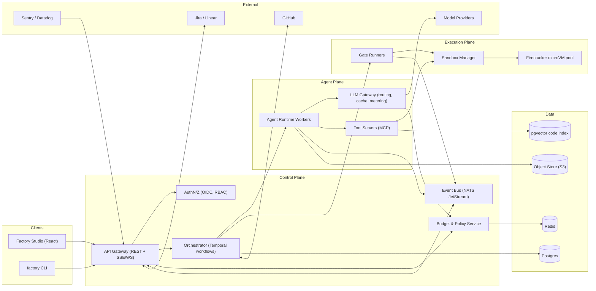
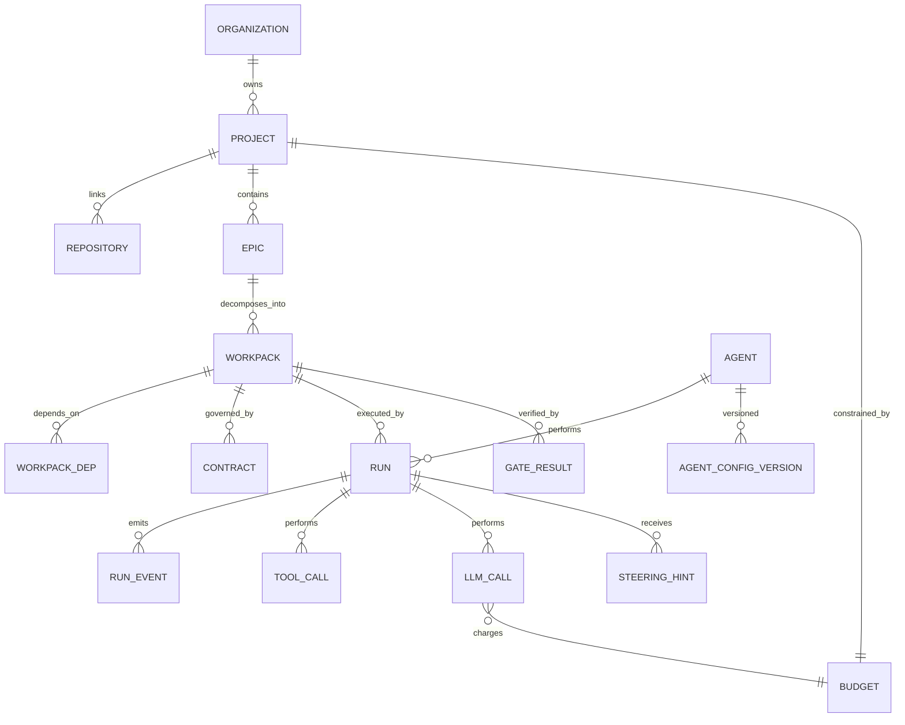
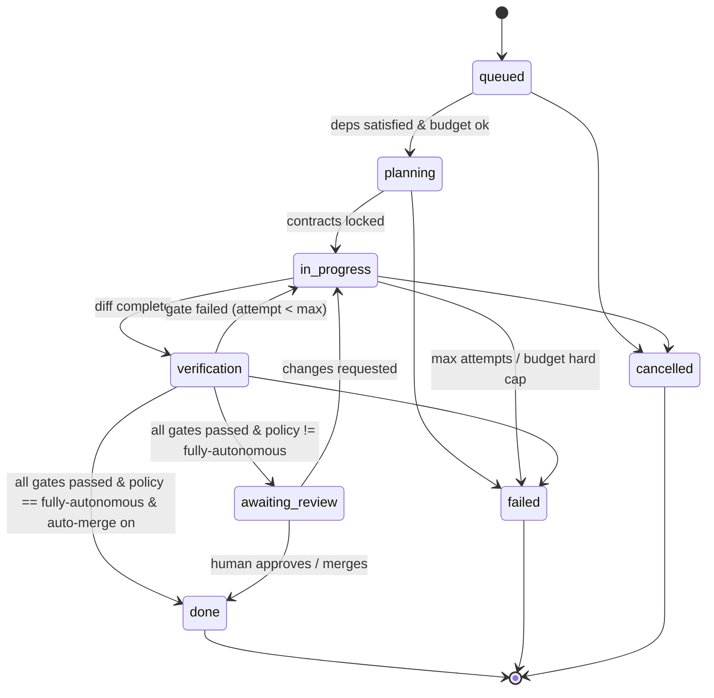
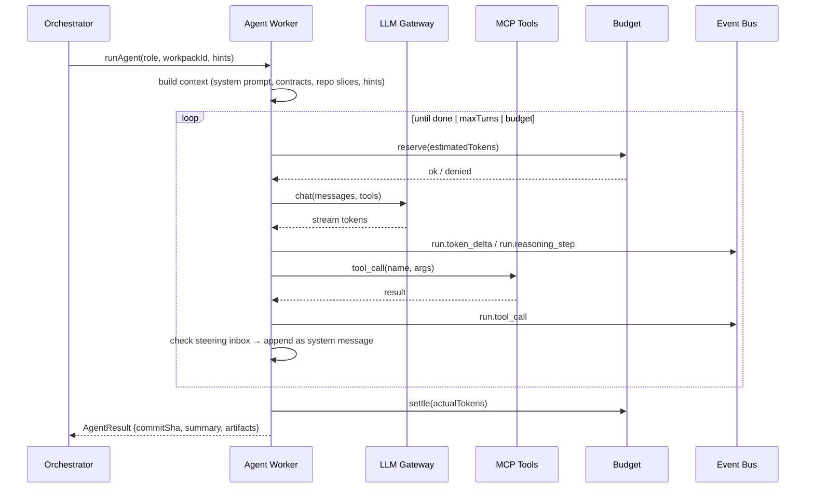

# Technical Specification — Synthetix Factory OS

> **Status:** Draft v0.1 · **Owner:** Platform Engineering · **Last updated:** 2026-10-30
> **Source docs:** [PRD](../designs/synthetix_factory_os_product_requirements_document_prd.md) · Frontend feature modules in [`src/pages/`](../src/pages)

---

## 1. Purpose & Scope

This document turns the Synthetix Factory OS PRD into a buildable design. The **Factory Studio frontend** exists already (React + Vite, feature-sliced under `src/pages/*`) and runs on mock data in `src/data/mockData.ts`. This spec defines everything behind it: the **control plane, orchestration engine, agent runtime, sandbox fleet, verification gates, budget enforcement, and integrations**. These turn the UI into a working autonomous software factory.

### 1.1 Goals

| # | Goal | Measurable target (from PRD) |
|---|------|------------------------------|
| G1 | Autonomous delivery | ≥ 80% of standard workpacks go from intake to a mergeable PR without a human writing code |
| G2 | Zero architectural drift | 100% of merged PRs pass contract + type + test + security gates |
| G3 | Cost predictability | No budget overrun beyond the hard cap. Spend is visible within ≤ 5 s |
| G4 | Human steerability | A steering hint reaches the running agent's next reasoning turn in ≤ 2 s (p95) |
| G5 | Full auditability | Every agent action, tool call, and token spend is attributable and replayable |

### 1.2 Non-Goals (v1)

- Training or fine-tuning foundation models. The factory only **consumes** hosted or self-hosted inference.
- Replacing CI/CD. The factory **produces PRs** and calls existing CI. It does not take over deploy pipelines past staging.
- Multi-repo atomic changes (monorepo or single-repo workpacks only in v1).
- A general-purpose chat assistant.

---

## 2. Glossary

| Term | Definition |
|------|------------|
| **Epic** | A top-level request (PRD, GitHub/Jira issue, or Sentry alert) |
| **Workpack** | An atomic unit of work produced by decomposing an Epic. It maps 1:1 to a branch and PR |
| **Workpack DAG** | The dependency graph between workpacks in one Epic |
| **Contract** | A machine-checkable spec written *before* code: TypeScript types, OpenAPI fragments, and acceptance tests |
| **Stage** | One step in the pipeline (Spec → Decompose → Synthesize → Verify) |
| **Gate** | A deterministic pass/fail check that must succeed before a workpack advances |
| **Specialist** | An agent role bound to a stage (Architect-Prime, CodeCraft, GateKeeper, SecOps-Vanguard, DocuForge, SentryWatch) |
| **Run** | One execution attempt of a stage for a workpack. A workpack can have many runs (retries) |
| **Steering hint** | Human text injected into a live run's context |
| **Sandbox** | An ephemeral, isolated microVM where code is built and tested |

---

## 3. System Architecture

### 3.1 High-Level Topology



### 3.2 Technology Choices

| Concern | Choice | Rationale | Alternatives considered |
|---------|--------|-----------|-------------------------|
| Backend language | **TypeScript (Node 22)** | Shares types with the frontend (`src/types`) | Go (faster, but splits the type system) |
| Durable workflows | **Temporal** | Long-running, retryable, pausable workflows with signals (needed for pause/steer/fork) | Inngest, custom queue + state machine |
| Primary DB | **Postgres 16** + `pgvector` | Relational core plus embeddings for code search | — |
| Hot state / rate limits | **Redis 7** | Token-bucket budgets and live counters | — |
| Event streaming | **NATS JetStream** | Low-latency fan-out to the UI with replay | Redis Streams, Kafka (heavier) |
| Sandboxes | **Firecracker microVMs** (via a sandbox manager service) | Strong isolation, about 125 ms cold start | gVisor, Kata, hosted E2B |
| Agent ↔ tools | **Model Context Protocol (MCP)** | A standard tool interface, reusable across agents | Bespoke function-calling |
| LLM gateway | Custom service (or LiteLLM fork) | Central routing, fallback, prompt cache, and metering | Direct provider SDKs |
| Telemetry | **OpenTelemetry** → Datadog/Grafana | Vendor-neutral traces, metrics, and logs | — |
| Frontend data layer | **TanStack Query** + SSE | Matches the HarperFast `queries/` / `mutations/` convention already in `src/pages` | SWR, Redux |

### 3.3 Repository Layout (target)

```
software-factory/
├── apps/
│   ├── studio/                 # current Vite app (this repo's src/)
│   ├── api/                    # REST + SSE gateway
│   ├── orchestrator/           # Temporal workers (workflows + activities)
│   ├── agent-runtime/          # specialist agent workers
│   ├── llm-gateway/            # model routing, metering, cache
│   ├── sandbox-manager/        # Firecracker pool + exec API
│   └── cli/                    # `factory` CLI
├── packages/
│   ├── contracts/              # shared zod schemas + TS types (source of truth)
│   ├── agent-sdk/              # base agent loop, tool binding, steering hooks
│   ├── gates/                  # gate runner implementations
│   ├── mcp-tools/              # repo, fs, search, test, git MCP servers
│   └── telemetry/              # OTel helpers, event envelope
├── infra/                      # Terraform, Helm charts, Firecracker images
└── docs/
```

> [!NOTE]
> `src/types/index.ts` should move into `packages/contracts` as zod schemas, so the API, workers, and UI all validate against one definition.

---

## 4. Domain Model

### 4.1 Entity Relationship



### 4.2 Core Tables (abridged DDL)

```sql
CREATE TYPE workpack_status AS ENUM (
  'queued','planning','in-progress','verification','awaiting-review','done','failed','cancelled'
);
CREATE TYPE priority AS ENUM ('P0 Blocker','P1 High','P2 Normal');
CREATE TYPE autonomy_policy AS ENUM ('fully-autonomous','draft-and-queue','propose-only');

CREATE TABLE epic (
  id            TEXT PRIMARY KEY,             -- e.g. EPIC-1042
  project_id    UUID NOT NULL REFERENCES project(id),
  source        TEXT NOT NULL,                -- 'spec-studio' | 'github' | 'jira' | 'sentry'
  source_ref    TEXT,                         -- external issue key / alert id
  title         TEXT NOT NULL,
  spec_markdown TEXT NOT NULL,
  mode          TEXT NOT NULL,                -- 'feature' | 'refactor' | 'bug' | 'security'
  created_by    UUID REFERENCES app_user(id),
  created_at    TIMESTAMPTZ DEFAULT now()
);

CREATE TABLE workpack (
  id                TEXT PRIMARY KEY,         -- e.g. WP-2841
  epic_id           TEXT NOT NULL REFERENCES epic(id),
  title             TEXT NOT NULL,
  description       TEXT NOT NULL,
  status            workpack_status NOT NULL DEFAULT 'queued',
  priority          priority NOT NULL DEFAULT 'P2 Normal',
  category          TEXT NOT NULL,
  assigned_agent_id TEXT REFERENCES agent(id),
  branch            TEXT,
  pr_number         INT,
  commit_sha        TEXT,
  target_files      TEXT[] NOT NULL DEFAULT '{}',
  lines_added       INT NOT NULL DEFAULT 0,
  lines_removed     INT NOT NULL DEFAULT 0,
  files_count       INT NOT NULL DEFAULT 0,
  completeness      SMALLINT NOT NULL DEFAULT 0 CHECK (completeness BETWEEN 0 AND 100),
  tokens_consumed   BIGINT NOT NULL DEFAULT 0,
  cost_usd_micros   BIGINT NOT NULL DEFAULT 0,
  temporal_wf_id    TEXT UNIQUE,
  version           INT NOT NULL DEFAULT 0,   -- optimistic concurrency
  created_at        TIMESTAMPTZ DEFAULT now(),
  completed_at      TIMESTAMPTZ
);

CREATE TABLE workpack_dep (
  workpack_id   TEXT REFERENCES workpack(id),
  depends_on_id TEXT REFERENCES workpack(id),
  PRIMARY KEY (workpack_id, depends_on_id)
);

CREATE TABLE contract (
  id           UUID PRIMARY KEY,
  workpack_id  TEXT REFERENCES workpack(id),
  kind         TEXT NOT NULL,                 -- 'ts-types' | 'openapi' | 'playwright' | 'invariant'
  path         TEXT NOT NULL,
  content      TEXT NOT NULL,
  hash         TEXT NOT NULL,
  locked       BOOLEAN NOT NULL DEFAULT false -- locked contracts cannot be edited by CodeCraft
);

CREATE TABLE run (
  id           UUID PRIMARY KEY,
  workpack_id  TEXT REFERENCES workpack(id),
  stage        SMALLINT NOT NULL,             -- 1..4
  agent_id     TEXT REFERENCES agent(id),
  agent_config_version INT NOT NULL,
  attempt      SMALLINT NOT NULL DEFAULT 1,
  status       TEXT NOT NULL,                 -- running | paused | succeeded | failed | cancelled
  started_at   TIMESTAMPTZ DEFAULT now(),
  ended_at     TIMESTAMPTZ,
  transcript_uri TEXT                         -- s3://… full message log
);

CREATE TABLE llm_call (
  id             UUID PRIMARY KEY,
  run_id         UUID REFERENCES run(id),
  provider       TEXT NOT NULL,
  model          TEXT NOT NULL,
  input_tokens   INT NOT NULL,
  cached_tokens  INT NOT NULL DEFAULT 0,
  output_tokens  INT NOT NULL,
  reasoning_tokens INT NOT NULL DEFAULT 0,
  cost_usd_micros BIGINT NOT NULL,
  latency_ms     INT NOT NULL,
  fallback_from  TEXT,
  created_at     TIMESTAMPTZ DEFAULT now()
);

CREATE TABLE gate_result (
  id          UUID PRIMARY KEY,
  workpack_id TEXT REFERENCES workpack(id),
  run_id      UUID REFERENCES run(id),
  gate        TEXT NOT NULL,                  -- see §8
  status      TEXT NOT NULL,                  -- passed | failed | running | skipped
  metrics     JSONB NOT NULL DEFAULT '[]',    -- [{label,value}]
  details_uri TEXT,
  created_at  TIMESTAMPTZ DEFAULT now()
);

CREATE TABLE steering_hint (
  id          UUID PRIMARY KEY,
  run_id      UUID REFERENCES run(id),
  author_id   UUID REFERENCES app_user(id),
  text        TEXT NOT NULL,
  kind        TEXT NOT NULL DEFAULT 'hint',   -- hint | constraint | veto
  delivered_at TIMESTAMPTZ,
  acknowledged_at TIMESTAMPTZ
);
```

Append-only tables (`run_event`, `llm_call`, `tool_call`, `audit_log`) are **partitioned monthly** and never updated.

---

## 5. Workpack Lifecycle

### 5.1 State Machine



**Rules**

1. Only the **Orchestrator** writes `workpack.status`. The API sends *intents* (Temporal signals). It never writes status directly.
2. Every transition emits a `workpack.status_changed` event (see §10.3).
3. A manual move from the Task Matrix (`updateWorkpackStatus`) becomes a signal. The workflow validates it against the state machine and rejects illegal moves with `409`.
4. `max_attempts` defaults to 3 per stage. After that, the workpack goes to `failed` and a notification fires.

### 5.2 Pipeline Stages ↔ Specialists

| Stage | Name (UI) | Primary agent | Inputs | Outputs | Exit gate |
|-------|-----------|---------------|--------|---------|-----------|
| 1 | Product Spec & Contracts | Architect-Prime | Epic spec, repo index | Contracts (types, OpenAPI, acceptance tests) | `contract.schema_valid`, `contract.compiles` |
| 2 | Architecture Decomposition | Architect-Prime | Contracts, dependency graph | Workpack DAG, target files, assignment | `dag.acyclic`, `dag.coverage` |
| 3 | Code Synthesis | CodeCraft | Workpack + locked contracts | Branch + commits + streaming diff | `build.passes`, `types.pass` |
| 4 | Verification & Security | GateKeeper + SecOps-Vanguard | Branch | Gate results, preview URL | All §8 gates |
| post | Docs & Merge | DocuForge | Merged diff | ADRs, OpenAPI sync, PR notes | `docs.openapi_in_sync` |
| loop | Observability | SentryWatch | Prod telemetry | New Epics (`source='sentry'`) | — |

---

## 6. Orchestration (Temporal)

### 6.1 Workflows

```ts
// apps/orchestrator/src/workflows/epic.ts
export async function EpicWorkflow(input: { epicId: string }): Promise<void> {
  const contracts = await stage1_Spec(input.epicId);         // Architect-Prime
  const dag = await stage2_Decompose(input.epicId, contracts); // Architect-Prime

  // Fan out: start child workflows in topological order, honoring deps
  await runDag(dag, (wp) =>
    executeChild(WorkpackWorkflow, { workflowId: `wp-${wp.id}`, args: [{ workpackId: wp.id }] })
  );
}

// apps/orchestrator/src/workflows/workpack.ts
export async function WorkpackWorkflow({ workpackId }: { workpackId: string }) {
  setHandler(pauseSignal, () => (paused = true));
  setHandler(resumeSignal, () => (paused = false));
  setHandler(steerSignal, (hint) => pendingHints.push(hint));
  setHandler(cancelSignal, () => cancelScope.cancel());
  setHandler(statusQuery, () => currentState);

  for (let attempt = 1; attempt <= MAX_ATTEMPTS; attempt++) {
    await condition(() => !paused);
    await activities.assertBudget(workpackId);                 // hard-cap check
    const synth = await activities.runAgent('codecraft', workpackId, { attempt, hints: drain(pendingHints) });
    const gates = await activities.runGates(workpackId, synth.commitSha);
    if (gates.allPassed) return finalize(workpackId, gates);
    feedback = gates.failures;                                 // fed into next attempt
  }
  await activities.markFailed(workpackId);
}
```

### 6.2 Signals & Queries (map to UI controls)

| UI control | Feature module | Temporal primitive |
|------------|----------------|--------------------|
| Pause Swarm / Resume | `mission-control`, `live-workspace` | `pauseSignal` / `resumeSignal`, broadcast to every active workflow in the project |
| Inject Hint | `mission-control/SteeringConsole`, `live-workspace/WorkspaceToolbar` | `steerSignal(hint)` |
| Fork Pipeline | `mission-control` | Start a new `WorkpackWorkflow` from the same commit with an `-fork-N` branch suffix |
| Move card (Kanban) | `task-matrix/useUpdateTaskStatusMutation` | `transitionSignal(target)` |
| Promote / Rollback | `quality-sandboxes/usePromoteReleaseMutation` | `approveSignal` / `revertActivity` |
| Run Intake Cycle | `fleet-tuning` | Start `IntakeWorkflow(agentId)` |

### 6.3 Concurrency & Fairness

- Task queues are split **per specialist** (`q.architect`, `q.codecraft`, …), so each role scales on its own.
- A per-project concurrency limit (default 8 concurrent workpacks) runs as a Temporal-side semaphore.
- P0 workpacks get a dedicated priority queue with reserved worker capacity (20%).

---

## 7. Agent Runtime

### 7.1 Agent Loop

Every specialist runs the same loop from `packages/agent-sdk`:



### 7.2 Agent Definition (versioned config)

```ts
// packages/contracts/src/agent.ts
export const AgentConfig = z.object({
  id: z.string(),                         // 'architect-prime'
  role: z.string(),
  stage: z.number().int().min(1).max(4).nullable(),
  model: z.object({
    primary: z.string(),                  // 'anthropic/claude-sonnet'
    fallbacks: z.array(z.string()).default([]),
    reasoningEffort: z.enum(['Low', 'Medium', 'High', 'Max']),
    temperature: z.number().min(0).max(1),
    maxOutputTokens: z.number().int(),
  }),
  systemPrompt: z.string(),
  tools: z.array(z.string()),             // MCP tool ids allow-list
  autonomyPolicy: z.enum(['fully-autonomous', 'draft-and-queue', 'propose-only']),
  limits: z.object({
    maxTurns: z.number().int().default(40),
    maxTokensPerRun: z.number().int(),
    maxWallClockSec: z.number().int().default(1800),
  }),
  skills: z.array(z.string()).default([]), // uploaded skill plugins (from Agent Tuning Drawer)
});
```

- Every save from the **Agent Tuning Drawer** creates a new `agent_config_version` row (immutable). Running runs keep the version they started with. New runs pick up the latest version.
- "Deploy Parameters" = `POST /agents/:id/versions` followed by `PUT /agents/:id/active-version`.

### 7.3 Specialist Contracts

| Agent | Allowed tools | May write to | Hard prohibitions |
|-------|---------------|--------------|-------------------|
| Architect-Prime | `repo.read`, `search.semantic`, `search.ast`, `contracts.write`, `dag.write` | `contracts/`, workpack DAG | Committing application code |
| CodeCraft | `repo.read`, `fs.write`, `git.commit`, `sandbox.exec`, `search.*` | Files in `target_files` (soft) and the branch | Editing locked contracts or test assertions authored in Stage 1 |
| GateKeeper | `sandbox.exec`, `tests.write`, `browser.playwright` | `tests/` (additive only) | Weakening or deleting existing tests |
| SecOps-Vanguard | `sast.semgrep`, `sbom.scan`, `secrets.scan`, `repo.read` | Gate results only | Any repo write. Holds **veto** |
| DocuForge | `repo.read`, `fs.write` (docs paths), `openapi.diff` | `docs/`, `openapi/`, PR body | Code paths |
| SentryWatch | `telemetry.query`, `epic.create` | New Epics | Any repo write |

Enforcement happens in the **MCP tool layer**, not in prompts. Path allow-lists and diff validators reject violating calls and log a `policy.violation` event.

### 7.4 Steering Semantics

- Hints are delivered at the **next turn boundary**. They are never injected mid-stream.
- `kind = 'hint'` → appended as `system: [HUMAN STEERING] …`.
- `kind = 'constraint'` → also persisted into the workpack's invariant list, so later runs and retries inherit it.
- `kind = 'veto'` → the current turn's tool calls are rolled back, and the agent is told why.
- The agent must acknowledge the hint in its next message. The runtime records `acknowledged_at`, and the UI shows the check mark in "Recent Steering Injections".

---

## 8. Verification Gates

Gates are **deterministic programs**, not LLM opinions. LLM agents may *author* tests, but pass/fail comes only from executing them.

| # | Gate id | Owner | Implementation | Pass criteria |
|---|---------|-------|----------------|---------------|
| 1 | `static.types_lint` | GateKeeper | `tsc --noEmit`, oxlint/eslint, formatter check | 0 errors. No new warnings vs. base |
| 2 | `tests.unit_integration` | GateKeeper | vitest/jest with coverage in sandbox | 100% pass. Coverage on changed lines ≥ 80% |
| 3 | `tests.e2e_viewports` | GateKeeper | Playwright across the viewport matrix (desktop/tablet/mobile × browsers) | 100% pass. Visual diff ≤ threshold |
| 4 | `security.sast_sbom` | SecOps-Vanguard | Semgrep, gitleaks, SBOM (syft) + CVE (grype), license policy | 0 high/critical findings. No disallowed licenses (GPL/AGPL in proprietary repos) |
| 5 | `contract.conformance` | Orchestrator | Compile against locked contracts. OpenAPI diff for breaking changes | No contract file modified. No breaking API diff unless the epic allows it |
| 6 | `diff.scope` | Orchestrator | Changed files ⊆ `target_files` ∪ allowed globs. Size limits | Within scope, or flagged for review |

- Gates 1–3 and 5–6 run **in parallel** in one sandbox snapshot. Gate 4 runs in a separate network-isolated sandbox.
- Results stream as `gate.updated` events, which drive `quality-sandboxes/VerificationGateGrid`.
- The structured failure output (file, line, message, logs excerpt ≤ 8 KB) feeds back into the next CodeCraft attempt.
- **Flaky test handling:** a failing test is re-run up to 2× in isolation. If it passes on retry, it is marked `flaky` and quarantined, which does not block merge but opens a maintenance workpack.

---

## 9. Execution Plane (Sandboxes)

### 9.1 Sandbox Manager API (internal)

```
POST   /sandboxes                 { image, repoUrl, ref, cpu, memMb, network: 'none'|'egress-allowlist' }
POST   /sandboxes/:id/exec        { cmd, cwd, timeoutSec, env }  → stream stdout/stderr
POST   /sandboxes/:id/snapshot    → snapshotId
POST   /sandboxes/:id/expose      { port } → preview URL (signed, 24h TTL)
DELETE /sandboxes/:id
```

### 9.2 Requirements

| Requirement | Target |
|-------------|--------|
| Cold start (from warm pool) | ≤ 200 ms p95 |
| Isolation | One microVM per run. No shared filesystem. Seccomp + jailer |
| Network | Default `none`. The package-install phase uses an egress allow-list (registry mirrors only) |
| Secrets | Never mounted. Test credentials come from short-lived scoped tokens |
| Lifetime | Max 60 min. Reaped on run end or orphan detection (heartbeat timeout 120 s) |
| Base images | Per-language, prebuilt with dependency caches. Rebuilt nightly. Signed (cosign) |

The **Live Workspace terminal** (`live-workspace/TerminalSession`) attaches to the run's sandbox through `POST /sandboxes/:id/exec` streamed over WebSocket. Human commands are tagged `actor=human` in the audit log and are **read-only by default** (a `--write` escalation needs the `sandbox:write` permission).

---

## 10. API Surface

### 10.1 Conventions

- Base path `/api/v1`. JSON. Auth uses OIDC bearer tokens. Errors follow `application/problem+json`.
- Mutations accept an `Idempotency-Key` header.
- Workpack writes use optimistic concurrency (`If-Match: <version>`).

### 10.2 REST Endpoints

| Method & path | Purpose | Frontend consumer |
|---------------|---------|-------------------|
| `GET /overview/metrics?window=24h` | KPI cards, sparkline series | `overview/queries/getOverviewMetrics` |
| `GET /overview/health` | Specialist and cluster health | `overview/queries` → `SystemHealthGauge` |
| `POST /benchmarks` | Run factory regression benchmark | `overview/mutations/triggerFactoryBenchmark` |
| `GET /pipeline/stages` | 4-stage stepper state | `mission-control` |
| `POST /pipeline/pause` · `/resume` | Global pause | `mission-control`, `live-workspace` |
| `POST /runs/:id/steer` | Inject steering hint | `mission-control/mutations/useSteerAgentMutation` |
| `GET /runs/:id/logs?level=` | Paged historical logs | `LiveExecutionLogViewer` |
| `GET /workpacks?status=&priority=&agent=&q=` | Task Matrix listing | `task-matrix/queries` |
| `POST /workpacks` | Create a single workpack (New Workpack modal) | `NewWorkpackModal` |
| `PATCH /workpacks/:id/status` | Status transition intent | `task-matrix/mutations/useUpdateTaskStatusMutation` |
| `POST /workpacks/:id/fork` | Fork pipeline | `mission-control` |
| `GET /workpacks/:id/diff?file=` | File diff for the workspace | `live-workspace/queries/getWorkspaceCode` |
| `GET /runs/:id/reasoning` | Chain-of-thought step summaries | `ReasoningTraceViewer` |
| `GET /workpacks/:id/gates` | Gate results | `quality-sandboxes` |
| `POST /workpacks/:id/promote` · `/rollback` | Merge to main / revert | `quality-sandboxes/mutations/usePromoteReleaseMutation` |
| `POST /epics` | Submit a spec from Spec Studio | `spec-studio/mutations/useDispatchSpecWorkpack` |
| `POST /epics/preview` | Dry-run decomposition → contracts + DAG preview (no execution) | `spec-studio` contract & graph panes |
| `GET /agents` · `GET /agents/:id` | Fleet listing | `fleet-tuning` |
| `POST /agents/:id/versions` · `PUT /agents/:id/active-version` | Tune / deploy params | `AgentTuningDrawer` |
| `POST /agents/:id/run` | Manual intake cycle | `fleet-tuning` "Run now" |
| `GET /fleet/stats` | Providers, VRAM, cache hit, burn | `fleet-tuning/queries/getFleetStatus` |
| `GET /budget` · `PUT /budget` | Soft/hard caps, runway | `BudgetModal` |
| `GET /integrations` · `PATCH /integrations/:id` | Connector state | `settings` |
| `GET /policies` · `PATCH /policies` | Governance toggles | `settings/GovernancePoliciesCard` |
| `POST /tokens` · `DELETE /tokens/:id` | API token lifecycle | `settings/TelemetryAndSecurityCard` |

### 10.3 Real-Time Event Stream

`GET /api/v1/stream?project=<id>&topics=workpack,run,gate,budget` returns **SSE**. The terminal attach uses WebSocket because it is bidirectional.

```ts
// packages/contracts/src/events.ts
type FactoryEvent =
  | { type: 'workpack.status_changed'; workpackId: string; from: Status; to: Status; version: number }
  | { type: 'workpack.progress';       workpackId: string; completeness: number; linesAdded: number; linesRemoved: number }
  | { type: 'run.token_delta';         runId: string; tokens: number; text?: string }   // text only when subscribed to run
  | { type: 'run.reasoning_step';      runId: string; step: number; title: string; status: 'active'|'done' }
  | { type: 'run.tool_call';           runId: string; tool: string; ok: boolean; durationMs: number }
  | { type: 'run.log';                 runId: string; level: 'info'|'warn'|'success'|'agent'|'error'; tag: string; message: string }
  | { type: 'steering.acknowledged';   runId: string; hintId: string }
  | { type: 'gate.updated';            workpackId: string; gate: string; status: GateStatus; metrics: Metric[] }
  | { type: 'budget.updated';          spendUsd: number; softLimitHit: boolean; hardCapHit: boolean; runwayHours: number }
  | { type: 'pipeline.paused' | 'pipeline.resumed'; actor: string };

interface Envelope<E extends FactoryEvent = FactoryEvent> {
  id: string;           // monotonic, used for Last-Event-ID resume
  ts: string;
  projectId: string;
  event: E;
}
```

**Frontend integration pattern.** A single `useFactoryStream()` hook in `src/hooks/` subscribes once. It **patches the TanStack Query cache** (`queryClient.setQueryData`) instead of keeping a parallel store. This replaces the `setInterval` simulation inside `AppContext`.

---

## 11. Budget, Cost & Guardrails

### 11.1 Model

- Spend is tracked in **USD micros**. The LLM gateway prices each call from a versioned `price_table` (input, cached input, output, and reasoning token rates per model).
- **Reservation protocol:** before each LLM call the agent reserves `estimate = prompt_tokens + maxOutputTokens` at the model's rate. After the call it settles to the actual amount. Reservations live in Redis (`INCRBY` against a Lua-guarded ceiling), so concurrent calls cannot overshoot the hard cap.
- Budgets are hierarchical: **org → project → epic (optional) → workpack (optional)**. A call must pass every level.

### 11.2 Thresholds (from `BudgetModal`)

| Threshold | Default | Action |
|-----------|---------|--------|
| Soft limit | 80% of monthly cap | Toast in Studio, Slack alert to configured channel, `budget.updated{softLimitHit}` |
| Auto-throttle (optional) | Soft limit | Downgrade non-P0 runs to fallback (cheaper) models. Cap concurrency at 50% |
| Hard cap | 100% | Reservation denied → active runs finish their current turn and then **pause** (not fail). New runs blocked. Only an admin can raise the cap |

**Runway** = `(cap − spend) / trailing_6h_burn_rate`, shown in days and hours.

### 11.3 Governance Policies (Settings)

| Policy | Enforcement point |
|--------|-------------------|
| Autonomous mainline auto-merge | `WorkpackWorkflow.finalize`. When off, every workpack stops at `awaiting-review` |
| Hard budget tripwire | Budget service (§11.1) |
| Human sign-off on P0/P1 + schema changes | `finalize` checks priority and whether the diff touches `migrations/` or `*.prisma` |
| Strict SAST & license audit | Gate 4 severity threshold and license deny-list |

---

## 12. LLM Gateway

- **Routing:** role → primary model → ordered fallbacks (the Fleet "Dynamic Routing & Fallback Matrix"). Failover triggers on 5xx, timeout (> 60 s to first token), or a provider rate limit.
- **Prompt caching:** stable prefixes (system prompt, contracts, repo summary) come first and are marked cacheable. The target is a cache hit ratio of ≥ 85%, surfaced in Fleet barometers.
- **Metering:** every call writes an `llm_call` row and emits OTel spans (`gen_ai.*` semantic conventions).
- **Safety:** outbound prompts are scanned for secrets (gitleaks patterns) and redacted. Responses are size-capped.
- **Provider keys** live in a KMS-backed secret store. The Settings UI only shows masked tokens. Rotation does not need a redeploy.

---

## 13. Integrations

| Integration | Direction | Mechanism | Notes |
|-------------|-----------|-----------|-------|
| GitHub | ↔ | Personal Access Token (PAT) or GitHub App, webhooks | Works with any individual developer repo or org repo. Branch `factory/<wp-id>-<slug>`. PRs carry gate summaries as check runs |
| Jira / Linear | → intake, ← status sync | Webhooks + REST | Label `factory:auto` opts an issue in |
| Sentry / Datadog | → intake | Alert webhooks | SentryWatch dedupes by fingerprint and only creates an Epic when no open Epic matches |
| Slack | ← notify | Incoming webhook / app | Budget alerts, review requests, failures |
| Model providers | ← | LLM gateway | Anthropic, OpenAI, DeepSeek, self-hosted (vLLM) |
| Semgrep / Syft / Grype / gitleaks | internal | CLI in gate sandbox | Rule packs pinned and versioned |

### 13.1 GitHub Integration & Individual Repository Connection

Any individual developer can connect a personal GitHub repository (or organization repository) directly to the software factory without requiring enterprise infrastructure or organization admin privileges.

1. **Developer Repository Onboarding Flow:**
   - **Repository Identifier:** An individual provides a repo identifier in standard `<owner>/<repo>` format (e.g. `octocat/hello-world` or `BboyAkers/Software-Factory-Studio`) or standard repository URL.
   - **Default Branch:** Defaults to `main` (or user-defined trunk branch `master`, `develop`).
   - **Authentication Options:**
     - **Personal Access Token (PAT):** Fine-grained personal token scoped exclusively to the target repository with permissions:
       - `Contents: Read and write` (for branch creation and commit pushes)
       - `Pull requests: Read and write` (for automated PR lifecycle management)
       - `Checks: Read and write` (for deterministic Quality Gate status runs)
       - `Webhooks: Read and write` (optional: automatic webhook setup)
     - **GitHub App / OAuth:** Installed directly on a developer's personal account or team organization with select repository access.
2. **Autonomous Swarm Operations on Connected Repositories:**
   - **Branch Isolation:** Factory agents never commit directly to the default branch. All code changes are pushed to isolated workpack branches: `factory/<wp-id>-<slug>`.
   - **Check Runs & Gate Summaries:** When GateKeeper executes deterministic Quality Sandboxes (typecheck, unit tests, integration tests, SAST), it posts GitHub Check Runs (`factory/gates/01-build`, `factory/gates/02-unit`, etc.) directly on the target commit.
   - **Interactive Steering via PR Comments:** Individual developers can review the opened PR on GitHub and comment `@factory steer <instructions>` to steer running agents directly from GitHub's native code review interface.
   - **Mainline Auto-Merge:** Controlled by the `autoMergeVerifiedPRs` governance toggle. When enabled and all gates are green, the factory fast-forward merges the PR into the default branch.

Integration toggles in Settings map to `PATCH /integrations/:id { enabled }`. Turning off GitHub **pauses** all workpacks targeting that repo.

---

## 14. Security & Compliance

- **AuthN:** OIDC (Okta/Entra/Google). SCIM user provisioning.
- **AuthZ (RBAC):**

  | Role | Capabilities |
  |------|-------------|
  | Viewer | Read everything except secrets |
  | Engineer | Create epics, steer, move cards, request changes |
  | Maintainer | Approve/promote, tune agents, fork pipelines |
  | Admin | Budgets, integrations, policies, tokens, sandbox write |

- **Tenant isolation:** row-level security on `project_id`. Separate sandbox pools per org for enterprise tier.
- **Supply chain:** agents cannot add dependencies without Gate 4 passing. New deps are listed explicitly in the PR body.
- **Audit log:** append-only and hash-chained (each row stores `prev_hash`). Exportable to SIEM.
- **Data retention:** transcripts 90 days (configurable). Audit 1 year. Customer code is never used for training (contractual flag sent to providers).
- **Prompt-injection defense:** repo content and issue text are wrapped as untrusted data. Tool allow-lists and path guards (§7.3) are the real boundary. Prompts are not trusted to enforce policy.

---

## 15. Observability

| Signal | Source | Destination | Used by |
|--------|--------|-------------|---------|
| Traces | OTel in API, orchestrator, agents, gateway | Datadog/Tempo | Debugging. Spec-to-merge cycle-time breakdown |
| Metrics | Prometheus exporters | Grafana / Datadog | Overview KPIs, Fleet barometers |
| Logs | Structured JSON (pino) | Loki/Datadog | Mission Control log stream (filtered subset) |
| Business events | Event bus → `factory_metrics` rollups | Postgres materialized views | Overview cards (velocity, zero-intervention rate) |

**Key SLIs**

- Spec-to-merge cycle time (p50/p90)
- Zero-intervention rate = merged without human commits ÷ total merged
- Gate first-pass rate
- Cost per merged PR
- Steering delivery latency (p95)
- Sandbox cold-start latency (p95)
- LLM failover rate

---

## 16. Frontend Integration Plan

The feature modules already follow the HarperFast `organizations` layout. Wiring them to the real backend is mechanical:

| Layer | Today (mock) | Target |
|-------|--------------|--------|
| `queries/*.ts` | Return static objects | `queryOptions({ queryKey, queryFn: () => api.get(...) })` |
| `mutations/*.ts` | Call `AppContext` setters | `useMutation({ mutationFn, onMutate (optimistic), onSettled: invalidate })` |
| `hooks/*.ts` | Compose `useApp()` + local state | Compose `useQuery`/`useMutation` + UI state only |
| `AppContext` | Global store + `setInterval` simulation | Thin UI state (drawers, modals, current tab). Data moves to TanStack Query + `useFactoryStream` |
| `routes.ts` | Static metadata | TanStack Router route objects (like HarperFast's `routes.ts`) so pages become deep-linkable |
| `src/types` | Hand-written TS | Generated from `packages/contracts` zod schemas |

**Migration order** (each step ships on its own behind a `VITE_USE_MOCKS` flag):
1. Add an API client, QueryClient provider, and MSW handlers that serve the current mock data (so nothing regresses).
2. Convert `task-matrix` and `overview` (read-heavy).
3. Add `useFactoryStream` and convert `mission-control` and `live-workspace`.
4. Convert `quality-sandboxes`, `spec-studio`, `fleet-tuning`, and `settings`.
5. Introduce TanStack Router and drop `currentTab` switching in `App.tsx`.

---

## 17. Deployment & Infrastructure

- **Runtime:** Kubernetes (EKS/GKE). Sandbox hosts are bare-metal or `.metal` instances (Firecracker needs KVM) in a separate node pool.
- **Environments:** `dev` → `staging` → `prod`, with a dedicated **dogfood** project where the factory works on its own repo.
- **Scaling:**
  - Agent workers: HPA on Temporal task-queue backlog per specialist.
  - Sandbox pool: warm pool size = `p90(concurrent runs over last 1h) × 1.2`.
  - Gateway: stateless and horizontally scaled. Redis cluster for budgets.
- **DR:** Postgres PITR (RPO 5 min). Temporal persistence on its own Postgres. Object store versioned. Workflows resume after a region failover.
- **IaC:** Terraform for cloud resources, Helm for services, GitHub Actions for CI with signed images.

---

## 18. Testing Strategy

| Level | Scope | Tooling |
|-------|-------|---------|
| Unit | Contracts, budget math, state machine, gate parsers | vitest |
| Workflow | Temporal workflows with a time-skipping test env and mocked activities | `@temporalio/testing` |
| Agent eval | Replay a golden set of ~200 real historical tickets. Score gate pass rate, cost, and turns | Custom eval harness. Runs nightly and on agent-config changes |
| Contract | API ↔ UI schema compatibility | zod + generated OpenAPI + Schemathesis |
| E2E | Studio flows against staging | Playwright |
| Chaos | Provider outage, sandbox host loss, Redis failover | Fault injection in staging |

> [!IMPORTANT]
> Any change to an agent's system prompt, model, or tools **must** pass the agent eval suite with no regression in gate first-pass rate (> 2 pts) or cost per PR (> 10%). Only then can it become the active version.

---

## 19. Delivery Roadmap

| Phase | Duration | Scope | Exit criteria |
|-------|----------|-------|---------------|
| **P0 — Foundations** | 3 wks | Monorepo, `packages/contracts`, Postgres schema, API skeleton, OIDC, event stream, MSW-backed Studio | Studio runs against the API with mock-parity data |
| **P1 — Single-lane factory** | 5 wks | Temporal `WorkpackWorkflow`, CodeCraft only, sandbox manager, gates 1–2, GitHub App PRs | A hand-written workpack becomes a green PR end-to-end on the dogfood repo |
| **P2 — Full pipeline** | 6 wks | Architect-Prime (contracts + DAG), GateKeeper e2e, SecOps gate, steering, pause/fork, budget reservations | Epic → DAG → multiple merged PRs. Hard cap provably enforced |
| **P3 — Governance & Fleet** | 4 wks | Agent config versioning, eval harness, policies, integrations (Jira, Slack), DocuForge | Config changes gated by evals. Policies enforced |
| **P4 — Closed loop** | 4 wks | SentryWatch intake, auto-throttle, analytics rollups, SOC 2 controls | ≥ 60% zero-intervention rate on dogfood over 2 weeks |
| **P5 — GA hardening** | 4 wks | Multi-tenant isolation, DR drills, perf targets, docs | All §1.1 targets met in staging for 30 days |

---

## 20. Risks & Open Questions

| # | Risk / question | Mitigation / owner |
|---|-----------------|--------------------|
| R1 | Agents "game" gates (e.g., weakening tests) | Locked Stage-1 tests, additive-only test edits, `diff.scope` gate, mutation testing sample |
| R2 | Runaway cost from retry loops | Per-workpack token ceiling, max attempts, reservation protocol |
| R3 | Prompt injection through issue or repo content | Tool-layer enforcement, untrusted-data wrapping, no secrets in sandboxes |
| R4 | Sandbox escape | Firecracker + jailer, no network by default, dedicated hosts, regular CVE patching |
| R5 | Merge conflicts across parallel workpacks in one DAG | Orchestrator rebases before Gate run. File-level locks for overlapping `target_files` |
| Q1 | Do we expose raw chain-of-thought or summarized reasoning steps in `ReasoningTraceViewer`? | **Proposed:** summarized steps only. Decision needed from Product + Legal |
| Q2 | Self-hosted inference (vLLM on H100) in v1, or provider-only? | Affects Fleet VRAM telemetry. Decision needed from Infra |
| Q3 | Should GateKeeper be allowed to *add* tests beyond Stage-1 contracts, or only execute them? | **Proposed:** additive only, never modify. Decision needed from Eng leads |
| Q4 | Monorepo-only in v1 — acceptable for launch customers? | Product |

---

## Appendix A — Feature Module ↔ Backend Ownership

| Studio feature (`src/pages/…`) | Backend services | Key events |
|-----------------------------------|------------------|-----------|
| `overview` | API (metrics rollups), Budget | `workpack.*`, `budget.updated` |
| `mission-control` | Orchestrator, Agent Runtime | `run.*`, `steering.acknowledged`, `pipeline.*` |
| `task-matrix` | Orchestrator, API | `workpack.status_changed`, `workpack.progress` |
| `live-workspace` | Agent Runtime, Sandbox Manager | `run.token_delta`, `run.reasoning_step`, WS terminal |
| `quality-sandboxes` | Gate Runners, Sandbox Manager, GitHub | `gate.updated` |
| `spec-studio` | Orchestrator (`EpicWorkflow`, preview mode) | `workpack.status_changed` |
| `fleet-tuning` | Agent config service, LLM Gateway | `budget.updated` |
| `settings` | Integrations, Policy, Token service | — |

## Appendix B — Definition of Done for a Workpack

1. All Stage-1 contracts compile and are unchanged.
2. Gates 1–6 have passed on the final commit SHA.
3. The PR body contains a summary, a change list, new dependencies (if any), gate results, cost, and a link to the run transcript.
4. DocuForge has updated OpenAPI/ADRs when the diff touches public interfaces.
5. Policy check passed (auto-merge allowed, or human approval recorded).
6. Audit log entries exist for every write action in the run.
