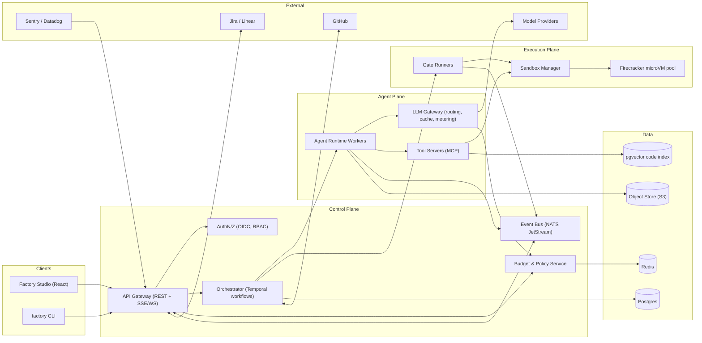
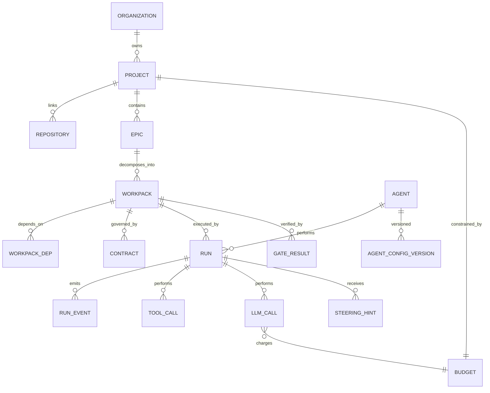
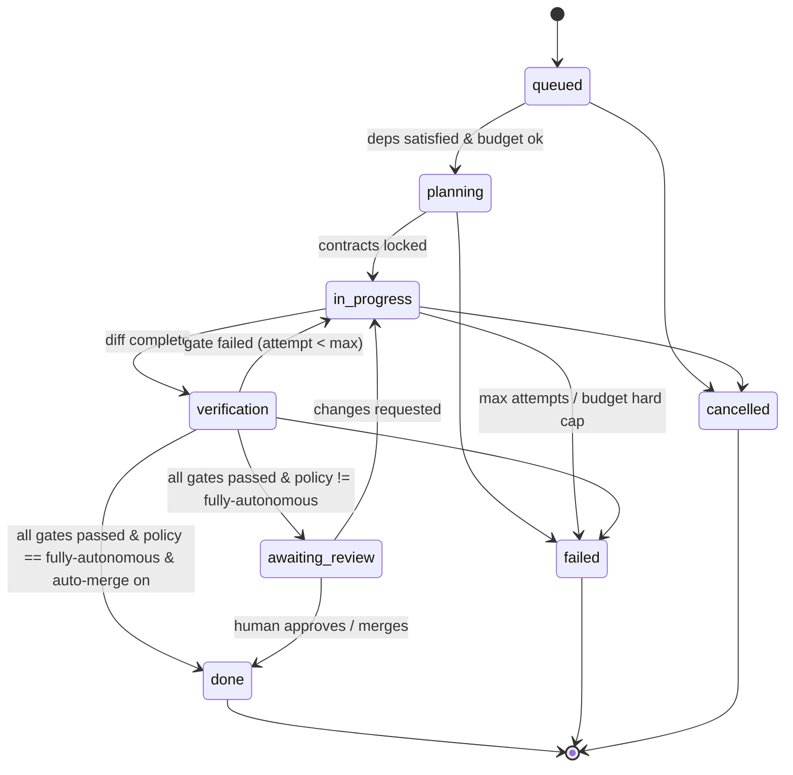
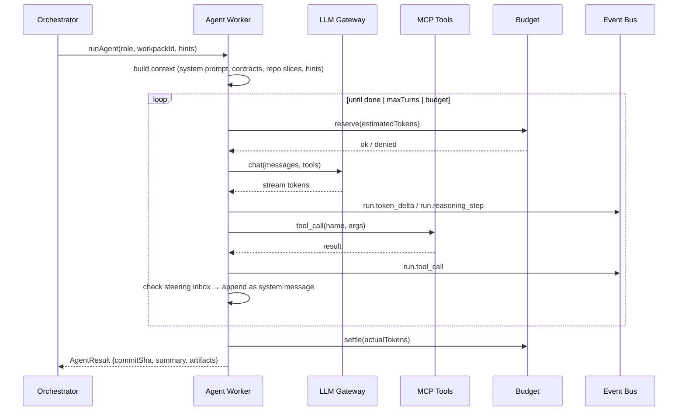

# Technical Specification — Synthetix Factory OS

> **Status:** Draft v0.2 · **Owner:** Platform Engineering · **Last updated:** 2026-11-01
> **Source docs:** [PRD](../designs/synthetix_factory_os_product_requirements_document_prd.md) · Frontend feature modules in [`src/pages/`](../src/pages) · [v0.2 Build Plan](./SPEC_V0.2_PLAN.md)
> **Scope lock:** v1 = GitHub-wins intake, TS/JS synthesize only, project-cap budget, Slack-only notify, single-org, provider-only LLMs, screenshots-only QA, merge-then-staging. See §1.2 for deferred list.

---

## 1. Purpose & Scope

This document turns the Synthetix Factory OS PRD into a buildable design. The **Factory Studio frontend** exists already (React + Vite, feature-sliced under `src/pages/*`) and runs on mock data in `src/data/mockData.ts`. This spec defines everything behind it: the **control plane, orchestration engine, agent runtime, sandbox fleet, verification gates, budget enforcement, and integrations**. These turn the UI into a working autonomous software factory.

### 1.1 Goals

| # | Goal | Measurable target (from PRD) |
|---|------|------------------------------|
| G1 | Autonomous delivery | ≥ 80% of standard workpacks go from intake to a mergeable PR without a human writing code |
| G2 | Zero architectural drift | 100% of merged PRs pass blocking gates (contract + type + test + security + migration). Warn-only gates (perf/a11y/i18n) tracked but non-blocking |
| G3 | Cost predictability | No budget overrun beyond the hard cap. Spend is visible within ≤ 5 s |
| G4 | Human steerability | An approved steering hint reaches the running agent's next reasoning turn in ≤ 2 s (p95), measured post-approval |
| G5 | Full auditability | Every agent action, tool call, and token spend is attributable and replayable. Hash-chain verifiable via Audit Log view |

GA exit: G1–G5 held for 30 days on the dogfood staging project after P0–P5 completion.

### 1.2 Non-Goals (v1)

- Training or fine-tuning foundation models. The factory only **consumes provider-hosted inference** (no self-hosted vLLM in v1).
- Replacing CI/CD. The factory **produces PRs** and calls existing CI. It does not take over deploy pipelines past staging.
- Multi-repo atomic changes (single-repo workpacks only in v1; monorepo treated as one repo).
- Non-TypeScript/JavaScript synthesis. Indexing covers TS/Python/Go/Java + docs, but sandbox execution and gates support TS/JS only in v1.
- Jira intake (deferred post-v1). GitHub Issues is the sole Epic source of truth.
- Deployed preview environments. Quality ships screenshots-only QA (Playwright captures to object store).
- Self-hosted model inference, BYO sandbox runners, custom skill bundles, non-Slack notifications, per-epic/agent enforceable caps, scoped/expiring API tokens, multi-org SaaS billing, custom KPI builder.
- A general-purpose chat assistant.

---

## 2. Glossary

| Term | Definition |
|------|------------|
| **Epic** | A top-level request (frontmatter-Markdown spec, GitHub issue, or Sentry alert via GitHub issue). GitHub Issues is the sole source of truth in v1 |
| **Workpack** | An atomic unit of work produced by decomposing an Epic. It maps 1:1 to a branch and PR |
| **Workpack DAG** | The dependency graph between workpacks in one Epic |
| **Contract** | A machine-checkable spec written *before* code: TypeScript types, OpenAPI fragments, and acceptance tests |
| **Stage** | One step in the pipeline (Spec → Decompose → Synthesize → Verify) |
| **Gate** | A deterministic check. **Blocking** gates must pass; **warn-only** gates (perf/a11y/i18n) surface without blocking; **quarantine** (flaky) files a tracking issue |
| **Specialist** | An agent role bound to a stage (Architect-Prime, CodeCraft, GateKeeper, SecOps-Vanguard, DocuForge, SentryWatch) |
| **Run** | One execution attempt of a stage for a workpack. A workpack can have many runs (retries, fixed `max_attempts=3`) |
| **Steering hint** | Approved human text injected into a live run's context at the next turn boundary. Viewers file *suggestions*; Engineer+ approves |
| **Steering suggestion** | A pending viewer proposal awaiting Engineer approval before injection |
| **Sandbox** | An ephemeral, isolated microVM where code is built and tested (Node-only images in v1) |
| **Archive** | Terminal `failed`/`cancelled` workpacks auto-hidden from the Kanban default view after 5 min |

---

## 3. System Architecture

### 3.1 High-Level Topology



### 3.2 Technology Choices

| Concern | Choice | Rationale | Alternatives considered |
|---------|--------|-----------|-------------------------|
| Backend language | **TypeScript (Node 22)** | Shares types with the frontend (`src/types`) | Go (faster, but splits the type system) |
| Durable workflows | **Temporal** | Long-running, retryable, pausable workflows with signals (needed for pause/steer/fork) | Inngest, custom queue + state machine |
| Primary DB | **Postgres 16** + `pgvector` | Relational core plus embeddings for code search | — |
| Hot state / rate limits | **Redis 7** | Token-bucket budgets and live counters | — |
| Event streaming | **NATS JetStream** | Low-latency fan-out to the UI with replay | Redis Streams, Kafka (heavier) |
| Sandboxes | **Firecracker microVMs** (factory-hosted pool only, KVM bare-metal) | Strong isolation, single-language pool keeps images warm | gVisor, Kata, hosted E2B, BYO runners (all deferred) |
| Agent ↔ tools | **Model Context Protocol (MCP)** | A standard tool interface, reusable across agents | Bespoke function-calling |
| LLM gateway | Custom service (or LiteLLM fork) | Central routing, fallback, prompt cache, and metering. **Provider-only in v1** (no vLLM) | Direct provider SDKs |
| Telemetry | **OpenTelemetry** → Datadog/Grafana | Vendor-neutral traces, metrics, and logs | — |
| Frontend data layer | **TanStack Query** + SSE | Matches the HarperFast `queries/` / `mutations/` convention already in `src/pages` | SWR, Redux |
| Frontend routing | **TanStack Router** | Deep links `/p/:project/<tab>/<workpackId>/<runId>` for every tab, workpack, and run | `currentTab` state only |

### 3.3 Repository Layout (target)

```
software-factory/
├── apps/
│   ├── studio/                 # current Vite app (this repo's src/)
│   ├── api/                    # REST + SSE gateway
│   ├── orchestrator/           # Temporal workers (workflows + activities)
│   ├── agent-runtime/          # specialist agent workers
│   ├── llm-gateway/            # model routing, metering, cache
│   ├── sandbox-manager/        # Firecracker pool + exec API
│   └── cli/                    # `factory` CLI
├── packages/
│   ├── contracts/              # shared zod schemas + TS types (source of truth)
│   ├── agent-sdk/              # base agent loop, tool binding, steering hooks
│   ├── gates/                  # gate runner implementations
│   ├── mcp-tools/              # repo, fs, search, test, git MCP servers
│   └── telemetry/              # OTel helpers, event envelope
├── infra/                      # Terraform, Helm charts, Firecracker images
└── docs/
```

> [!NOTE]
> `src/types/index.ts` should move into `packages/contracts` as zod schemas, so the API, workers, and UI all validate against one definition.

---

## 4. Domain Model

### 4.1 Entity Relationship



### 4.2 Core Tables (abridged DDL)

```sql
CREATE TYPE workpack_status AS ENUM (
  'queued','planning','in-progress','verification','awaiting-review','done','failed','cancelled'
);
CREATE TYPE priority AS ENUM ('P0 Blocker','P1 High','P2 Normal');
CREATE TYPE autonomy_policy AS ENUM ('fully-autonomous','draft-and-queue','propose-only');
CREATE TYPE gate_severity AS ENUM ('block','warn','quarantine');

CREATE TABLE epic (
  id            TEXT PRIMARY KEY,             -- e.g. EPIC-1042
  project_id    UUID NOT NULL REFERENCES project(id),
  source        TEXT NOT NULL,                -- 'spec-studio' | 'github' | 'sentry-via-github'
  source_ref    TEXT,                         -- GitHub issue URL/key (canonical dedupe key); Sentry fingerprint stored in source_meta
  source_meta   JSONB NOT NULL DEFAULT '{}',  -- e.g. {sentryFingerprint, dslVersion}
  title         TEXT NOT NULL,
  spec_markdown TEXT NOT NULL,                -- frontmatter-Markdown DSL, see Appx C
  mode          TEXT NOT NULL,                -- 'feature' | 'refactor' | 'bug' | 'security'
  created_by    UUID REFERENCES app_user(id),
  created_at    TIMESTAMPTZ DEFAULT now(),
  UNIQUE (project_id, source_ref)             -- GitHub-wins dedupe: duplicates link to canonical Epic
);

CREATE TABLE workpack (
  id                TEXT PRIMARY KEY,         -- e.g. WP-2841
  epic_id           TEXT NOT NULL REFERENCES epic(id),
  title             TEXT NOT NULL,
  description       TEXT NOT NULL,
  status            workpack_status NOT NULL DEFAULT 'queued',
  priority          priority NOT NULL DEFAULT 'P2 Normal',
  category          TEXT NOT NULL,
  language          TEXT NOT NULL DEFAULT 'typescript', -- v1 synthesizes TS/JS only; other values rejected at intake
  assigned_agent_id TEXT REFERENCES agent(id),
  branch            TEXT,                       -- factory/<wp-id>-<slug>
  pr_number         INT,
  commit_sha        TEXT,
  target_files      TEXT[] NOT NULL DEFAULT '{}',
  lines_added       INT NOT NULL DEFAULT 0,
  lines_removed     INT NOT NULL DEFAULT 0,
  files_count       INT NOT NULL DEFAULT 0,
  completeness      SMALLINT NOT NULL DEFAULT 0 CHECK (completeness BETWEEN 0 AND 100),
  tokens_consumed   BIGINT NOT NULL DEFAULT 0,
  cost_usd_micros   BIGINT NOT NULL DEFAULT 0,
  temporal_wf_id    TEXT UNIQUE,
  version           INT NOT NULL DEFAULT 0,   -- optimistic concurrency
  archived          BOOLEAN NOT NULL DEFAULT false, -- failed/cancelled auto-archive after 5 min
  sla_due_at        TIMESTAMPTZ,              -- P0: created+4h, P1: created+24h, P2: NULL
  sla_breached      BOOLEAN NOT NULL DEFAULT false,
  blocked_by        TEXT REFERENCES workpack(id), -- file-lock queue pointer
  fork_of           TEXT REFERENCES workpack(id),  -- set on -fork-N clones
  human_locked_files TEXT[] NOT NULL DEFAULT '{}', -- per-run editor locks, released on run end
  autonomy_override TEXT,                     -- NULL = use agent policy; else project auto-merge toggle governs merge
  created_at        TIMESTAMPTZ DEFAULT now(),
  completed_at      TIMESTAMPTZ
);

CREATE TABLE workpack_dep (
  workpack_id   TEXT REFERENCES workpack(id),
  depends_on_id TEXT REFERENCES workpack(id),
  PRIMARY KEY (workpack_id, depends_on_id)
);

CREATE TABLE contract (
  id           UUID PRIMARY KEY,
  workpack_id  TEXT REFERENCES workpack(id),
  kind         TEXT NOT NULL,                 -- 'ts-types' | 'openapi' | 'playwright' | 'invariant'
  path         TEXT NOT NULL,
  content      TEXT NOT NULL,
  hash         TEXT NOT NULL,
  locked       BOOLEAN NOT NULL DEFAULT false, -- locked contracts cannot be edited by CodeCraft
  unlocked_by  UUID REFERENCES app_user(id), -- Maintainer one-click unlock
  unlocked_at  TIMESTAMPTZ,
  unlock_reason TEXT
);

CREATE TABLE run (
  id           UUID PRIMARY KEY,
  workpack_id  TEXT REFERENCES workpack(id),
  stage        SMALLINT NOT NULL,             -- 1..4
  agent_id     TEXT REFERENCES agent(id),
  agent_config_version INT NOT NULL,
  attempt      SMALLINT NOT NULL DEFAULT 1,
  status       TEXT NOT NULL,                 -- running | paused | succeeded | failed | cancelled
  started_at   TIMESTAMPTZ DEFAULT now(),
  ended_at     TIMESTAMPTZ,
  transcript_uri TEXT                         -- s3://… full message log
);

CREATE TABLE llm_call (
  id             UUID PRIMARY KEY,
  run_id         UUID REFERENCES run(id),
  provider       TEXT NOT NULL,
  model          TEXT NOT NULL,
  input_tokens   INT NOT NULL,
  cached_tokens  INT NOT NULL DEFAULT 0,
  output_tokens  INT NOT NULL,
  reasoning_tokens INT NOT NULL DEFAULT 0,
  cost_usd_micros BIGINT NOT NULL,
  latency_ms     INT NOT NULL,
  fallback_from  TEXT,
  created_at     TIMESTAMPTZ DEFAULT now()
);

CREATE TABLE gate_result (
  id          UUID PRIMARY KEY,
  workpack_id TEXT REFERENCES workpack(id),
  run_id      UUID REFERENCES run(id),
  gate        TEXT NOT NULL,                  -- see §8
  severity    gate_severity NOT NULL DEFAULT 'block',
  status      TEXT NOT NULL,                  -- passed | failed | running | skipped | quarantined
  metrics     JSONB NOT NULL DEFAULT '[]',    -- [{label,value}]
  details_uri TEXT,
  screenshot_uris TEXT[] NOT NULL DEFAULT '{}', -- Playwright captures, 30d TTL
  created_at  TIMESTAMPTZ DEFAULT now()
);

CREATE TABLE steering_suggestion (
  id          UUID PRIMARY KEY,
  run_id      UUID REFERENCES run(id),
  author_id   UUID REFERENCES app_user(id),
  text        TEXT NOT NULL,
  status      TEXT NOT NULL DEFAULT 'pending', -- pending | approved | rejected
  approver_id UUID REFERENCES app_user(id),
  created_at  TIMESTAMPTZ DEFAULT now(),
  decided_at  TIMESTAMPTZ
);

CREATE TABLE steering_hint (
  id          UUID PRIMARY KEY,
  run_id      UUID REFERENCES run(id),
  author_id   UUID REFERENCES app_user(id),
  text        TEXT NOT NULL,
  kind        TEXT NOT NULL DEFAULT 'hint',   -- hint | constraint | veto
  suggestion_id UUID REFERENCES steering_suggestion(id), -- set when promoted from queue
  delivered_at TIMESTAMPTZ,
  acknowledged_at TIMESTAMPTZ
);

CREATE TABLE audit_log (
  id          UUID PRIMARY KEY,
  project_id  UUID NOT NULL,
  actor       TEXT NOT NULL,                  -- user id, agent id, or 'system'
  action      TEXT NOT NULL,
  target      JSONB NOT NULL DEFAULT '{}',
  prev_hash   TEXT NOT NULL,
  hash        TEXT NOT NULL,                  -- sha256(prev_hash || canonical(row))
  created_at  TIMESTAMPTZ DEFAULT now()
);
```

Append-only tables (`run_event`, `llm_call`, `tool_call`, `audit_log`) are **partitioned monthly** and never updated.

---

## 5. Workpack Lifecycle

### 5.1 State Machine



**Rules**

1. Only the **Orchestrator** writes `workpack.status`. The API sends *intents* (Temporal signals). It never writes status directly.
2. Every transition emits a `workpack.status_changed` event (see §10.3).
3. A manual move from the Task Matrix (`updateWorkpackStatus`) becomes a signal. The workflow validates it against the state machine and rejects illegal moves with `409`.
4. `max_attempts` is fixed at **3** per stage for all priorities. After that, the workpack goes to `failed` and a notification fires.
5. `failed` / `cancelled` workpacks set `archived=true` after 5 min and leave the Kanban default query (`archived=false`). The Archive view lists them with filter + badge.
6. **SLAs:** P0 due at `created_at + 4h`, P1 at `created_at + 24h`, P2 has no due date. On breach the workflow emits `workpack.sla_breached`, bumps priority display, and pages on-call in Slack.
7. **File locks:** if a workpack's `target_files` overlap a running workpack's, the newcomer stays `queued` with `blocked_by` set and emits `workpack.blocked`. It starts when the lock releases, then rebases before gates.
8. **Abort/cancel** kills the run but keeps the branch and PR open for pickup. Workpack → `cancelled` → auto-archive.
9. **Fork** clones the workpack (`fork_of` set) to a `-fork-N` branch from the same commit SHA and starts a fresh `WorkpackWorkflow` in the same Epic.
10. **Pause** exists at two levels: project-global (`pipeline.pause`) broadcasts to every active workflow; per-workpack / per-epic (`workpack.pause`) pauses one workflow. Resume mirrors both.

### 5.2 Pipeline Stages ↔ Specialists

| Stage | Name (UI) | Primary agent | Inputs | Outputs | Exit gate |
|-------|-----------|---------------|--------|---------|-----------|
| 1 | Product Spec & Contracts | Architect-Prime | Epic spec, repo index | Contracts (types, OpenAPI, acceptance tests) | `contract.schema_valid`, `contract.compiles` |
| 2 | Architecture Decomposition | Architect-Prime | Contracts, dependency graph | Workpack DAG, target files, assignment | `dag.acyclic`, `dag.coverage` |
| 3 | Code Synthesis | CodeCraft | Workpack + locked contracts | Branch + commits + streaming diff | `build.passes`, `types.pass` |
| 4 | Verification & Security | GateKeeper + SecOps-Vanguard | Branch | Gate results, screenshot set | All §8 blocking gates |
| post | Docs & Merge | DocuForge | Merged diff | PR summary + changelog + OpenAPI sync (public interfaces); ADRs/guides on demand | `docs.openapi_in_sync` |
| loop | Observability | SentryWatch | Prod telemetry | GitHub issue (auto-filed on fingerprint miss) → new Epic | — |

**Global merge rule:** the project `autoMergeVerifiedPRs` governance toggle overrides per-agent autonomy policy. The workpack auto-merges only when the toggle AND the agent policy both allow it; otherwise it stops at `awaiting-review`.

---

## 6. Orchestration (Temporal)

### 6.1 Workflows

```ts
// apps/orchestrator/src/workflows/epic.ts
export async function EpicWorkflow(input: { epicId: string }): Promise<void> {
  const contracts = await stage1_Spec(input.epicId);         // Architect-Prime
  const dag = await stage2_Decompose(input.epicId, contracts); // Architect-Prime

  // Fan out: start child workflows in topological order, honoring deps
  await runDag(dag, (wp) =>
    executeChild(WorkpackWorkflow, { workflowId: `wp-${wp.id}`, args: [{ workpackId: wp.id }] })
  );
}

// apps/orchestrator/src/workflows/workpack.ts
export async function WorkpackWorkflow({ workpackId }: { workpackId: string }) {
  const MAX_ATTEMPTS = 3; // fixed for all stages and priorities in v1
  setHandler(pauseSignal, () => (paused = true));
  setHandler(resumeSignal, () => (paused = false));
  setHandler(workpackPauseSignal, () => (paused = true));
  setHandler(workpackResumeSignal, () => (paused = false));
  setHandler(approveSteerSignal, (hint) => pendingHints.push(hint)); // Engineer-approved only
  setHandler(cancelSignal, () => cancelScope.cancel()); // keeps branch + PR open
  setHandler(statusQuery, () => currentState);

  for (let attempt = 1; attempt <= MAX_ATTEMPTS; attempt++) {
    await condition(() => !paused);
    await activities.assertFileLock(workpackId);         // queue while target_files overlap
    await activities.assertBudget(workpackId);                 // hard-cap check
    const synth = await activities.runAgent('codecraft', workpackId, { attempt, hints: drain(pendingHints) });
    const gates = await activities.runGates(workpackId, synth.commitSha);
    if (gates.blockingPassed) return finalize(workpackId, gates);
    feedback = gates.failures;                                 // fed into next attempt
  }
  await activities.markFailed(workpackId); // → auto-archive after 5 min
}
```

### 6.2 Signals & Queries (map to UI controls)

| UI control | Feature module | Temporal primitive |
|------------|----------------|--------------------|
| Pause Swarm / Resume (global) | `mission-control`, `live-workspace` | `pauseSignal` / `resumeSignal`, broadcast to every active workflow in the project |
| Pause / Resume workpack | `task-matrix`, `live-workspace` | `workpackPauseSignal` / `workpackResumeSignal` for one workflow |
| Suggest steering (viewer) | `mission-control/SteeringConsole`, `live-workspace/WorkspaceToolbar` | Creates `steering_suggestion` row (pending). No signal yet |
| Approve + Inject Hint (Engineer+) | `mission-control/mutations/useSteerAgentMutation` | `approveSteerSignal(hint)`; G4 2s SLA measured from approval |
| Fork Pipeline | `mission-control` | Clone workpack (`fork_of` set), new `WorkpackWorkflow` from same commit with `-fork-N` branch |
| Move card (Kanban) | `task-matrix/useUpdateTaskStatusMutation` | `transitionSignal(target)` with `If-Match: version`; stale replays get `409` |
| Archive | `task-matrix` | `archiveSignal`; sets `archived=true` |
| Promote / Rollback | `quality-sandboxes/usePromoteReleaseMutation` | `approveSignal` (merge to main, then staging deploy) / `revertActivity` (revert commit) |
| Run Intake Cycle | `fleet-tuning` | Start `IntakeWorkflow(agentId)` |

### 6.3 Concurrency & Fairness

- Task queues are split **per specialist** (`q.architect`, `q.codecraft`, …), so each role scales on its own.
- A per-project concurrency limit (default 8 concurrent workpacks) runs as a Temporal-side semaphore.
- P0/P1 workpacks jump the queue (no reserved capacity in v1). Within the same priority, FIFO.
- Offline replay: mutations carry `If-Match: version`. Stale replays are rejected with `409` + toast; the UI refetches and the user retries.

---

## 7. Agent Runtime

### 7.1 Agent Loop

Every specialist runs the same loop from `packages/agent-sdk`:



### 7.2 Agent Definition (versioned config)

```ts
// packages/contracts/src/agent.ts
export const AgentConfig = z.object({
  id: z.string(),                         // 'architect-prime'
  role: z.string(),
  stage: z.number().int().min(1).max(4).nullable(),
  model: z.object({
    primary: z.string(),                  // 'anthropic/claude-sonnet'
    fallbacks: z.array(z.string()).default([]),
    reasoningEffort: z.enum(['Low', 'Medium', 'High', 'Max']),
    temperature: z.number().min(0).max(1),
    maxOutputTokens: z.number().int(),
  }),
  systemPrompt: z.string(),
  tools: z.array(z.string()),             // MCP tool ids allow-list
  autonomyPolicy: z.enum(['fully-autonomous', 'draft-and-queue', 'propose-only']),
  limits: z.object({
    maxTurns: z.number().int().default(40),
    maxTokensPerRun: z.number().int(),
    maxWallClockSec: z.number().int().default(1800),
  }),
  skills: z.array(z.string()).default([]), // skill names; each skill = Markdown prompt + tools[] allow-list JSON (no JS bundles in v1)
});

export const SkillDefinition = z.object({
  name: z.string(),
  promptMarkdown: z.string(),               // injected into system context when enabled
  tools: z.array(z.string()).default([]),    // subset of the agent's tool allow-list
});
```

- Every save from the **Agent Tuning Drawer** creates a new `agent_config_version` row (immutable). Running runs keep the version they started with. New runs pick up the latest version.
- "Deploy Parameters" = `POST /agents/:id/versions` followed by `PUT /agents/:id/active-version`.
- Any change to system prompt, model, or tools **must pass the agent eval suite** (200 historical tickets, nightly + on change) with no regression in gate first-pass rate (> 2 pts) or cost per PR (> 10%) before promotion.
- **Fixed v1 model map** (admin cannot free-type model IDs):

| Specialist | Primary | Fallbacks (ordered) |
|------------|---------|---------------------|
| Architect-Prime | Claude Opus | Claude Sonnet → GPT-4o |
| CodeCraft | Claude Sonnet | DeepSeek-V3 → GPT-4o |
| GateKeeper | Claude Sonnet | Claude Haiku → DeepSeek-V3 |
| SecOps-Vanguard | Claude Sonnet | GPT-4o → DeepSeek-V3 |
| DocuForge | Claude Haiku | Claude Sonnet → GPT-4o |
| SentryWatch | Claude Sonnet | Claude Haiku → GPT-4o |

### 7.3 Specialist Contracts

| Agent | Allowed tools | May write to | Hard prohibitions |
|-------|---------------|--------------|-------------------|
| Architect-Prime | `repo.read`, `search.semantic`, `search.ast`, `contracts.write`, `dag.write` | `contracts/`, workpack DAG | Committing application code |
| CodeCraft | `repo.read`, `fs.write` (editor path), `git.commit`, `sandbox.exec`, `search.*` | Files in `target_files` except `human_locked_files`; branch only. Terminal is read-only in v1 (no `--write`) | Editing locked contracts; writing to human-locked files |
| GateKeeper | `sandbox.exec`, `tests.write`, `browser.playwright` | `tests/` (additive, edits allowed only via second-agent review) | Unreviewed weakening or deleting existing tests |
| SecOps-Vanguard | `sast.semgrep`, `sbom.scan`, `secrets.scan`, `repo.read` | Gate results only | Any repo write. Holds **veto** |
| DocuForge | `repo.read`, `fs.write` (docs paths), `openapi.diff` | `docs/`, `openapi/`, PR body | Code paths |
| SentryWatch | `telemetry.query`, `github.issue.create` | GitHub issues only (Epics form from GitHub) | Any repo write; direct Epic creation |

Enforcement happens in the **MCP tool layer**, not in prompts. Path allow-lists and diff validators reject violating calls and log a `policy.violation` event.

**Human file locks:** `human_locked_files` is per-run and releases on run end. While set, any agent `fs.write` to a locked path is denied at the MCP layer. Terminal safe-command allow-list in v1: `vitest`, `git diff/status/log`, `tsc --noEmit`, `ls`, `cat`, log tail. Everything else is denied.

**GateKeeper test-review guardrail (reconciles R1):** any GateKeeper test add/edit/delete produces a diff that requires a second-agent review activity (Architect-Prime or a fresh GateKeeper run) before `finalize`. Unreviewed test weakening fails `contract.conformance`.

### 7.4 Steering Semantics

- Viewers file **suggestions** (`steering_suggestion`, status `pending`). Engineer+ approves or rejects. Approval emits `steering.approved` and sends `approveSteerSignal`.
- Approved hints are delivered at the **next turn boundary**. They are never injected mid-stream. G4 (≤ 2 s p95) is measured **from approval to next-turn injection**.
- `kind = 'hint'` → appended as `system: [HUMAN STEERING] …`.
- `kind = 'constraint'` → also persisted into the workpack's invariant list, so later runs and retries inherit it.
- `kind = 'veto'` → the current turn's tool calls are rolled back, and the agent is told why.
- The agent must acknowledge the hint in its next message. The runtime records `acknowledged_at`, and the UI shows the check mark in "Recent Steering Injections".
- **Reasoning traces are summaries only** (step title + status). No raw chain-of-thought is stored or streamed.

---

## 8. Verification Gates

Gates are **deterministic programs**, not LLM opinions. LLM agents may *author* tests, but pass/fail comes only from executing them. Each gate carries a **severity**: `block` (must pass), `warn` (surfaced, non-blocking), or `quarantine` (flaky path).

| # | Gate id | Severity | Owner | Implementation | Pass criteria |
|---|---------|----------|-------|----------------|---------------|
| 1 | `static.types_lint` | block | GateKeeper | `tsc --noEmit`, oxlint/eslint, formatter check | 0 errors. No new warnings vs. base |
| 2 | `tests.unit_integration` | block | GateKeeper | vitest with coverage in sandbox (TS/JS only in v1) | 100% pass. Coverage on changed lines ≥ 80% |
| 3 | `tests.e2e_viewports` | block | GateKeeper | Playwright across the viewport matrix (desktop/tablet/mobile × browsers) | 100% pass. Captures stored as screenshots (no deployed preview) |
| 4 | `security.sast_sbom` | block | SecOps-Vanguard | Semgrep, gitleaks, SBOM (syft) + CVE (grype), license policy | 0 new high/critical findings. No disallowed licenses (GPL/AGPL in proprietary repos) |
| 5 | `contract.conformance` | block | Orchestrator | Compile against locked contracts. OpenAPI diff for breaking changes. Rejects unreviewed test weakening | No contract file modified. No breaking API diff unless the epic allows it |
| 6 | `diff.scope` | block | Orchestrator | Changed files ⊆ `target_files` ∪ allowed globs. Size limits. Respects `human_locked_files` | Within scope, or flagged for review |
| 7 | `perf.budgets` | warn | GateKeeper | Bundle delta, LCP/p95 check on sandbox captures | Surfaced in Quality + PR body; never blocks in v1 |
| 8 | `a11y.scan` | warn | GateKeeper | Automated a11y scan (new criticals flagged) | New criticals flagged; warns only in v1 |
| 9 | `i18n.check` | warn | GateKeeper | Missing-key / locale-format check | Warns only in v1 |
| 10 | `migration.safety` | block | GateKeeper | Migration dry-run + backward-compat check | Dry-run must pass; blocks on failure |

- Blocking gates 1–6 and 10 run **in parallel** in one sandbox snapshot. Gate 4 runs in a separate network-isolated sandbox. Warn gates 7–9 run alongside and cannot fail the workpack.
- Results stream as `gate.updated` events (with `severity`), which drive `quality-sandboxes/VerificationGateGrid`.
- The structured failure output (file, line, message, logs excerpt ≤ 8 KB) feeds back into the next CodeCraft attempt.
- **Screenshots-only QA:** Playwright captures are written to object store at `previews/<workpack>/<sha>/<viewport>.png` with 30d TTL and served via signed GET. There is no deployed preview environment in v1.
- **Flaky test handling:** a failing test is re-run up to 2× in isolation. If it passes on retry, it is marked `quarantined`, does not block merge, is listed in the PR body, and auto-files a GitHub `flaky-test` issue.

---

## 9. Execution Plane (Sandboxes)

### 9.1 Sandbox Manager API (internal)

```
POST   /sandboxes                 { image, repoUrl, ref, cpu, memMb, network: 'none'|'egress-allowlist' }
POST   /sandboxes/:id/exec        { cmd, cwd, timeoutSec, env }  → stream stdout/stderr (safe-command allow-list for humans)
POST   /sandboxes/:id/snapshot    → snapshotId
POST   /sandboxes/:id/screenshot  { viewport, fullPage } → object-store URI (Playwright captures)
DELETE /sandboxes/:id
```

> `POST /sandboxes/:id/expose` (preview URLs) is **removed in v1**. QA is screenshots-only; no deployed preview environment.

### 9.2 Requirements

| Requirement | Target |
|-------------|--------|
| Cold start (from warm pool) | ≤ 200 ms p95 |
| Isolation | One microVM per run. No shared filesystem. Seccomp + jailer. Factory-hosted KVM bare-metal pool only (no BYO runners) |
| Network | Default `none`. The package-install phase uses an egress allow-list (registry mirrors only) |
| Secrets | Never mounted by default. Tests use the shared project vault via Maintainer allow-list, injected as per-run scoped env vars, redacted in logs |
| Lifetime | Max 60 min. Reaped on run end or orphan detection (heartbeat timeout 120 s) |
| Base images | **Node-only in v1**, prebuilt with dependency caches. Rebuilt nightly. Signed (cosign) |

The **Live Workspace terminal** (`live-workspace/TerminalSession`) attaches to the run's sandbox through `POST /sandboxes/:id/exec` streamed over WebSocket. Human commands are tagged `actor=human` in the audit log and are **read-only**: only the safe-command allow-list (`vitest`, `git diff/status/log`, `tsc --noEmit`, `ls`, `cat`, log tail) is accepted. The file editor is the sole human write path, governed by per-run `human_locked_files`.

---

## 10. API Surface

### 10.1 Conventions

- Base path `/api/v1`. JSON. Auth uses OIDC bearer tokens. Errors follow `application/problem+json`.
- Mutations accept an `Idempotency-Key` header.
- Workpack writes use optimistic concurrency (`If-Match: <version>`).

### 10.2 REST Endpoints

| Method & path | Purpose | Frontend consumer |
|---------------|---------|-------------------|
| `GET /overview/metrics?window=24h` | KPI cards (velocity, zero-intervention, cost/PR, cycle p50/p90), sparkline series | `overview/queries/getOverviewMetrics` |
| `GET /overview/health` | Specialist and cluster health | `overview/queries` → `SystemHealthGauge` |
| `POST /benchmarks` | Run factory regression benchmark | `overview/mutations/triggerFactoryBenchmark` |
| `GET /pipeline/stages` | 4-stage stepper state | `mission-control` |
| `POST /pipeline/pause` · `/resume` | Global pause (broadcast) | `mission-control`, `live-workspace` |
| `POST /workpacks/:id/pause` · `/resume` | Per-workpack pause | `task-matrix`, `live-workspace` |
| `POST /runs/:id/steer` | Inject approved steering hint (Engineer+) | `mission-control/mutations/useSteerAgentMutation` |
| `POST /steering/suggest` | File viewer steering suggestion | `SteeringConsole`, `WorkspaceToolbar` |
| `POST /steering/:id/approve` · `/reject` | Engineer approve/reject suggestion | `SteeringConsole` |
| `GET /runs/:id/logs?level=` | Paged historical logs | `LiveExecutionLogViewer` |
| `GET /workpacks?status=&priority=&agent=&q=&archived=` | Task Matrix listing (default `archived=false`) | `task-matrix/queries` |
| `POST /workpacks` | Create a single workpack (New Workpack modal) | `NewWorkpackModal` |
| `PATCH /workpacks/:id/status` | Status transition intent (`If-Match: version`) | `task-matrix/mutations/useUpdateTaskStatusMutation` |
| `POST /workpacks/:id/archive` | Archive terminal workpack | `task-matrix` Archive view |
| `POST /workpacks/:id/fork` | Clone workpack to `-fork-N`, fresh workflow | `mission-control` |
| `GET /workpacks/:id/diff?file=` | File diff for the workspace | `live-workspace/queries/getWorkspaceCode` |
| `GET /runs/:id/reasoning` | Summarized reasoning steps (no raw CoT) | `ReasoningTraceViewer` |
| `GET /workpacks/:id/gates` | Gate results with severity + screenshots | `quality-sandboxes` |
| `POST /workpacks/:id/promote` · `/rollback` | Merge to main then staging deploy / revert commit | `quality-sandboxes/mutations/usePromoteReleaseMutation` |
| `POST /contracts/:id/unlock` | Maintainer one-click contract unlock + audit | `live-workspace`, `quality-sandboxes` |
| `POST /epics` | Submit frontmatter-DSL spec from Spec Studio | `spec-studio/mutations/useDispatchSpecWorkpack` |
| `POST /epics/preview` | Dry-run decomposition → contracts + DAG preview (no execution) | `spec-studio` contract & graph panes |
| `GET /search?q=&scope=` | Global search (epics, workpacks, files, logs) | Command palette, `Ctrl+F` |
| `GET /audit?workpack=&actor=&since=` | Hash-chained audit entries | Audit Log view |
| `GET /audit/verify` | Verify hash chain over a range | Audit Log view |
| `GET /agents` · `GET /agents/:id` | Fleet listing | `fleet-tuning` |
| `POST /agents/:id/versions` · `PUT /agents/:id/active-version` | Tune / deploy params (eval-gated) | `AgentTuningDrawer` |
| `POST /agents/:id/run` | Manual intake cycle | `fleet-tuning` "Run now" |
| `GET /fleet/stats` | Providers, latency, cache hit, burn (no VRAM in v1) | `fleet-tuning/queries/getFleetStatus` |
| `GET /budget` · `PUT /budget` | Project soft/hard caps, runway | `BudgetModal` |
| `GET /budget/attribution?by=epic,agent` | Spend attribution views (non-enforcing) | `overview` |
| `GET /tokens` · `POST /tokens/rotate` | Single project token + one-click rotate | `settings/TelemetryAndSecurityCard` |
| `GET /vault/keys` · `PUT /vault/keys` | Shared test-secret vault (Maintainer) | `settings` |
| `POST /projects/connect` | Guided wizard: repo + PAT + branch + cap + toggles | `settings/ConnectGitHubRepoModal` |
| `GET /integrations` · `PATCH /integrations/:id` | Connector state (GitHub, providers, Semgrep) | `settings` |
| `GET /policies` · `PATCH /policies` | Governance toggles | `settings/GovernancePoliciesCard` |

All mutations accept `Idempotency-Key` and enforce `If-Match: version` on versioned resources. Stale offline replays get `409`.

**v1 CLI (`factory`):** `up` (connect/status), `run` (trigger intake), `steer` (suggest/approve), `pause` (global or workpack), `logs` (tail), `budget` (show/set caps). Authenticates with the single project token.

### 10.3 Real-Time Event Stream

`GET /api/v1/stream?project=<id>&topics=workpack,run,gate,budget` returns **SSE**. The terminal attach uses WebSocket because it is bidirectional.

```ts
// packages/contracts/src/events.ts
type FactoryEvent =
  | { type: 'workpack.status_changed'; workpackId: string; from: Status; to: Status; version: number }
  | { type: 'workpack.progress';       workpackId: string; completeness: number; linesAdded: number; linesRemoved: number }
  | { type: 'run.token_delta';         runId: string; tokens: number; text?: string }   // text only when subscribed to run
  | { type: 'run.reasoning_step';      runId: string; step: number; title: string; status: 'active'|'done' }
  | { type: 'run.tool_call';           runId: string; tool: string; ok: boolean; durationMs: number }
  | { type: 'run.log';                 runId: string; level: 'info'|'warn'|'success'|'agent'|'error'; tag: string; message: string }
  | { type: 'steering.acknowledged';   runId: string; hintId: string }
  | { type: 'steering.suggested';      runId: string; suggestionId: string; author: string }
  | { type: 'steering.approved' | 'steering.rejected'; runId: string; suggestionId: string; approver: string }
  | { type: 'contract.unlocked';       workpackId: string; contractId: string; by: string; reason: string }
  | { type: 'policy.violation';        runId: string; tool: string; path: string; reason: string }
  | { type: 'workpack.blocked';        workpackId: string; blockedBy: string; reason: string }
  | { type: 'workpack.archived';       workpackId: string; from: Status }
  | { type: 'workpack.sla_breached';   workpackId: string; priority: string; slaDueAt: string }
  | { type: 'gate.updated';            workpackId: string; gate: string; severity: 'block'|'warn'|'quarantine'; status: GateStatus; metrics: Metric[] }
  | { type: 'budget.updated';          spendUsd: number; softLimitHit: boolean; hardCapHit: boolean; runwayHours: number }
  | { type: 'budget.resumed';          actor: string; resumedRuns: number }
  | { type: 'token.rotated';           actor: string }
  | { type: 'pipeline.paused' | 'pipeline.resumed'; actor: string; scope: 'project' | 'workpack' | 'epic' };

interface Envelope<E extends FactoryEvent = FactoryEvent> {
  id: string;           // monotonic, used for Last-Event-ID resume
  ts: string;
  projectId: string;
  event: E;
}
```

**Frontend integration pattern.** A single `useFactoryStream()` hook in `src/hooks/` subscribes once. It **patches the TanStack Query cache** (`queryClient.setQueryData`) instead of keeping a parallel store. This replaces the `setInterval` simulation inside `AppContext`.

---

## 11. Budget, Cost & Guardrails

### 11.1 Model

- Spend is tracked in **USD micros**. The LLM gateway prices each call from a versioned `price_table` (input, cached input, output, and reasoning token rates per model).
- **Reservation protocol:** before each LLM call the agent reserves `estimate = prompt_tokens + maxOutputTokens` at the model's rate. After the call it settles to the actual amount. Reservations live in Redis (`INCRBY` against a Lua-guarded ceiling), so concurrent calls cannot overshoot the hard cap.
- Enforceable caps exist at **project/monthly level only**. Org/epic/agent/workpack spend is tracked as attribution (see `GET /budget/attribution`), never enforced.

### 11.2 Thresholds (from `BudgetModal`)

| Threshold | Default | Action |
|-----------|---------|--------|
| Soft limit | 80% of monthly cap | Toast in Studio + Slack alert to configured channel + `budget.updated{softLimitHit}`. Alert-only; runs continue |
| Auto-throttle | OFF (deprecated in v1) | Field kept for forward-compat but never enforced. No model downgrade, no concurrency cut |
| Hard cap | 100% | Reservation denied → active runs finish their current turn and then **pause** (not fail). New runs blocked. Only an admin can raise the cap |
| Cap raise | — | Emits `budget.resumed`; the orchestrator auto-resumes all paused runs in priority order (P0 → P1 → P2, then FIFO) |

**Runway** = `(cap − spend) / trailing_6h_burn_rate`, shown in days and hours.

### 11.3 Governance Policies (Settings)

| Policy | Enforcement point |
|--------|-------------------|
| Autonomous mainline auto-merge (global override) | `WorkpackWorkflow.finalize`. Auto-merge only when the toggle AND the agent's `autonomyPolicy` both allow it; otherwise stops at `awaiting-review`. Autonomy policy is set per-agent in v1 |
| Hard budget tripwire | Budget service (§11.1) |
| Human sign-off on P0/P1 + schema changes | `finalize` checks priority and whether the diff touches `migrations/` or `*.prisma` |
| Strict SAST & license audit | Blocking gate 4 severity threshold and license deny-list |
| SLA escalation (P0 4h / P1 24h) | `WorkpackWorkflow` timer → `workpack.sla_breached` + Slack page to on-call |

---

## 12. LLM Gateway

- **Routing:** fixed per-specialist primary → ordered fallbacks (§7.2 table). Failover triggers on 5xx, timeout (> 60 s to first token), or a provider rate limit. **Provider-only in v1** — no self-hosted vLLM/H100. Fleet stats show provider latency, cache-hit, token burn, and failover rate (no VRAM/GPU cards).
- **Prompt caching:** stable prefixes (system prompt, contracts, repo summary) come first and are marked cacheable. The target is a cache hit ratio of ≥ 85%, surfaced in Fleet barometers.
- **Metering:** every call writes an `llm_call` row and emits OTel spans (`gen_ai.*` semantic conventions).
- **Safety:** outbound prompts are scanned for secrets (gitleaks patterns) and redacted. Responses are size-capped. Shared-vault values are redacted from transcripts.
- **Provider keys** live in a KMS-backed secret store. The Settings UI only shows masked tokens. Rotation does not need a redeploy.
- **Code index pipeline (pgvector):** on-push indexing of TS, Python, Go, Java + Markdown docs + OpenAPI specs. Ignores `node_modules/`, `dist/`, `build/`, lockfiles, binaries, generated dirs. TS/JS execution only in v1; other indexed languages return `unsupported_language` at intake.

---

## 13. Integrations

| Integration | Direction | Mechanism | Notes |
|-------------|-----------|-----------|-------|
| GitHub | ↔ | Personal Access Token (PAT) or GitHub App, webhooks | Sole Epic source of truth. Branch `factory/<wp-id>-<slug>`. PRs carry gate summaries as check runs |
| Jira / Linear | — | Deferred post-v1 | No intake, no mirror in v1 |
| Sentry / Datadog | → intake via GitHub | Alert webhooks → SentryWatch → GitHub issue | SentryWatch dedupes by fingerprint; files a GitHub issue only when no open issue/Epic matches, then the Epic forms from GitHub |
| Slack | ← notify | Incoming webhook / app | v1 notify surface: budget alerts, review requests, failures, SLA breaches. No in-app center, email, Teams, or webhooks in v1 |
| Model providers | ← | LLM gateway (provider-only) | Anthropic, OpenAI, DeepSeek. No self-hosted vLLM in v1 |
| Semgrep / Syft / Grype / gitleaks | internal | CLI in gate sandbox | Rule packs pinned and versioned |

### 13.1 GitHub Integration & Individual Repository Connection

Any individual developer can connect a personal GitHub repository (or organization repository) directly to the software factory without requiring enterprise infrastructure or organization admin privileges.

1. **Developer Repository Onboarding Flow (guided wizard):**
    - **Repository Identifier:** An individual provides a repo identifier in standard `<owner>/<repo>` format (e.g. `octocat/hello-world` or `BboyAkers/Software-Factory-Studio`) or standard repository URL.
    - **Default Branch:** Defaults to `main` (or user-defined trunk branch `master`, `develop`).
    - **Budget:** Monthly project cap + soft-limit percent. Defaults: cap required, 80% soft / 100% hard, alert-only soft.
    - **Governance toggles:** `autoMergeVerifiedPRs` (default off), P0/P1 sign-off (default on).
    - No source-of-truth picker in v1 — GitHub always wins.
    - **Authentication Options:**
      - **Personal Access Token (PAT):** Fine-grained personal token scoped exclusively to the target repository with permissions:
        - `Contents: Read and write` (for branch creation and commit pushes)
        - `Pull requests: Read and write` (for automated PR lifecycle management)
        - `Checks: Read and write` (for deterministic Quality Gate status runs)
        - `Webhooks: Read and write` (optional: automatic webhook setup)
      - **GitHub App / OAuth:** Installed directly on a developer's personal account or team organization with select repository access.
2. **Autonomous Swarm Operations on Connected Repositories:**
    - **Branch Isolation:** Factory agents never commit directly to the default branch. All code changes are pushed to isolated workpack branches: `factory/<wp-id>-<slug>`.
    - **Check Runs & Gate Summaries:** When GateKeeper executes deterministic Quality Sandboxes (typecheck, unit tests, integration tests, SAST), it posts GitHub Check Runs (`factory/gates/01-build`, `factory/gates/02-unit`, etc.) directly on the target commit.
    - **Interactive Steering via PR Comments:** Individual developers can review the opened PR on GitHub and comment `@factory steer <instructions>` to file a steering suggestion (viewer) or approved hint (Engineer+) directly from GitHub's native code review interface.
    - **Mainline Auto-Merge:** Controlled by the `autoMergeVerifiedPRs` governance toggle AND the agent's `autonomyPolicy`. Both must allow autonomous merge; otherwise the workpack stops at `awaiting-review`. On merge, staging deploy is automatic (factory does not manage past staging).
    - **Dedupe:** intake checks `(project_id, source_ref)` uniqueness. Duplicates link to the canonical Epic — no second Epic is created.

Integration toggles in Settings map to `PATCH /integrations/:id { enabled }`. Turning off GitHub **pauses** all workpacks targeting that repo.

---

## 14. Security & Compliance

- **AuthN:** OIDC (Okta/Entra/Google). SCIM user provisioning. CLI authenticates with the single project token (no OIDC device flow in v1).
- **AuthZ (RBAC):**

  | Role | Capabilities |
  |------|-------------|
  | Viewer | Read everything except secrets. File steering *suggestions* (require Engineer approval) |
  | Engineer | Create epics, approve steering suggestions, move cards, request changes |
  | Maintainer | Approve/promote, unlock contracts (audited), tune agents, fork pipelines, manage vault keys |
  | Admin | Budgets, integrations, policies, token rotate, sandbox write |

- **Tenant isolation:** single org per deployment in v1. Row-level security on `project_id`.
- **Supply chain:** agents cannot add dependencies without blocking Gate 4 passing. New deps are listed explicitly in the PR body.
- **Audit log:** append-only and hash-chained (`prev_hash` → `hash`). Viewable in the new Audit Log view with one-click chain verify (`GET /audit/verify`). Exportable to SIEM.
- **API tokens:** single full-power project token per project. Masked display, last-used + actor audit, one-click Revoke + Regenerate (`POST /tokens/rotate` emits `token.rotated`). Scoped/expiring tokens are a P1 follow-up — v1 accepts this residual risk.
- **Test secrets:** shared project vault, Maintainer-managed allow-list, injected as per-run scoped env vars, redacted in logs and transcripts.
- **Data retention:** transcripts 90 days, audit 1 year (fixed in v1). Customer code is never used for training (contractual flag sent to providers).
- **Prompt-injection defense:** repo content and issue text are wrapped as untrusted data. Tool allow-lists and path guards (§7.3) are the real boundary. Prompts are not trusted to enforce policy.

---

## 15. Observability

| Signal | Source | Destination | Used by |
|--------|--------|-------------|---------|
| Traces | OTel in API, orchestrator, agents, gateway | Datadog/Tempo | Debugging. Spec-to-merge cycle-time breakdown |
| Metrics | Prometheus exporters | Grafana / Datadog | Overview KPIs, Fleet barometers (latency, cache-hit, burn — no VRAM in v1) |
| Logs | Structured JSON (pino) | Loki/Datadog | Mission Control log stream (filtered subset) |
| Business events | Event bus → `factory_metrics` rollups | Postgres materialized views | Overview cards (velocity, zero-intervention rate) |

**Overview KPIs v1 (fixed, windows 24h + 7d):** output velocity (merged PRs/wk + %), zero-intervention rate, cost per merged PR, spec-to-merge cycle p50/p90. Spend attribution by epic + agent shown alongside; caps enforced at project level only.

**Key SLIs**

- Spec-to-merge cycle time (p50/p90)
- Zero-intervention rate = merged without human commits ÷ total merged
- Gate first-pass rate
- Cost per merged PR
- Steering delivery latency post-approval (p95, G4)
- Steering suggestion approval latency (p95, new)
- Sandbox cold-start latency (p95)
- LLM failover rate
- SLA breach rate (P0/P1)
- Offline-replay conflict rate (`409` on stale version)

---

## 16. Frontend Integration Plan

The feature modules already follow the HarperFast `organizations` layout. Wiring them to the real backend is mechanical:

| Layer | Today (mock) | Target |
|-------|--------------|--------|
| `queries/*.ts` | Return static objects | `queryOptions({ queryKey, queryFn: () => api.get(...) })` |
| `mutations/*.ts` | Call `AppContext` setters | `useMutation({ mutationFn, onMutate (optimistic), onSettled: invalidate })` |
| `hooks/*.ts` | Compose `useApp()` + local state | Compose `useQuery`/`useMutation` + UI state only |
| `AppContext` | Global store + `setInterval` simulation | Thin UI state (drawers, modals, current tab). Data moves to TanStack Query + `useFactoryStream` |
| `routes.ts` | Static metadata | TanStack Router route objects (like HarperFast's `routes.ts`) so pages become deep-linkable |
| `src/types` | Hand-written TS | Generated from `packages/contracts` zod schemas |

**Migration order** (each step ships on its own behind a `VITE_USE_MOCKS` flag):
1. Add an API client, QueryClient provider, and MSW handlers that serve the current mock data (so nothing regresses).
2. Convert `task-matrix` and `overview` (read-heavy).
3. Add `useFactoryStream` and convert `mission-control` and `live-workspace`.
4. Convert `quality-sandboxes`, `spec-studio`, `fleet-tuning`, and `settings`.
5. Introduce TanStack Router and drop `currentTab` switching in `App.tsx`. Routes: `/p/:project/overview|mission|matrix|workspace/:wpId/:runId|quality/:wpId|spec|fleet|settings|audit`.
6. Add Audit Log view, global palette search (epics + workpacks + files + logs), and offline banner + queue indicator. Offline queues steering hints + Kanban moves only (steer + moves replay with `If-Match`; budget/promote blocked offline).
7. Empty/error/offline states per tab (no data, stream disconnected, gate failed, `409` conflict).

---

## 17. Deployment & Infrastructure

- **Runtime:** Kubernetes (EKS/GKE). Sandbox hosts are bare-metal or `.metal` instances (Firecracker needs KVM) in a separate node pool.
- **Environments:** `dev` → `staging` → `prod`, with a dedicated **dogfood** project where the factory works on its own repo. Pilot order: dogfood this repo first, then 2–3 design-partner repos before GA.
- **Scaling:**
  - Agent workers: HPA on Temporal task-queue backlog per specialist.
  - Sandbox pool: Node-only warm pool size = `p90(concurrent runs over last 1h) × 1.2`, capped by the global 8-concurrent-workpacks-per-project semaphore.
  - Gateway: stateless and horizontally scaled. Redis cluster for budgets.
- **DR:** Postgres PITR (RPO 5 min). Temporal persistence on its own Postgres. Object store versioned. Workflows resume after a region failover.
- **IaC:** Terraform for cloud resources, Helm for services, GitHub Actions for CI with signed images.

---

## 18. Testing Strategy

| Level | Scope | Tooling |
|-------|-------|---------|
| Unit | Contracts, budget math, state machine, gate parsers | vitest |
| Workflow | Temporal workflows with a time-skipping test env and mocked activities | `@temporalio/testing` |
| Agent eval | Replay the golden set of 200 real historical tickets. Score gate pass rate, cost, and turns | Custom eval harness. Runs nightly and on every agent-config change; blocks promotion on regression |
| Contract | API ↔ UI schema compatibility | zod + generated OpenAPI + Schemathesis |
| E2E | Studio flows against staging (deep routes, offline replay, audit verify) | Playwright |
| Chaos | Provider outage, sandbox host loss, Redis failover | Fault injection in staging |

> [!IMPORTANT]
> Any change to an agent's system prompt, model, or tools **must** pass the agent eval suite with no regression in gate first-pass rate (> 2 pts) or cost per PR (> 10%). Only then can it become the active version.

---

## 19. Delivery Roadmap

| Phase | Duration | Scope | Exit criteria |
|-------|----------|-------|---------------|
| **P0 — Foundations** | 3 wks | Monorepo, `packages/contracts`, Postgres schema (§4 v0.2 DDL), API skeleton, OIDC, event stream, MSW-backed Studio | Studio runs against the API with mock-parity data |
| **P1 — Single-lane factory** | 5 wks | Temporal `WorkpackWorkflow` (fixed 3 attempts, file locks, SLA timers), CodeCraft TS-only, Node sandbox manager, blocking gates 1–2 + migration dry-run, GitHub PRs + check runs | A hand-written workpack becomes a green PR end-to-end on the dogfood repo |
| **P2 — Full pipeline** | 6 wks | Architect-Prime (frontmatter-DSL contracts + DAG), GateKeeper e2e + screenshots, SecOps gate, suggest-queue steering, global + per-workpack pause/fork, project-cap reservations | Epic → DAG → multiple merged PRs. Hard cap provably enforced (pause → raise → auto-resume drill) |
| **P3 — Governance & Fleet** | 4 wks | Agent config versioning + fixed model map + skill schema, 200-ticket eval harness, policies (global auto-merge override), Slack-only notify, DocuForge PR+OpenAPI | Config changes gated by evals. Policies enforced |
| **P4 — Closed loop** | 4 wks | SentryWatch via GitHub auto-file, warn-only perf/a11y/i18n, flaky-test GitHub issues, SLA escalation, analytics rollups, audit view | ≥ 60% zero-intervention rate on dogfood over 2 weeks |
| **P5 — GA hardening** | 4 wks | Single-org hardening, DR drills, perf targets, CLI ops set, wizard, deep routes, offline queue, docs | G1–G5 held 30 days on dogfood staging, then 2–3 design-partner repos green. Phases complete = GA |

---

## 20. Risks & Open Questions

| # | Risk / question | Mitigation / owner |
|---|-----------------|--------------------|
| R1 | Agents "game" gates (e.g., weakening tests) | Locked Stage-1 contracts + Maintainer one-click unlock (audited) + **second-agent review on all GateKeeper test diffs** + `diff.scope` gate. Unreviewed weakening fails `contract.conformance` |
| R2 | Runaway cost from retry loops | Per-workpack token ceiling, fixed 3 attempts, reservation protocol, project hard cap (pause-not-fail) |
| R3 | Prompt injection through issue or repo content | Tool-layer enforcement, untrusted-data wrapping, vault redaction, no secrets in sandboxes by default |
| R4 | Sandbox escape | Firecracker + jailer, no network by default, factory-hosted KVM pool only, regular CVE patching |
| R5 | Merge conflicts across parallel workpacks in one DAG | Queue-on-lock for overlapping `target_files` + orchestrator rebase before Gate run |
| R6 | Single full-power project token leak (accepted v1 risk) | Masked display, last-used + actor audit, one-click Revoke + Regenerate. Scoped/expiring tokens are P1 |
| R7 | Warn-only perf/a11y/i18n debt accumulation | Warn counts tracked in Overview quality tile; blocking threshold review post-GA |
| Q1 | Raw chain-of-thought vs summarized reasoning? | **Decided v0.2:** summaries only. No raw CoT stored or streamed |
| Q2 | Self-hosted inference (vLLM on H100) in v1? | **Decided v0.2:** provider-only. Fleet drops VRAM/GPU cards |
| Q3 | Should GateKeeper add tests beyond Stage-1? | **Decided v0.2:** full edit allowed, gated by second-agent review before merge |
| Q4 | Monorepo-only in v1 acceptable? | **Decided v0.2:** single-repo workpacks only; TS/JS synthesize; index 4 langs + docs on-push |

---

## Appendix A — Feature Module ↔ Backend Ownership

| Studio feature (`src/pages/…`) | Backend services | Key events |
|-----------------------------------|------------------|-----------|
| `overview` | API (metrics rollups), Budget (project cap + attribution) | `workpack.*`, `budget.updated`, `budget.resumed` |
| `mission-control` | Orchestrator, Agent Runtime | `run.*`, `steering.suggested|approved|acknowledged`, `pipeline.*`, `policy.violation` |
| `task-matrix` | Orchestrator, API | `workpack.status_changed`, `workpack.progress`, `workpack.blocked|sla_breached|archived` |
| `live-workspace` | Agent Runtime, Sandbox Manager | `run.token_delta`, `run.reasoning_step`, WS terminal, `contract.unlocked` |
| `quality-sandboxes` | Gate Runners, Sandbox Manager, GitHub | `gate.updated` (severity + screenshots) |
| `spec-studio` | Orchestrator (`EpicWorkflow`, preview mode, DSL validation) | `workpack.status_changed` |
| `fleet-tuning` | Agent config service (eval-gated), LLM Gateway (provider-only) | `budget.updated` |
| `settings` | Integrations, Policy, Token + Vault services, Onboarding wizard | `token.rotated` |
| Audit Log view (new) | Audit service | `policy.violation`, `token.rotated`, `contract.unlocked` |
| Command palette + search (new) | API search | — |

## Appendix B — Definition of Done for a Workpack

1. All Stage-1 contracts compile and are unchanged (or Maintainer-unlocked with audit entry).
2. All **blocking** gates (1–6, 10) have passed on the final commit SHA. Warn gates reported, flaky quarantined with GitHub issue.
3. The PR body contains a summary, a change list, new dependencies (if any), blocking + warn gate results, screenshots, cost, and a link to the run transcript.
4. DocuForge has updated OpenAPI when the diff touches public interfaces (ADRs/migration guides on demand).
5. Policy check passed (global auto-merge AND agent policy allow, or human approval recorded). P0/P1 + schema changes signed off.
6. Audit log entries exist for every write action in the run (verifiable via Audit Log view).
7. Reproducibility bundle attached: branch + commit SHA, gate result JSON, run transcript URI, vault-redacted env list.

## Appendix C — Spec Studio DSL (frontmatter Markdown, v1)

```markdown
---
title: "Multi-tenant Stripe webhook retry"
mode: feature            # feature | refactor | bug | security
priority: P1             # P0 | P1 | P2  (P0 → sla 4h, P1 → 24h)
areas: [billing, webhooks]
acceptance:
  - "Idempotent retries with exponential backoff"
  - "Redis lease lock < 450ms"
contracts:               # optional hints; Architect-Prime authors canonical
  - { kind: ts-types, path: contracts/stripe.ts }
dag_hints: [stripe-ledger]   # optional
test_plan: ["vitest tests/stripe.test.ts"]  # optional
---

Freeform problem statement. Agents interpret; frontmatter is authoritative.
```

- **Required:** `title`, `mode`, `priority`, `areas[]` (non-empty), `acceptance[]` (non-empty). Missing/invalid → `422` with field errors.
- **Auto-fix:** Spec Studio offers one-click "Fill defaults" (diff-accept) for optional fields; required fields are never auto-filled.
- **Language guard:** non-TS repos or `language` outside `typescript` return `unsupported_language` at intake.
- **Dedupe:** GitHub-sourced Epics key on `(project_id, source_ref)`; duplicates link to canonical Epic.

## Appendix D — CLI Reference (`factory`, v1)

Auth: single project token (`FACTORY_TOKEN` env or `--token`). Ops set only.

```
factory up [--project ID]                 # connect check + project status
factory run --epic ID | --spec FILE.md    # trigger intake (DSL validated)
factory steer --run ID --text "..."       # file suggestion (viewer) 
factory steer --approve SUGGEST_ID        # approve (Engineer+)
factory steer --reject SUGGEST_ID         # reject (Engineer+)
factory pause [--workpack ID]             # global if no ID, else per-workpack
factory resume [--workpack ID]            # mirror of pause
factory logs --run ID [--level LVL]       # tail run logs
factory budget [--set-cap USD]            # show caps/runway; Admin sets cap
```

Exit codes: `0` ok, `2` validation error, `3` auth error, `4` budget blocked, `5` version conflict (`409`).

## Appendix E — Reproducibility Bundle (failed workpack)

`GET /workpacks/:id/repro` returns `{ branch, commitSha, prNumber, gateResults[], transcriptUri, envRedacted[], workpackJson }`. Linked from Quality UI + PR body. Vault values and secrets never included.

## Appendix F — Screenshot Store (screenshots-only QA)

Playwright captures → `s3://<bucket>/previews/<workpack>/<sha>/<viewport>.png`, 30d TTL, served via signed GET (`GET /workpacks/:id/screenshots`). No `expose`/preview-URL API in v1. Quality UI renders the viewport matrix from these objects.
